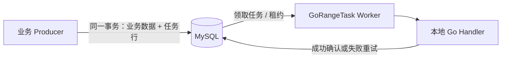

# GoRangeTask

GoRangeTask 是一个可嵌入 Go 服务的 **MySQL 持久化任务队列**，面向由本服务 Worker 执行的后台任务。

> **项目状态：v0.1.0 已发布（早期阶段）。**
>
> **已可用**：任务与配置类型、Handler 注册表与 payload 解码、公开错误、MySQL migration（版本管理 + 脏状态检测）、完整的 MySQL Client（`Enqueue` / `EnqueueTx` / `Get` / `Cancel`，含幂等键），以及 Worker 侧的领取与执行闭环（`Claim` / `Succeed` / `Retry` / `MarkDead`、并发 `Run` 轮询、**租约续期与失租取消**、**过期租约回收**、**失败退避与永久错误分流**、**Handler panic 兜底**、**终态任务清理**、优雅停机、逐任务超时）。单元测试与真库集成测试覆盖上述实现，CI 已接入 MySQL。另有一个**可独立运行的示例服务** `example/basic`（业务行与任务行同事务创建、幂等 Handler、`cmd/demo` 入口），见下文「安装与快速开始」。**结构化日志**（`Config.Logger`）与**指标**（`Config.Metrics` / `ClientConfig.Metrics`）已接上，见下文「可观测性」；官方可选 **GORM adapter** 见下文「在 GORM 事务里入队」。
>
> **性能与恢复已实测（2026-10-18，Ryzen 7 8745H；另有 2026-10-17 的 4 核机基线）**：数字、命令与原始 JSON 见[性能基线（Ryzen 7 8745H）](docs/GoRangeTask-性能基线-Ryzen7-8745H.md)。最要紧的几条——10,000 笔「业务行 + 任务行同一事务」中事务完整率 **100.00%**（回滚零残留、零孤儿任务）；Worker 停止续租后 **2.05–3.68 s** 任务被另一个 Worker 接手（租约 2 s 配置，上界 4.29 s）；陈旧 epoch 的写回被 fencing 拒绝；256 B payload、单机 8 核 16 线程（MySQL 与压测同机）下 W=1/4/16 为 **66–714 task/s**（W=32 到 1000），每任务固定 6 条 SQL、行锁等待接近 0。**这些数字只用来说明量级与瓶颈位置**：同一格两次运行最多差 13.6%（旧 4 核机上是 45%），且语义是"至少一次**尝试**"而非"保证业务处理成功"。
>
> **已知边界**：清理是**物理删除**。任务行被删掉之后它的幂等键就不再占用唯一索引，同一个键可以被重新接受——库保证的是"保留期内不重复入队"，不是"永不重复"。需要更强语义时要在业务侧自行去重。终态清理的保留期默认 7 天（`succeeded` / `canceled`）与 30 天（`dead`）；把 `CleanupInterval` 设成负值会关闭清理器，终态表将随任务吞吐单调增长。
>
> 下文的能力清单与语义说明描述的是**已实现并验收**的行为；未实现或未实测的部分会在原处显式标注。逐项证据见[项目进度跟踪](docs/GoRangeTask-进度跟踪.md)。

## 项目定位

业务服务可以在**自己的数据库事务**中写入业务数据和 GoRangeTask 任务行。事务提交后，GoRangeTask Worker 从 MySQL 领取任务并调用本地注册的 Go Handler。

同一事务插入业务数据和任务行，直接 SQL 就可以实现。GoRangeTask 不会比 MySQL 事务提供更强的原子性保证。它的目标是把任务行写入之后的执行生命周期封装为可复用库：并发领取、租约续期、Worker 故障恢复、失败重试、旧租约写回保护和死信管理。



GoRangeTask 适用于生产者与 Handler 共用数据库、任务由本服务执行且需要可靠恢复的场景。简单任务也可以直接用 SQL 自行实现；使用 GoRangeTask 的理由是复用并验证完整的并发和故障处理机制。

## 执行语义与边界

GoRangeTask 目标是让已提交任务在数据库和 Worker 可用、重试策略允许的情况下至少交给 Handler 尝试执行一次。Handler 可能重复运行，也可能因永久错误或达到最大尝试次数进入死信。

- **不保证 Handler 必定成功。** 长期故障、永久错误或重试次数耗尽时，需要告警或人工处理。
- **不保证 exactly-once（恰好一次）外部副作用。** Handler 应实现幂等；fencing token 保护的是 GoRangeTask 任务状态，不会撤销已经发生的外部操作。
- **恢复只在 Worker 进程内进行。** 租约过期的任务由运行中的 Worker 内置的回收器捡回（`Config.ReapInterval`，负值可关闭该职责），所以"至少有一个 Worker 在运行"是进程崩溃、停机超时之后任务能被重新执行的前提；全部 Worker 下线期间，任务只是停在 `running` 等着，不会自己回到队列。
- **不替代 RabbitMQ。** 需要跨服务/跨语言分发、广播、路由、Broker 缓冲或多个独立订阅者时，继续使用 Outbox + RabbitMQ 等事件架构。GoRangeTask 不充当 Outbox 转发器。
- **不追求默认高于 Broker 的吞吐。** MySQL 查询、锁等待、连接池和轮询成本需要在目标负载下实测。

## 能力清单

以下每一条都已实现（逐项的实现口径与测试证据见[进度跟踪](docs/GoRangeTask-进度跟踪.md)）：

- `EnqueueTx`：在调用方现有数据库事务中写入任务，不接管事务的提交或回滚。
- 立即执行和延迟执行。
- MySQL InnoDB 多 Worker 并发领取，使用短事务和 `FOR UPDATE SKIP LOCKED`。
- 数据库时间基准的租约、续期、过期恢复。
- 递增 `lease_epoch`（fencing token），拒绝旧租约持有者写回任务状态。
- 可配置重试次数、有上限的指数退避 + 抖动、永久失败和死信。
- 可选幂等键、任务状态查询、取消尚未领取的任务。
- 优雅停机、结构化日志、基础指标和终态任务清理。
- 官方可选 GORM adapter（`adapter/gorm`）。
- 可独立运行的示例，演示事务入队、Worker 执行和故障恢复。

性能与恢复已有实测基线（硬件、MySQL 参数、Worker 配置、命令与原始 JSON 齐全）：见[性能基线（Ryzen 7 8745H）](docs/GoRangeTask-性能基线-Ryzen7-8745H.md)，以及[一台 4 核笔记本的旧基线](docs/GoRangeTask-性能基线.md)。**不要把这些数字当成容量承诺**——它们来自与 MySQL 同机的开发机（还有 14–32% 的背景负载，MySQL 跑在 WSL2 虚拟盘上），同一格两次运行最多差 13.6%，换机器后结论会变；文档里也明确标出了"测不出来"与"没测到"的项。

## 技术基线

| 项目 | 选择 |
|---|---|
| 公开项目名 | GoRangeTask |
| 仓库名 | `gorangetask` |
| Go module | `github.com/Tidehyc/gorangetask` |
| Go 版本 | 1.24+ |
| 数据库 | MySQL 8.0+ / InnoDB；MVP 只验证 MySQL |
| SQL 层 | 核心包使用 `database/sql`，不依赖 GORM；GORM adapter 是可选子包 `adapter/gorm`（已实现） |
| 许可证 | MIT |

数据库任务表承担本地任务持久化与 Worker 领取，不经过 RabbitMQ。未来支持其他数据库时，需要单独实现并验证该数据库的 migration、领取 SQL、租约 SQL 和并发语义。

## 本地 MySQL 环境

仓库提供 `scripts/dev-mysql.sh`，用容器化 MySQL 8.0 作为本地开发库：

```bash
./scripts/dev-mysql.sh up      # 启动 MySQL 容器
./scripts/dev-mysql.sh status  # 查看状态
./scripts/dev-mysql.sh shell   # 打开 mysql 客户端
./scripts/dev-mysql.sh down    # 停止容器，保留数据卷
./scripts/dev-mysql.sh reset   # 删除容器和数据卷
```

默认连接信息：`127.0.0.1:3306`，数据库 `gotask`，用户 `root`，密码 `rootpw`，UTC 时区，`READ-COMMITTED` 隔离级别。该环境用于本地开发；不要将示例密码用于共享或生产环境。

## 安装

```bash
go get github.com/Tidehyc/gorangetask
```

核心包（根包与 `store/mysql`）只用标准库的 `database/sql`，唯一的直接依赖是 MySQL 驱动（由使用方自己引入并注册）。最低 Go 1.24。

仓库里还有一个**可选**子包 `adapter/gorm`，它依赖 `gorm.io/gorm`。核心包不 import 它，因此不使用 GORM 的项目不会把它编译进产物；但 `go.mod` 里会列出这个依赖——Go 的模块图是全仓库共享的。这与"核心不依赖 GORM"并不矛盾：那条说的是 **import** 层面的隔离。

接入的步骤顺序不能换：

1. **迁移任务表**：`mysqlmigrations.Migrate(ctx, db)` 建出 `gotask_tasks` 并管理版本；
2. **建业务表**：业务表属于使用方，库对它一无所知；
3. **构造 store**：`mysqlstore.New(db, clientCfg)`——它**只读表、不建表**，所以必须排在两步建表之后。

```go
ctx := context.Background()

db, err := sql.Open("mysql", dsn) // dsn 必须带库名；库不替调用方创建数据库
// ... ping、错误处理 ...

if err := mysqlmigrations.Migrate(ctx, db); err != nil {
	return err
}
client, err := mysqlstore.New(db, gorangetask.ClientConfig{})
// ... 错误处理 ...
```

## 快速开始：业务数据与任务同事务

这是整个库存在的理由。业务行与任务行写在**同一个 `*sql.Tx`** 上——`EnqueueTx` 不开、不提交、不回滚这个事务，它只是借用你的连接插入一行：

```go
tx, err := db.BeginTx(ctx, nil)
if err != nil {
	return err
}
defer func() { _ = tx.Rollback() }() // 提交成功后返回 sql.ErrTxDone，可忽略

res, err := tx.ExecContext(ctx,
	"INSERT INTO orders (customer, amount_cents) VALUES (?, ?)", customer, amountCents)
if err != nil {
	return err
}
orderID, err := res.LastInsertId()
if err != nil {
	return err
}

payload, err := json.Marshal(map[string]int64{"order_id": orderID})
if err != nil {
	return err
}

// 同一个 tx：提交则订单与任务一起可见，回滚则两者都不存在。
taskID, err := client.EnqueueTx(ctx, tx, gorangetask.Task{
	Queue:   "orders",
	Type:    "order.export",
	Payload: payload,
})
if err != nil {
	return err // 注意：此时 tx 还没提交，taskID 不具备"任务已存在"的含义
}

if err := tx.Commit(); err != nil {
	return err
}
```

Worker 侧注册 Handler 并运行。**Handler 必须幂等**——库的语义是「至少一次」，进程崩溃、租约过期、停机超时都会让同一条任务被重新领取：

```go
registry := gorangetask.NewRegistry()
if err := registry.Register("order.export", func(ctx context.Context, raw json.RawMessage) error {
	var p struct {
		OrderID int64 `json:"order_id"`
	}
	if err := json.Unmarshal(raw, &p); err != nil {
		// payload 是入队时写死的，重试不会让它变得可解析 ⇒ 带永久标记，直接进死信，
		// 而不是白试到次数耗尽。
		return gorangetask.Permanent(fmt.Errorf("decode payload %s: %w", raw, err))
	}

	// 幂等的来源：条件更新。第一次影响 1 行，第二次影响 0 行——0 行不是错误。
	res, err := db.ExecContext(ctx, `UPDATE orders SET status = 'exported'
        WHERE id = ? AND status = 'pending'`, p.OrderID)
	if err != nil {
		return err
	}
	affected, err := res.RowsAffected()
	if err != nil {
		return err
	}
	if affected == 0 {
		// 简化版：把 0 行当幂等命中。完整写法还要回读业务状态，把「已经导出过」
		// （不是错误）与「订单根本不存在」（应当返回 gorangetask.Permanent）
		// 分开——见 example/basic/handler.go。
		return nil
	}
	return nil
}); err != nil {
	return err
}

worker, err := gorangetask.NewWorker(client, registry, gorangetask.Config{Queues: []string{"orders"}})
if err != nil {
	return err
}

// 阻塞运行直到 ctx 被取消；取消触发优雅停机（Handler 在 ShutdownTimeout 内没退出
// 会返回 ErrShutdownTimeout，被放弃的任务保持 running，交给回收器）。
if err := worker.Run(ctx); err != nil {
	return err
}
```

一份完整、可直接运行的版本在 [`example/basic`](example/basic)（表结构、幂等 Handler 的完整写法、可运行入口都在里面）：

```bash
./scripts/dev-mysql.sh up
go run ./example/basic/cmd/demo              # 造 5 笔订单，起一个 Worker，打印进度
go run ./example/basic/cmd/demo -orders 0    # 不建订单，只起 Worker 观察业务表，按 Ctrl-C 结束
go run ./example/basic/cmd/demo -h           # 连接串、订单数、Handler 延迟、打印间隔
```

## 故障演示：停机打断 → 租约过期 → 换人接手

「至少一次」不是口号。进程在 Handler 跑到一半时消失，那条任务会**原样留在 `running`**，
直到租约过期、并且**有一个活着的 Worker 在跑回收器**把它捡回来。

`example/basic` 的入口带了 `-lease` / `-reap` 两个开关，专门把这条路径压进几秒。下面每一步都是实测输出：进程输出照抄，查库结果都附了对应的 SQL。

**第一幕：起一个 Worker，让 Handler 慢一点，然后在它跑完之前按 Ctrl-C。**

```bash
go run ./example/basic/cmd/demo -orders 2 -handler-delay 30s -lease 5s -reap 2s
```

```text
created order 1 (task 1) in one transaction
created order 2 (task 2) in one transaction
worker started; press Ctrl-C to stop (watching every 1s)

order  status   task  status   attempt  error
1      pending  1     running  1
2      pending  2     running  1
...
```

按 Ctrl-C，收尾是这样的：

```text
shutting down: interrupted
task 1 (order 1) is still running
task 2 (order 2) is still running

2 task(s) left unfinished. They stay as-is until the lease expires,
then the reaper hands them back to the queue. Restart with `-orders 0` to
watch a fresh worker pick them up (see README.md).
```

业务行还是 `pending`、任务行是 `running`、`attempt` 停在 `1`：Handler 一收到取消就收手，没有写回任何业务结果。查库能看到租约还剩多久：

```sql
-- 下面三段查库结果都出自这条查询（表名固定为 gotask_tasks，库不自带管理界面）
SELECT id, status, attempt, lease_until, UTC_TIMESTAMP(6) AS now_utc
FROM gotask_tasks ORDER BY id;
```

```text
id  status   attempt  lease_until                 now_utc
1   running  1        2026-10-16 08:15:49.200823  2026-10-16 08:15:44.394506
2   running  1        2026-10-16 08:15:49.202704  2026-10-16 08:15:44.394506
```

**等几秒让租约到期**——`-lease 5s` 且心跳是租约的 1/3，所以租约最晚在停机后 5 秒内到期——再查一次：

```text
id  status   attempt  lease_until                 now_utc
1   running  1        2026-10-16 08:15:49.200823  2026-10-16 08:15:50.551951
2   running  1        2026-10-16 08:15:49.202704  2026-10-16 08:15:50.551951
```

`lease_until` 已经落在 `now_utc` 后面了，但状态**还是 `running`——租约到期本身什么都不改变**。
此刻集群里没有任何 Worker，也就没有人在回收。这正是回收器存在的理由，也是"光有租约不够"的地方。

**第二幕：换一个 Worker 起来，这次不建订单，只观察业务表。**

```bash
go run ./example/basic/cmd/demo -orders 0 -lease 5s -reap 2s
```

```text
order  customer     amount_cents  status   exported_at
1      customer-01  1999          pending  -
2      customer-02  3998          pending  -
...

order  customer     amount_cents  status    exported_at
1      customer-01  1999          exported  2026-10-16T08:15:52.928231Z
2      customer-02  3998          exported  2026-10-16T08:15:52.967856Z
```

起来约 2 秒（一个 `-reap 2s` 周期）后，回收器把两笔过期租约放回 `pending`，同一个 Worker 随即领取、
跑完 Handler，业务行翻成 `exported`。收尾查库：

```text
id  status     attempt  lease_until  now_utc
1   succeeded  2        NULL         2026-10-16 08:16:00.733618
2   succeeded  2        NULL         2026-10-16 08:16:00.733618
```

`attempt` 从 1 变成 2，就是"同一条任务被领过两次"的直接证据——所以 Handler 必须幂等。

> 两个开关只服务于演示。默认是 `LeaseDuration 30s` / `ReapInterval 30s`，照默认跑这条路径要等几十秒；
> 生产里这个量级才合理——租约太短，一次 GC 停顿或网络抖动就会被误判成"进程崩了"。

## 可观测性：结构化日志与指标

两者都是**可选**的：不配就是静默，库不替你决定往哪写。日志在 `Config.Logger`，
Worker 指标在 `Config.Metrics`，入队与取消的计数在 `ClientConfig.Metrics`。

### 日志：`Config.Logger`

```go
type Logger interface {
	Log(ctx context.Context, level gorangetask.Level, msg string, kv ...any)
}
```

它只有一个方法，接任何日志库都是十几行。接 `log/slog`：

```go
type slogAdapter struct{ l *slog.Logger }

func (a slogAdapter) Log(ctx context.Context, level gorangetask.Level, msg string, kv ...any) {
	var lvl slog.Level
	switch level {
	case gorangetask.LevelDebug:
		lvl = slog.LevelDebug
	case gorangetask.LevelInfo:
		lvl = slog.LevelInfo
	case gorangetask.LevelWarn:
		lvl = slog.LevelWarn
	default:
		lvl = slog.LevelError
	}
	a.l.Log(ctx, lvl, msg, kv...)
}

cfg.Logger = slogAdapter{l: slog.Default()}
```

字段名是稳定的 snake_case：`task_id` / `task_type` / `queue` / `attempt` / `max_attempts` /
`lease_epoch` / `worker_id` / `duration` / `delay` / `error`。**payload 永远不进日志**
（有一条用哨兵值守着这件事的用例）。

级别分配：`info` 启动、停机、任务成功；`warn` 失败待重试、进入死信；`error` 基础设施错误、
停机超时；`debug` 每轮领取与清理。回收器**只在真的捡回任务时**记一条——它每轮都在跑，
每轮都记会把"确实有进程崩过"那一次埋在噪音里。

### 指标：`Config.Metrics` / `ClientConfig.Metrics`

```go
type Metrics interface {
	TaskEnqueued(queue string)
	TaskCanceled()
	TaskClaimed(queue, taskType string)
	TaskFinished(queue, taskType string, outcome gorangetask.Outcome, d time.Duration)
	TaskWaited(queue, taskType string, d time.Duration)
	LeaseLost(queue, taskType string)
	HandlerPanicked(queue, taskType string)
	HandlerTimedOut(queue, taskType string)
	TasksReaped(toPending, toDead int)
	TasksCleaned(status gorangetask.Status, deleted int64)
	ClaimLatency(d time.Duration)
	ConcurrencyInUse(n int)
}
```

它刻意是**具名事件**，而不是通用的 `Counter(name, labels)` 原语：指标名与标签集合由库固定，
你无法（也无法不小心）把 task ID 塞进标签。接 Prometheus 时嵌入 `NopMetrics`、只覆盖关心的
几个即可：

```go
type promMetrics struct {
	gorangetask.NopMetrics // 其余方法自动成为空实现
	tasks    *prometheus.CounterVec
	duration *prometheus.HistogramVec
}

func (m *promMetrics) TaskFinished(queue, taskType string, outcome gorangetask.Outcome, d time.Duration) {
	m.tasks.WithLabelValues(queue, taskType, string(outcome)).Inc()
	m.duration.WithLabelValues(queue, taskType).Observe(d.Seconds())
}
```

两条需求条目刻意**不在库里**：按队列与状态的积压量（要库主动轮询，改由宿主自己查
`SELECT queue_name, status, COUNT(*) FROM gotask_tasks GROUP BY 1, 2`），以及数据库连接池占用
（属于宿主，用 `db.Stats()`）。

`TaskWaited` 的数值由**数据库时钟**算出（从任务"最早可被领取"到实际被领取），因此不受各机器
钟差影响。`TaskEnqueued` 有一条已知局限：`EnqueueTx` 也会计数，**包括事务最终回滚的那一次**
——库无从知道调用方的事务是否提交。

### 两者别混用

日志面向**人**：带 task ID 与错误原文，用来追溯"这一条任务发生了什么"。指标面向**聚合**：
不带任何高基数维度。把 task ID 加进指标标签会让监控系统的基数爆掉。

## 在 GORM 事务里入队

`adapter/gorm` 是官方可选包，把 `*gorm.DB` 事务接到同一个 `EnqueueTx` 上：

```go
import (
	"gorm.io/gorm"

	gormadapter "github.com/Tidehyc/gorangetask/adapter/gorm"
)

adapter, err := gormadapter.New(client) // client 就是上文那个 *mysqlstore.Client
if err != nil {
	return err
}

err = db.WithContext(ctx).Transaction(func(tx *gorm.DB) error {
	if err := tx.Create(&order).Error; err != nil {
		return err
	}
	_, err := adapter.EnqueueTx(ctx, tx, gorangetask.Task{
		Queue: "orders", Type: "order.export", Payload: payload,
	})
	return err
})
```

**必须传事务句柄**：`db.Transaction` 的回调参数，或 `db.Begin()` 的返回值。传一个非事务的
`*gorm.DB` 会让任务行走自己的连接（autocommit），与业务写入不在同一个事务里——那种写法
编译通过、运行也不报错，只在回滚时才暴露（业务行没了、任务行还在），所以 adapter 会直接
拒绝它。

为什么不能直接把 `*gorm.DB` 当作 `gorangetask.Tx`：它没有 `ExecContext` 方法，而且它的 `Exec`
会丢掉 `sql.Result`——GORM 只在内部的 `Create` 流程里读 `LastInsertId`，裸 SQL 拿不到新插入
行的 ID，而 `EnqueueTx` 必须返回任务 ID。adapter 因此从 `*gorm.DB` 上取出**它正在使用的连接**
（`Statement.ConnPool`），交给 `store/mysql` 执行与普通入队完全相同的那条 INSERT：校验、
幂等键冲突识别、时间口径全部复用，没有第二份实现。

## 文档

- [需求文档](docs/GoRangeTask-需求文档.md)：项目目标、MVP 范围、状态机、API 草案、可观测性和验收标准。
- [技术设计](docs/GoRangeTask-技术设计.md)：任务表 DDL、领取/续租/确认/回收 SQL、API 与验证计划；**附录 A** 是一次实测事故的完整留档——`SELECT ... FOR UPDATE LIMIT n` 的加锁范围由执行计划决定，计划一离开预期索引就会锁住整个积压、`SKIP LOCKED` 失效，附 `EXPLAIN`/`data_locks` 对照与固定手段。
- [迁移机制](docs/GoRangeTask-迁移机制.md)：MySQL DDL、dirty 状态、advisory lock、多语句处理及实测验证。
- [进度跟踪](docs/GoRangeTask-进度跟踪.md)：阶段状态、完成标准和可核验的实现证据。
- [性能基线（Ryzen 7 8745H）](docs/GoRangeTask-性能基线-Ryzen7-8745H.md)：当前开发机上的硬件/MySQL/Worker 配置、入队延迟、吞吐与伸缩、排队延迟、事务完整率、崩溃恢复耗时，以及**这些数字不能用来声称什么**。
- [性能基线（i5-8200Y，历史）](docs/GoRangeTask-性能基线.md)：同一套测法在一台 4 逻辑核笔记本上的结果，用于对照"哪些结论随机器变、哪些不变"。
- [STAR 说明](docs/GoRangeTask-STAR.md)：项目定位、与手写 SQL 及 Outbox/RabbitMQ 的区别、简历证据框架（R 段为实测值）。
- [下一步计划](docs/GoRangeTask-下一步计划.md)：还没做的事按"证据缺口 / 能力缺口 / 工程化"分优先级，每项都写清验收判据；同时列出**明确不做**的边界。
- [面试复习指南](docs/GoRangeTask-面试复习指南.md)：按 19 个 Feat 拆解源码与设计取舍，用于面试前复盘。

## 许可

本项目使用 [MIT License](LICENSE)。
