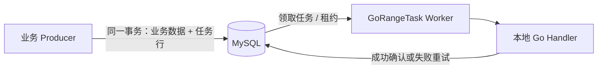

# GoRangeTask

GoRangeTask 是一个可嵌入 Go 服务的 **MySQL 持久化任务队列**，面向由本服务 Worker 执行的后台任务。

> **项目状态：早期开发中。**
>
> **已可用**：任务与配置类型、Handler 注册表与 payload 解码、公开错误、MySQL migration（版本管理 + 脏状态检测）、完整的 MySQL Client（`Enqueue` / `EnqueueTx` / `Get` / `Cancel`，含幂等键），以及 Worker 侧的领取与执行闭环（`Claim` / `Succeed` / `Retry` / `MarkDead`、并发 `Run` 轮询、**租约续期与失租取消**、**过期租约回收**、优雅停机、逐任务超时）。单元测试与真库集成测试覆盖上述实现，CI 已接入 MySQL。
>
> **尚未实现**：失败退避与永久错误分类、panic 隔离、终态任务清理、结构化日志与指标、GORM adapter、可独立运行的示例服务。
>
> 当前文档描述的是目标设计与验收计划，不代表所有功能已经可用。进度见[项目进度跟踪](docs/GoRangeTask-进度跟踪.md)。

## 项目定位

业务服务可以在**自己的数据库事务**中写入业务数据和 GoRangeTask 任务行。事务提交后，GoRangeTask Worker 从 MySQL 领取任务并调用本地注册的 Go Handler。

同一事务插入业务数据和任务行，直接 SQL 就可以实现。GoRangeTask 不会比 MySQL 事务提供更强的原子性保证。它的目标是把任务行写入之后的执行生命周期封装为可复用库：并发领取、租约续期、Worker 故障恢复、失败重试、旧租约写回保护和死信管理。



GoRangeTask 适用于生产者与 Handler 共用数据库、任务由本服务执行且需要可靠恢复的场景。简单任务也可以直接用 SQL 自行实现；使用 GoRangeTask 的理由是复用并验证完整的并发和故障处理机制。

## 执行语义与边界

GoRangeTask 目标是让已提交任务在数据库和 Worker 可用、重试策略允许的情况下至少交给 Handler 尝试执行一次。Handler 可能重复运行，也可能因永久错误或达到最大尝试次数进入死信。

- **不保证 Handler 必定成功。** 长期故障、永久错误或重试次数耗尽时，需要告警或人工处理。
- **不保证 exactly-once（恰好一次）外部副作用。** Handler 应实现幂等；fencing token 保护的是 GoRangeTask 任务状态，不会撤销已经发生的外部操作。
- **恢复只在 Worker 进程内进行。** 租约过期的任务由运行中的 Worker 内置的回收器捡回（`Config.ReapInterval`，负值可关闭该职责），所以"至少有一个 Worker 在运行"是进程崩溃、停机超时之后任务能被重新执行的前提；全部 Worker 下线期间，任务只是停在 `running` 等着，不会自己回到队列。
- **不替代 RabbitMQ。** 需要跨服务/跨语言分发、广播、路由、Broker 缓冲或多个独立订阅者时，继续使用 Outbox + RabbitMQ 等事件架构。GoRangeTask 不充当 Outbox 转发器。
- **不追求默认高于 Broker 的吞吐。** MySQL 查询、锁等待、连接池和轮询成本需要在目标负载下实测。

## MVP 目标能力

以下是目标功能，尚未全部实现：

- `EnqueueTx`：在调用方现有数据库事务中写入任务，不接管事务的提交或回滚。
- 立即执行和延迟执行。
- MySQL InnoDB 多 Worker 并发领取，使用短事务和 `FOR UPDATE SKIP LOCKED`。
- 数据库时间基准的租约、续期、过期恢复。
- 递增 `lease_epoch`（fencing token），拒绝旧租约持有者写回任务状态。
- 可配置重试次数、有上限的指数退避 + 抖动、永久失败和死信。
- 可选幂等键、任务状态查询、取消尚未领取的任务。
- 优雅停机、结构化日志、基础指标和终态任务清理。
- 可独立运行的示例，演示事务入队、Worker 执行和故障恢复。

## 技术基线

| 项目 | 选择 |
|---|---|
| 公开项目名 | GoRangeTask |
| 仓库名 | `gorangetask` |
| Go module | `github.com/Tidehyc/gorangetask` |
| Go 版本 | 1.24+ |
| 数据库 | MySQL 8.0+ / InnoDB；MVP 只验证 MySQL |
| SQL 层 | 核心包使用 `database/sql`，不依赖 GORM；GORM adapter 为可选组件 |
| 许可证 | MIT |

数据库任务表承担本地任务持久化与 Worker 领取，不经过 RabbitMQ。未来支持其他数据库时，需要单独实现并验证该数据库的 migration、领取 SQL、租约 SQL 和并发语义。

## 本地 MySQL 环境

仓库提供 `scripts/dev-mysql.sh`，用容器化 MySQL 8.0 作为本地开发库：

```bash
./scripts/dev-mysql.sh up      # 启动 MySQL 容器
./scripts/dev-mysql.sh status  # 查看状态
./scripts/dev-mysql.sh shell   # 打开 mysql 客户端
./scripts/dev-mysql.sh down    # 停止容器，保留数据卷
./scripts/dev-mysql.sh reset   # 删除容器和数据卷
```

默认连接信息：`127.0.0.1:3306`，数据库 `gotask`，用户 `root`，密码 `rootpw`，UTC 时区，`READ-COMMITTED` 隔离级别。该环境用于本地开发；不要将示例密码用于共享或生产环境。

## 文档

- [需求文档](docs/GoRangeTask-需求文档.md)：项目目标、MVP 范围、状态机、API 草案、可观测性和验收标准。
- [技术设计](docs/GoRangeTask-技术设计.md)：任务表 DDL、领取/续租/确认/回收 SQL、API 与验证计划；**附录 A** 是一次实测事故的完整留档——`SELECT ... FOR UPDATE LIMIT n` 的加锁范围由执行计划决定，计划一离开预期索引就会锁住整个积压、`SKIP LOCKED` 失效，附 `EXPLAIN`/`data_locks` 对照与固定手段。
- [迁移机制](docs/GoRangeTask-迁移机制.md)：MySQL DDL、dirty 状态、advisory lock、多语句处理及实测验证。
- [进度跟踪](docs/GoRangeTask-进度跟踪.md)：阶段状态、完成标准和可核验的实现证据。
- [STAR 说明](docs/GoRangeTask-STAR.md)：项目定位、与手写 SQL 及 Outbox/RabbitMQ 的区别、简历证据框架。

## 许可

本项目使用 [MIT License](LICENSE)。
