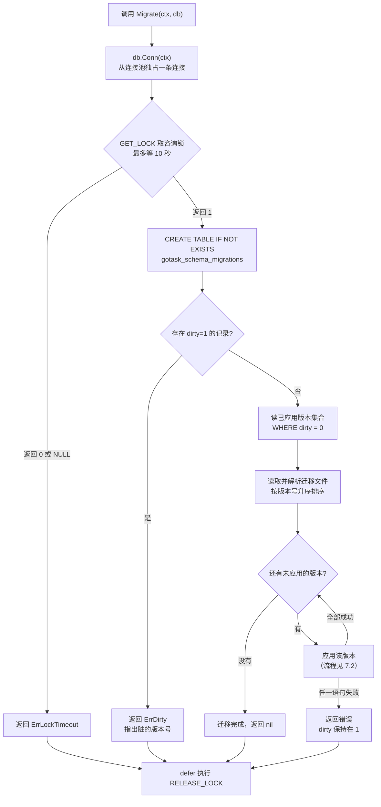
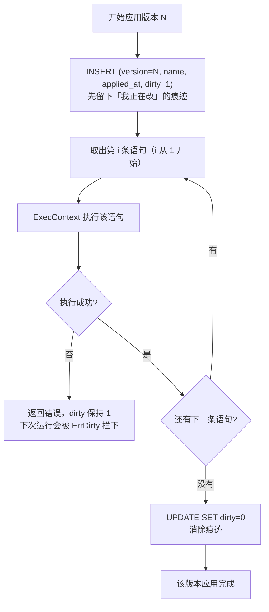
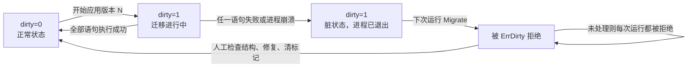

# GoRangeTask 数据库迁移机制

> 用途：解释 GoRangeTask 的数据库迁移（migration）为什么需要、怎么工作、MySQL 上有哪些坑，以及我们的实现决策。
> 定位：机制说明与学习材料。它与[需求文档](./GoRangeTask-需求文档.md) §6.2、[技术设计](./GoRangeTask-技术设计.md) §3.1 配套。

## 1. 为什么需要迁移

数据库表结构不是一次定死的。项目上线后，加字段、加索引、改类型、拆表都会发生。

手工做法是：登录数据库，手工敲 `ALTER TABLE`。这在只有你一个人的开发机上没问题，但一旦有多套环境（本地、测试、生产）、多个实例、多个协作者，就会出事：

- **不知道当前是哪个版本**：生产库到底加没加那个字段？没人记得。
- **重复执行会失败或造成偏差**：`ALTER TABLE ... ADD COLUMN x` 跑两次，第二次报错。
- **上线顺序不可控**：应用发了新版本，但数据库还没加字段，代码直接崩。

**迁移（migration）就是把"数据库结构变更"当作代码来管理**：变更写成带序号的 SQL 文件、进版本控制、由一个程序按顺序、可重复地应用，并记录"应用到了哪一版"。

## 2. 核心机制

任何迁移系统（无论自研还是第三方库）都由三样东西组成：

| 组成 | 说明 | 在 GoRangeTask 中 |
|---|---|---|
| **版本记录表** | 数据库里的一张表，记录每个已应用的版本 | `gotask_schema_migrations` |
| **有序的迁移文件** | 每个变更一个文件，文件名带序号 | `migrations/mysql/0001_*.sql` |
| **执行器（runner）** | 读记录表、比对文件、应用缺失的、写回记录 | `migrations/mysql` 包 |

执行流程只有四步：

```
① 读版本记录表          → 得到"已应用"的版本集合
② 扫描迁移文件目录      → 得到"全部"的版本集合
③ 差集 = 待应用          → 按序号从小到大依次执行
④ 每个执行成功后写记录   → 中途失败则立即报错停止
```

正因为"只应用差集"，**迁移天然可重复运行**：跑第二遍时没有差集，什么都不做，安全返回。

### 版本号怎么定

用递增整数，文件名前缀零填充：

```
0001_create_tasks_table.sql
0002_add_priority_column.sql
0010_...
```

零填充是为了文件名排序和数字排序一致。文件名去掉前缀后作为版本号（`1`、`2`、`10`），**执行顺序以解析出的数字为准**，不以文件名字典序为准。

### 版本记录表长什么样

```sql
CREATE TABLE gotask_schema_migrations (
    version    BIGINT       NOT NULL,
    name       VARCHAR(255) NOT NULL,
    applied_at DATETIME(6)  NOT NULL,
    dirty      TINYINT(1)   NOT NULL DEFAULT 0,
    PRIMARY KEY (version)
) ENGINE=InnoDB DEFAULT CHARSET=utf8mb4 COLLATE=utf8mb4_0900_ai_ci;
```

`version` 作主键，天然防止同一个版本被记录两次。`dirty` 字段见第 4 节。

## 3. MySQL 的关键特性：DDL 隐式提交，且无法回滚

这是整个迁移机制里**最容易踩、后果最严重**的一点，必须单独讲。

你在业务代码里习惯了"事务提交/回滚"，那是 **DML**（`INSERT`/`UPDATE`/`DELETE`）的能力。**DDL 是另一套规则**：

- MySQL 在执行 DDL 前后会**隐式提交**当前事务。也就是说，你没法把 `CREATE TABLE` / `ALTER TABLE` 包在一个可回滚的事务里。
- MySQL 的 DDL **不支持回滚**。语句执行成功就是永久生效。

会触发隐式提交的常见语句：

```
CREATE / ALTER / DROP DATABASE, TABLE, INDEX, VIEW, TRIGGER
TRUNCATE TABLE
RENAME TABLE
LOCK TABLES / UNLOCK TABLES
```

> 对比：**PostgreSQL 支持事务型 DDL**，可以把结构变更和回滚放在一个事务里。MySQL 不行。所以同一套迁移逻辑，在 MySQL 上风险更高 —— 这是选 MySQL 时必须自己承担的。

### 这会导致什么

假设某次迁移文件里有三条语句：

```sql
ALTER TABLE gotask_tasks ADD COLUMN foo INT;      -- ① 执行成功
ALTER TABLE gotask_tasks ADD COLUMN bar INT;      -- ② 报错（例如列名冲突）
CREATE INDEX ix_foo ON gotask_tasks (foo);        -- ③ 根本不会执行
```

结果：

- **①已经永久生效**，无法撤销。
- 数据库现在处在"改了一半"的状态 —— 行业里叫 **dirty（脏）状态**。
- 如果执行器此时把版本号记成"已应用"，下次运行就会**跳过** ② ③，你以为迁移完成了，实际上没有。**这是最危险的**：错误被静默掩盖。

所以迁移执行器必须回答一个问题：**中途失败时，怎么让人知道、并且不再往下走？**

## 4. 脏（dirty）状态的检测与处理

golang-migrate 的做法值得借鉴，我们的实现采用同样的思路：

**执行前先标记，执行成功再消除标记。**

```
1. 开始执行版本 N  →  INSERT (version=N, dirty=1)     ← 先留下"我正在改"的痕迹
2. 逐条执行 SQL
3. 全部成功        →  UPDATE ... SET dirty=0          ← 消除痕迹
   中途失败        →  保持 dirty=1，返回错误
```

这样无论进程在第 2 步的哪个位置崩溃或报错，记录表里都会留下 `dirty=1`。

**每次启动迁移前，先检查有没有 `dirty=1` 的记录：**

- 有 → **拒绝执行任何迁移**，直接报错，指出是哪个版本脏了。
- 没有 → 正常走第 2 节的四步。

为什么"拒绝"而不是"重试"？因为**数据库结构已经处于未知的中间状态**，程序没有能力判断该回滚还是该继续 —— 只有人知道。所以正确做法是停下来，让人手工检查数据库、修复结构、清掉 dirty 标志，然后重新运行。

这条原则和需求文档 §6.2 的要求是一致的：*"升级失败需返回清晰错误，不静默继续启动 Worker"*。

### 一个具体例子

下面是实现后的真实输出（场景：库里已存在同名表，导致 0001 的 `CREATE TABLE` 失败）。

第一次运行 —— 直接报出失败位置，并说明 DDL 无法回滚：

```text
gorangetask/migrate: version 1 (create_tasks_table) statement 1/1 failed:
  Error 1050 (42S01): Table 'gotask_tasks' already exists;
  MySQL DDL cannot be rolled back, the schema may be partially changed — manual intervention required
```

此时元数据表里留下了 `version=1, dirty=1`。第二次运行 —— 被拒绝：

```text
gorangetask/migrate: database is in a dirty state:
  affected version(s): 1 (create_tasks_table);
  inspect the actual schema, align it with expectations, then clear the dirty flag
```

人工恢复：

```sql
SHOW CREATE TABLE gotask_tasks;                       -- 看实际结构
-- 把结构对齐到预期状态后，清除失败记录：
DELETE FROM gotask_schema_migrations WHERE version = 1;   -- 该版本将整条重跑
-- 或者保留记录、只清标记（结构与预期一致时）：
UPDATE gotask_schema_migrations SET dirty = 0 WHERE version = 1;
```

再次运行 `Migrate` —— 恢复正常：

```text
Migrate 成功
```

这段输出是 2026-10-12 在 MySQL 8.0.46 上实测所得，并有对应的自动化测试覆盖（`TestMigrateIntegrationMarksDirtyOnFailure`）。

## 5. 并发安全：为什么需要 advisory lock

场景：你有多个 API 实例，启动时都调用了 `Migrate`。两个实例同时读到"待应用 = [1]"，于是**都去执行 0001**。第二个会失败（表已存在），或者更糟 —— 在复杂的 `ALTER` 上产生互相干扰。

MySQL 提供了 **advisory lock（咨询锁）**，用来让相关方自行协调：

```sql
SELECT GET_LOCK('gorangetask_migrate', 10);   -- 尝试获取，最多等 10 秒
-- 返回 1 = 拿到；0 = 超时没拿到；NULL = 出错
...
SELECT RELEASE_LOCK('gorangetask_migrate');   -- 释放
```

拿到锁的实例执行迁移，没拿到的等一会儿、再读一次状态（此时迁移已完成，无差集，直接返回）。

### 一个必须注意的陷阱

**`GET_LOCK` 是会话级的**：锁属于"连接"，不属于"程序"。而 Go 的 `database/sql` 有连接池，`db.Exec` 每次可能拿到**不同的连接** —— 那么你在连接 A 上拿了锁，却在连接 B 上执行 DDL、在连接 C 上释放锁，锁就形同虚设。

正确做法是用 `db.Conn(ctx)` **把一条连接固定下来**，整个迁移过程都在这条连接上：

```go
conn, err := db.Conn(ctx)      // 从池里取出并独占一条连接
defer conn.Close()
// GET_LOCK / 迁移 SQL / RELEASE_LOCK 全部用 conn，而不是 db
```

连接关闭时，MySQL 会自动释放该会话持有的锁，所以即使程序崩溃也不会留下死锁。

## 6. 多语句迁移的坑

一个迁移文件里可能想写多条语句。但 MySQL 驱动（`go-sql-driver/mysql`）**默认不允许一次 `Exec` 里带多条语句**，会报语法错误。三种处理方式：

| 方式 | 做法 | 取舍 |
|---|---|---|
| 一条语句一个文件 | `0001_create_table.sql`、`0002_add_index.sql` | 最安全，但文件变多 |
| 要求 DSN 加 `multiStatements=true` | 依赖调用方配置连接串 | 把正确性绑在配置上，容易忘 |
| 执行器自己切分语句 | 按 `;` 拆分后逐条执行 | 灵活，但要自己处理注释和字符串里的分号 |

**GoRangeTask 的选择**：执行器自行切分（按行尾分号），因为这样不要求调用方改 DSN，行为可预测。代价是切分逻辑简单化处理 —— 我们的迁移 SQL 都是手写的 DDL，不包含字符串字面量里的分号，够用。

> 注意：**多语句迁移天然不是原子的**（见第 3 节）。所以哪怕执行器能切分，也应尽量让一个迁移文件只做一件事 —— 越少的语句，脏状态越简单。

## 7. 完整执行流程（详细流程图）

前面 §2–§6 把各个机制拆开讲了。这一节把它们串成一条完整链路，作为阅读代码时的对照。

### 7.1 Migrate 总流程



逐步说明：

| 步骤 | 动作 | 为什么要这样 |
|---|---|---|
| ① | `db.Conn(ctx)` 独占一条连接 | `GET_LOCK` 是**会话级**的，必须全程同一条连接（§5） |
| ② | `GET_LOCK` 取咨询锁 | 多实例同时启动时只让一个真正执行迁移 |
| ③ | `CREATE TABLE IF NOT EXISTS` 元数据表 | 后面两步都要读它；幂等，可安全重复执行 |
| ④ | 检查是否存在 `dirty=1` | 上次若中途失败，结构状态未知，必须停下（§4） |
| ⑤ | 读已应用版本集合 | 充当"差集"的减数 |
| ⑥ | 解析迁移文件并按数字升序 | 顺序以**解析出的数字**为准，不是文件名字典序（§2） |
| ⑦ | 逐个应用差集中的版本 | 顺序执行、失败即停、不跳过 |
| ⑧ | `defer` 释放锁 | 成功、报错、ctx 取消三种情况都要释放（§5） |

三个失败出口（`ErrLockTimeout` / `ErrDirty` / 语句执行失败）都**不继续**，且都会经过第 ⑧ 步释放锁。

### 7.2 单个版本的应用流程



**这个顺序是脏状态机制能成立的关键**：先写 `dirty=1`、再执行语句、最后才清标记。

如果反过来 —— 先执行语句、成功后再写记录 —— 进程一旦在"语句已执行、记录还没写"之间崩溃，就会留下**结构已经改了、但数据库里没有任何痕迹**的状态。下次运行既不会报错也不会跳过，会直接重复执行，问题被彻底静默掩盖。

### 7.3 脏状态的生命周期



正常路径是 `dirty=0 → 1 → 0`，一次往返。异常路径停在 `dirty=1`，**没有任何自动恢复** —— 必须人工介入。

这是刻意的设计，不是偷懒：程序无法判断数据库结构该往哪个方向修，只有人能判断。所以正确做法是停下来、报清楚、等人处理（§4）。

## 8. GoRangeTask 的实现决策

| 决策点 | 选择 | 理由 |
|---|---|---|
| 自研还是用库 | **自研** | 需求只需"按序应用 + 记录版本 + 报错停止"；不加依赖；机制可见，符合项目"小而清晰"的定位 |
| 脏状态检测 | **做** | 与需求 §6.2"失败需清晰错误、不静默继续"一致；这是 MySQL DDL 不可回滚的直接后果 |
| 并发保护 | **`GET_LOCK` + 单连接** | 多实例启动时避免并发迁移 |
| 语句切分 | **执行器按行尾分号切分** | 不要求调用方改 DSN |
| 回滚（down 迁移） | **MVP 不做** | 需求未要求；MySQL DDL 无法回滚，"回滚"实际要靠新写一个反向迁移，留待 P1 |
| 自动执行 | **否，必须显式调用** | 需求 §6.2：不在每次应用启动时自动修改生产 schema |
| 支持数据库 | **仅 MySQL** | 与 MVP 范围一致 |

## 9. 使用方式

迁移是**独立的一步**，在启动 Worker 之前显式调用：

```go
import (
    "database/sql"
    _ "github.com/go-sql-driver/mysql"
    "github.com/Tidehyc/gorangetask/migrations/mysql"
)

db, err := sql.Open("mysql", dsn)
if err != nil { log.Fatal(err) }

// 显式执行迁移；失败则不要启动 Worker
if err := mysqlmigrations.Migrate(ctx, db); err != nil {
    log.Fatalf("migrate: %v", err)
}

// 迁移成功后再创建 client / worker
```

建议把迁移做成部署流程里的**独立步骤**（例如一个单独的 `migrate` 子命令），而不是每次启动都跑 —— 这样结构变更的时机是可控、可审计的。

## 10. 常见错误与排查

| 报错 | 含义 | 处理 |
|---|---|---|
| `database is in a dirty state` | 上次迁移中途失败 | 检查真实表结构 → 人工对齐 → 清 `dirty` |
| `version N (...) statement i/j failed: Error 1050 ...` | 该版本的 SQL 报错 | 按错误信息修 SQL 或修库 |
| `Duplicate column name` / `Table already exists` | 结构已被手工改过，与迁移文件不一致 | 对齐两者；必要时清掉该版本的记录重跑 |
| `could not acquire migration lock` | 另一个实例正在迁移 | 等它结束；若长期拿不到，检查是否有残留连接持锁 |
| 版本号跳号 | 文件缺失或被删 | 迁移文件一旦应用**不要修改或删除**，只能新增 |

**铁律**：已经应用过的迁移文件**不要再改**。需要变更就新增一个更大的版本号。理由是别的环境可能已经按旧内容应用过了，改文件会造成各环境结构不一致。

## 11. 实测验证记录（2026-10-12）

以下论断已在真实 MySQL **8.0.46**（容器 `gotask-mysql`）上实测，不是推测：

| 验证项 | 结果 |
|---|---|
| 技术设计 §3.1 的 DDL 可执行 | 通过；4 个索引（PRIMARY / uq / claim / lease / cleanup）全部按预期创建 |
| 唯一索引允许多个 NULL 幂等键 | 通过；同队列插入 2 条 `idempotency_key IS NULL` 均成功 |
| 重复幂等键被拒绝 | 通过；第二次插入同 `(q, K1)` 返回 `ERROR 1062 Duplicate entry 'q-K1'` |
| 幂等键作用域是队列级 | 通过；`(q, K1)` 与 `(q2, K1)` 可共存 |
| 领取查询命中索引 | 通过；`EXPLAIN` → `key=ix_gotask_claim`，`type=range`，`Extra=Using where; Using index`（覆盖索引） |
| 回收查询命中索引 | 通过；`EXPLAIN` → `key=ix_gotask_lease`，`Extra=Using where; Using index` |
| `GET_LOCK` 行为 | 通过；首次获取返回 `1`，`IS_USED_LOCK` 返回持有连接 id，`RELEASE_LOCK` 返回 `1` |
| `SKIP LOCKED` 跳过被锁行 | 通过；会话 A 锁定 id=1 期间，会话 B 立即拿到 id=2，未阻塞 |

环境前提（本次实测的 MySQL 设置）：`innodb_default_row_format=dynamic`（索引前缀上限 3072 字节）、`sql_mode` 含 `STRICT_TRANS_TABLES`、`lower_case_table_names=0`、时区 `+00:00`、隔离级别 `READ-COMMITTED`。

## 12. 为什么不直接用 golang-migrate

golang-migrate 是成熟可靠的方案，处理了多方言、up/down、CLI、脏状态等大量细节。不选它的原因是**需求与定位**：

- 需求只需要"按序应用 + 记录版本 + 失败报错"，用不到它的多方言和 CLI。
- 项目定位是"核心不依赖外部库、保持小而清晰的 API"。
- 这是一个用于展示 MySQL 队列内部机制的项目。自己实现迁移器，意味着必须真正理解 DDL 隐式提交、脏状态、advisory lock 这些细节 —— 而这些正是选型文档里比"会用工具"更有说服力的部分。

如果将来真的需要多数据库支持或复杂的回滚编排，再迁移到成熟库也不迟 —— 因为版本记录表的格式是通用的，切换成本可控。
