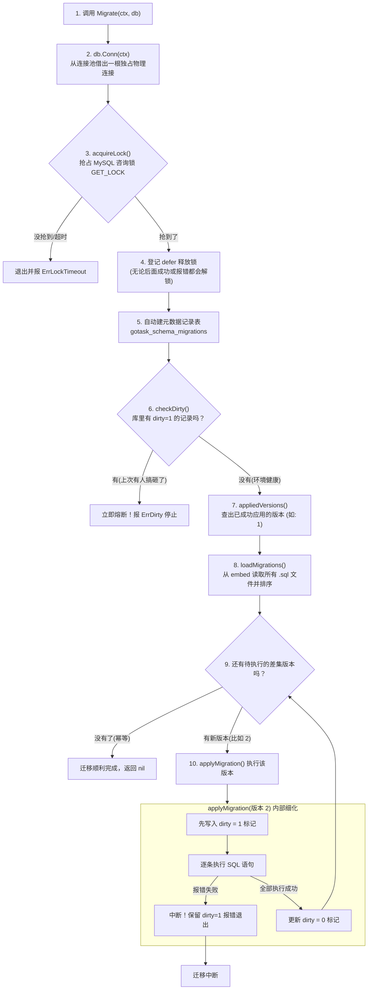
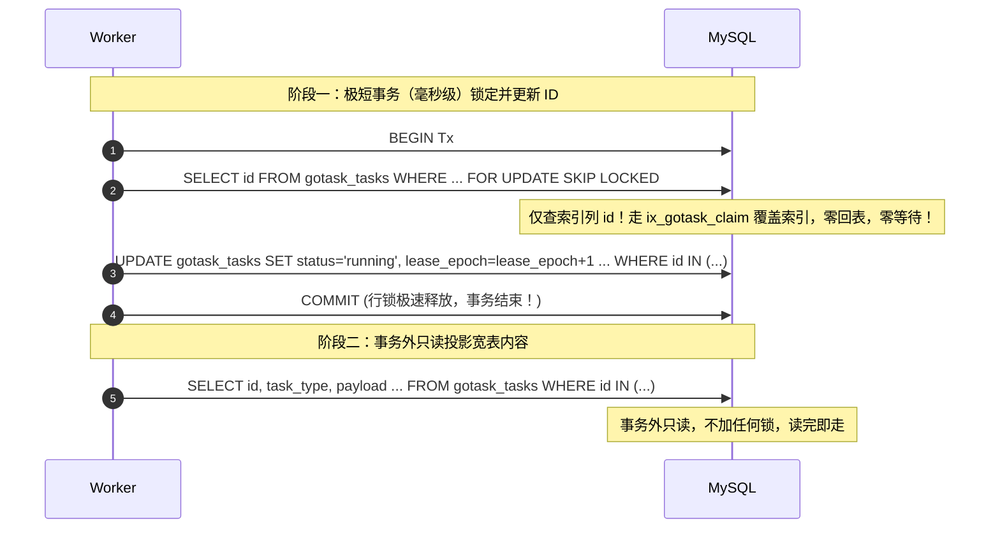
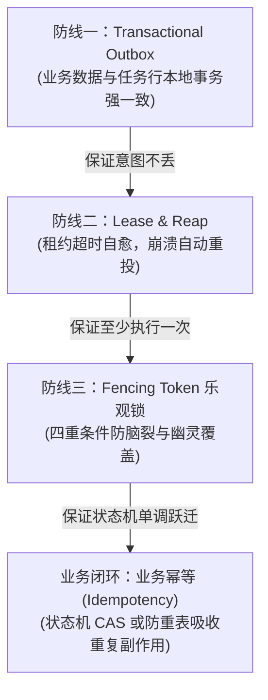
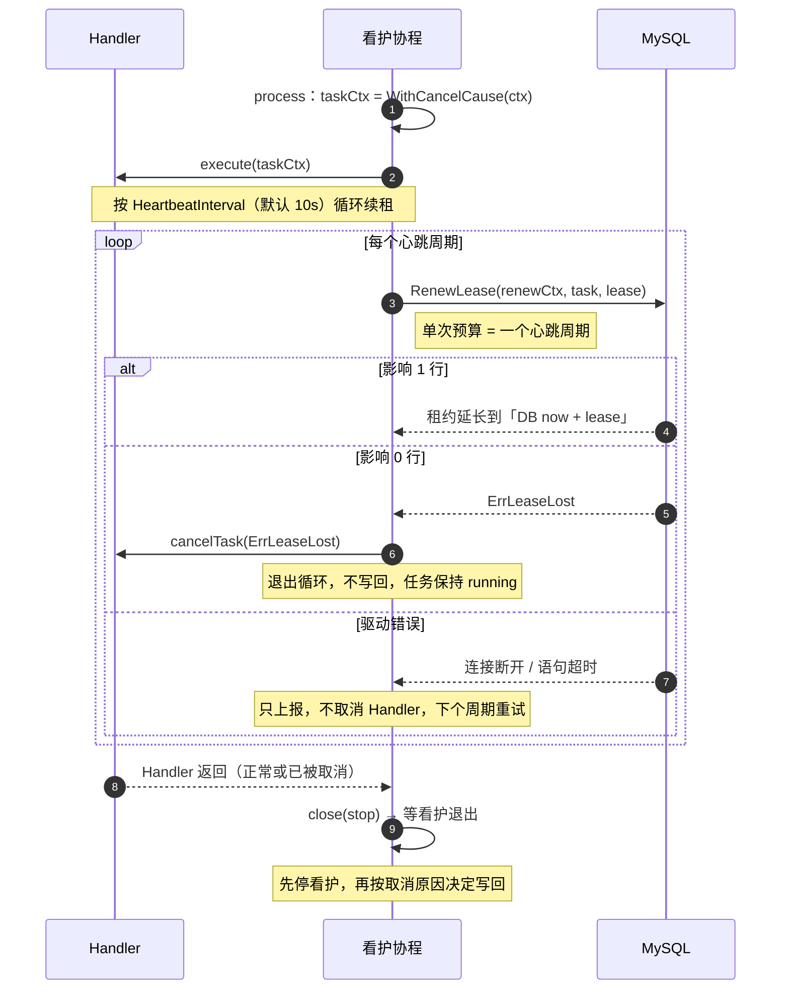

# GoRangeTask 核心技术点与面试复习指南

> 本文档基于 GoRangeTask 的实际开发演进（Git 提交历史）提炼，专为 Go 高级后端、分布式系统及基础架构岗位的技术面试打造。
> 结合底层源码实现、设计权衡、避坑经验与真实面试答对模板，逐层剖析。


## 一、领域契约与架构设计规范（Feat 1 沉淀）

> **对应 Git 提交**：`57be84f feat: 定义公开 API 类型、错误与 Handler 注册表`  
> **核心价值**：定义清晰的系统边界。在未写一行 SQL 和存储代码之前，先把库对外的输入模型、读写隔离、事务特权、状态流转和错误契约彻底规范化。

---

### 1. 最小特权原则与事务抽象（Tx 接口设计）

#### ① 源码设计
在 `client.go` 中，库定义了面向调用方的事务执行器接口：
```go
// Tx 表示一个能够在调用方现有事务内执行语句的执行器。
type Tx interface {
    ExecContext(ctx context.Context, query string, args ...any) (sql.Result, error)
}
```

#### ② 为什么坚决不暴露 Commit 和 Rollback？
* **最小特权原则（Principle of Least Privilege）**：
  * GoRangeTask 的核心定位之一是允许业务在自己的事务中插入任务（保证业务数据和任务记录原子提交）。
  * 库唯一的职责是在该连接上执行一条 `INSERT` 语句，因此它**只需要且仅应该**拥有执行 SQL 的能力（`ExecContext`）。
  * 若接口包含了 `Commit()` 或 `Rollback()`，无异于给底层组件暴露了“能私自提交或回滚业务事务”的危险后门。事务的生命周期（开启、提交、回滚）必须 100% 由业务调用方控制。
* **解耦 ORM 与原生 SQL**：
  * 标准库的 `*sql.Tx` 天然实现了这个单方法接口；
  * 第三方 ORM（如 GORM、XORM、sqlx）也可以通过轻量 adapter 取出底层物理连接并适配该接口，核心包无需依赖庞大的第三方库。

#### 💡 面试官高频提问与应答范式
> **面试官问**：“你在封装底层基础设施或 SDK 时，是如何处理与外部数据库事务集成的？如果调用方用 GORM，你们又怎么解耦？”
> 
> **回答要点**：
> 1. **接口最小化**：我遵循 Go 的接口正交与最小特权原则，定义了一个只包含 `ExecContext` 方法的 `Tx` 接口，坚决不暴露 `Commit` 与 `Rollback`。因为基础设施库绝不能越权接管调用方的事务生命周期。
> 2. **解耦第三方依赖**：Go 标准库 `*sql.Tx` 天然满足此接口；对于 GORM 等 ORM，我们在上层通过独立 Adapter 获取其底层的事务连接池来适配该接口，保证了核心包的零外部依赖。

---

### 2. 读写模型分离（CQRS）与内部状态信息隐藏

#### ① 源码设计
在 `task.go` 中，明确区分了两个模型：
* **`Task`（写模型 / 入队输入）**：面向调用方，仅包含创建意图所需的纯净属性：`Queue`、`Type`、`Payload`（`json.RawMessage`）、`RunAt`、`MaxAttempts`、`IdempotencyKey`。
* **`TaskInfo`（读模型 / 查询视图）**：面向调用方查询，包含已生成的运行时状态：`ID`、`Status`、`Attempt`、`LastError`、`CreatedAt`、`UpdatedAt`、`FinishedAt` 等。

#### ② 为什么 TaskInfo 坚决不暴露 lease_owner 和 lease_epoch？
* **信息隐藏（Information Hiding）与防逆向依赖**：
  * `lease_owner`（当前持有租约的 Worker 标识）、`lease_until`（租约到期时间戳）、`lease_epoch`（Fencing 代次）是队列内部用于并发争抢、选主、心跳续约和防脑裂覆写的**私有实现细节**。
  * 如果暴露在公开查询模型中，业务调用方可能会写出“检查某任务是不是 Worker-A 在跑”或“自己计算租约剩余秒数”等畸形代码，导致业务层与底层队列并发调度机制强耦合，破坏未来架构演进的自由度。

#### 💡 面试官高频提问与应答范式
> **面试官问**：“你们对外暴露的任务数据结构是如何设计的？数据库表里所有的字段都会一股脑返回给调用方吗？”
> 
> **回答要点**：
> 1. **读写分离与意图纯粹**：入队参数 `Task` 和只读查询结果 `TaskInfo` 严格隔离，入队只关注业务意图，查询关注状态与耗时。
> 2. **内部控制状态严禁外露**：数据库中用于分布式并发控制的字段（如租约所有人 `lease_owner`、递增代次 `lease_epoch`）在查询映射时被坚决过滤。因为这些属于 Worker 调度的私有实现细节，对外暴露会引诱调用方产生错误的依赖假设。

---

### 3. 哨兵错误体系与 Go 1.13+ 错误包装规范

#### ① 源码设计
在 `errors.go` 中统一定义强类型的包级哨兵错误：
```go
var (
    ErrDuplicateTask  = errors.New("gorangetask: duplicate task")
    ErrNotFound       = errors.New("gorangetask: task not found")
    ErrNotPending      = errors.New("gorangetask: task is not pending")
    ErrNoHandler      = errors.New("gorangetask: no handler registered for task type")
    ErrInvalidPayload = errors.New("gorangetask: invalid payload")
    ErrInvalidTask    = errors.New("gorangetask: invalid task")
    ErrLeaseLost      = errors.New("gorangetask: lease lost")
)
```

#### ② 核心考量与避坑
* **禁止字符串比对**：
  * 在生产级 Go 开发中，严禁调用方通过 `strings.Contains(err.Error(), "not found")` 判断错误。这种做法极其脆弱，一旦底层调整错误文字提示，上层逻辑立即静默失效。
* **与 `%w` 体系完全兼容**：
  * 库内部在抛出具体错误时，会携带上下文（例如 `fmt.Errorf("%w: task type %q", ErrNoHandler, taskType)`）。
  * 只要底层基于 `errors.New` 声明哨兵错误，外部就能始终使用 `errors.Is(err, gorangetask.ErrNoHandler)` 可靠判断，保证了错误上下文的丰富性与类型判定的稳定性两立。

#### 💡 面试官高频提问与应答范式
> **面试官问**：“Go 项目中如何设计一个优雅且易于维护的错误处理体系？”
> 
> **回答要点**：
> 1. **预定义类型安全的 Sentinel Errors**：公开错误使用包级 `errors.New` 变量定义，明确语义边界。
> 2. **支持链式解包（Error Wrapping）**：内部遇到错误时，通过 `fmt.Errorf("%w: ...", ErrSentinel)` 包装具体排障上下文，外部统一通过 `errors.Is` 和 `errors.As` 进行断言解包，拒绝不可靠的字符串匹配。

---

### 4. 封闭有限状态机（FSM）与安全状态跃迁

#### ① 源码设计
在 `task.go` 中，任务状态被收敛为 5 种枚举值，提供了 `IsTerminal()` 纯函数：
```go
type Status string

const (
    StatusPending   Status = "pending"
    StatusRunning   Status = "running"
    StatusSucceeded Status = "succeeded" // 终态
    StatusDead      Status = "dead"      // 终态
    StatusCanceled  Status = "canceled"  // 终态
)
```

#### ② 状态流转图与跃迁守卫
```text
                    ┌───(执行成功)───> succeeded (终态)
                    │
pending ──(领取)──> running ──(临时失败重试)──> pending
   │                │
   │                └───(永久错误/超限)───> dead (终态)
   │
   └──(调用方取消)───> canceled (终态)
```
* **为什么 Canceled 只能从 Pending 跃迁？**
  * `Cancel` 语义被严格限定为“取消尚未被领取的任务”。
  * 一旦任务被 Worker 领走进入 `running` 状态，业务 Handler 的本地或外部副作用（如扣款、发信、落库）可能已经启动。此时若允许随意强行标记为 `canceled`，会导致“数据库记录已取消、底层副作用仍在执行”的不一致严重事故。针对运行中的任务，必须走协作式 Context 超时/取消与租约机制。

---

### 5. 防呆设计的并发安全 Handler 注册表

#### ① 源码设计（`handler.go`）
```go
type Handler func(ctx context.Context, payload json.RawMessage) error

type Registry struct {
    mu       sync.RWMutex
    handlers map[string]Handler
}
```

#### ② 防御性编程亮点
* **故障前移（Fail Fast）**：
  * 在服务启动时调用 `Register`，若传入空 taskType、`nil` Handler，或者重复注册同一个任务类型，立即返回 `ErrInvalidTask` 报错打断。
  * 严禁静默覆盖已有 Handler，防止微服务中不同模块意外注册同名任务导致代码执行错乱。
* **读写锁的最优场景**：
  * 注册操作（写）仅发生在服务启动期；运行期多个并发 Worker 线程只有只读检索（`Lookup`）。典型的高并发“读极多、写极少”模型，使用 `sync.RWMutex` 能获得极高的读取并发吞吐与线程安全保证。


---

## 二、Worker 配置体系、分布式不变量与代码工程优化（Feat 2 沉淀）

> **对应 Git 提交**：`921e230 feat: 定义 Worker 配置类型、默认值与校验`  
> **核心价值**：把分布式协同在运行期的所有潜在风险（脑裂、雪崩、锁表、长事务）拦截在服务启动时的配置校验阶段；同时践行 Go 语言“零值可用”与“不可变性”哲学，并给出对抗样板代码的工程重构思路。

---

### 1. Worker 配置子系统全景划分

Worker 的 16 项参数并不是平铺的杂项，而是严格按照**任务执行生命周期的 6 大子系统**正交划分：

| 归属子系统 | 关键参数 | 工业默认值 | 为什么需要它？底层设计考量 |
| :--- | :--- | :--- | :--- |
| **① 路由与并发** | `Queues` | `["default"]` | **队列监听列表**。多租户/多优先级队列的基础隔离。 |
| | `Concurrency` | `8` | **Goroutine 并发执行度**。控制单 Worker 进程同时运行的 Handler 数量，避免无界并发压垮内存。 |
| | `BatchSize` | `10` | **单次批量领取数**。批量 `FOR UPDATE SKIP LOCKED` 拉取任务，均摊网络交互 RTT，硬上限 100（防长事务锁行过多）。 |
| **② 轮询与空转退避** | `PollInterval` | `1s` | **空队列基准轮询时间**。队列无任务时的最小休眠等待。 |
| | `MaxPollInterval` | `10s` | **空队列退避上限**。长期无任务时按指数退避休眠，最高 10s，**防止大量 Worker 空转把 MySQL QPS 打爆**。 |
| **③ 租约与续期** | `LeaseDuration` | `30s` | **分布式租约锁定时长**。任务被领取后的独占保护窗口，其他 Worker 绝不碰它。 |
| | `HeartbeatInterval` | `10s` | **续约心跳周期**。在途长任务每 10s 续期一次，**必须严格小于租约时长（通常取 1/3）**。 |
| **④ 超时与停机** | `ShutdownTimeout` | `30s` | **优雅停机预算**。收到 `SIGTERM` 信号后等待在途 Handler 收尾的最大上限。 |
| | `HandlerTimeout` | `5m` | **全局任务硬超时**。业务 Handler 协作式 Context 超时保护，防止死循环任务挂死 Worker 协程。 |
| | `MaxPayloadSize` | `256 KiB` | **参数体积上限**。在入队前拦截超大 JSON，杜绝恶意或误传几百 MB 二进制打爆 DB 行与内存。 |
| **⑤ 失败重试** | `RetryBaseDelay` | `1s` | **重试基准退避时间**。业务报错后，初次重试的等待时长。 |
| | `RetryMaxDelay` | `1h` | **重试退避封顶上限**。防止指数退避时间无限制膨胀至数天/数月。 |
| **⑥ 终态与清理** | `SucceededRetention`| `7天` | **成功/取消记录保留期**。用于生产审计与对账，过期后物理删除。 |
| | `DeadRetention` | `30天` | **死信记录保留期**。留足 1 个月供排障排查与人工补偿。 |
| | `CleanupBatchSize` | `1000` | **单次清理删除上限**。每轮只 `DELETE ... LIMIT 1000`，**防止一次性删几十万行导致 MySQL 严重锁表与主从延迟**。 |
| | `CleanupInterval` | `1h` | **清理协程运行周期**。后台清理任务的触发频率。 |

---

### 2. 分布式核心不变量（Invariants）与防灾设计

在 `Validate()` 中，核心不是做普通的 `> 0` 检查，而是卡死**分布式协同的不变量约束**：

#### ① 心跳必须严格小于租约（HeartbeatInterval < LeaseDuration）
```go
if c.HeartbeatInterval >= c.LeaseDuration {
    errs = append(errs, fmt.Errorf("heartbeat interval (%s) must be < lease duration (%s)", ...))
}
```
* **灾难场景推演**：
  * 若心跳设为 30s，租约也设为 30s。长任务执行到第 29s 时，由于网络抖动或 MySQL 偶发慢查，心跳续约请求在第 30.5s 才到达。
  * 此时租约已经过期，回收器（Reaper）早已将该任务重新标记为 `pending`，被集群中的 Worker-B 抢走并发执行！
  * **结论**：心跳取租约的 $1/3$ 是工业界经典经验值（容忍至少 1~2 次网络抖动与重试）。

#### ② 批量拉取与物理清理的硬上限约束
* `BatchSize` 限定在 `[1, MaxBatchSize]`（MaxBatchSize = 100）。
* `CleanupBatchSize` 默认 1000。
* **为什么都要设上限？**
  * 在数据库作为队列的架构中，`SELECT ... FOR UPDATE` 锁住的行数越多，事务持有排他锁的时间就越长，并发冲突率几何级上升；
  * `DELETE` 语句如果在单笔事务里清理几十万行，不仅会引发锁等待超时，还会产生巨大的 `binlog` 导致从库出现严重的主从复制延迟（Replication Lag）。

---

### 3. Go API 设计哲学与工程细节

#### ① “Make the zero value useful”（让零值可用）
* 允许调用方传入一个完全空白的 `Config{}` 结构体；
* 通过 `cfg = cfg.WithDefaults()` 将零值字段补齐为安全工业默认值，调用方只需显式覆盖关心的参数，极大降低了使用门槛与心智负担。

#### ② 函数式不可变性：坚持值接收者（Value Receiver）
```go
// 注意：值接收者，返回新副本，不使用指针接收者 (*Config)
func (c Config) WithDefaults() Config {
    // ...
    return c
}
```
* **避坑考量**：
  * 若使用指针接收者 `func (c *Config) WithDefaults()`，方法内部会就地修改入参指针，极易在外部并发启动多个 Worker 或复用配置模板时引发**隐式数据竞争（Data Race）**。
  * 保持纯函数特性（入参不可变，返回新实例）是基础库编写的优秀习惯。

#### ③ Go 1.20+ `errors.Join` 一次性合并报错（Fail-At-Once）
```go
var errs []error
// 收集所有不合规项
if len(errs) == 0 {
    return nil
}
return fmt.Errorf("%w: %w", ErrInvalidConfig, errors.Join(errs...))
```
* 避免“配错 5 个参数，需要修改重启 5 次”的痛苦运维试错；
* 使用双 `%w` 包装，既完整展示每一个违规项的详细原因，又允许外部通过 `errors.Is(err, ErrInvalidConfig)` 进行错误类型匹配。

---

### 4. 代码工程品味与重构进阶（面试加分亮点）

#### ① 现状痛点剖析
在初版 `config.go` 中，`WithDefaults()` 有 16 个 `if c.X == 0`，`Validate()` 有 20 多个 `if c.X <= 0`。
* **原作者初衷**：遵循 KISS 原则（Keep It Simple, Stupid），纯显式代码，零外部依赖，编译期类型最安全；
* **代码缺陷**：样板代码（Boilerplate）膨胀严重，视觉噪音大，新增字段时维护成本高。

#### ② 优雅重构方案一：Go 1.18+ 泛型辅助函数（消除 16 个 if）
利用泛型比较零值，将 50 行的 `WithDefaults` 压缩为极简的单行流：
```go
// 泛型辅助函数：零值替换
func defaultIfZero[T comparable](val, def T) T {
    var zero T
    if val == zero {
        return def
    }
    return val
}

func (c Config) WithDefaults() Config {
    if len(c.Queues) == 0 {
        c.Queues = []string{DefaultQueue}
    }
    c.Concurrency        = defaultIfZero(c.Concurrency, DefaultConcurrency)
    c.PollInterval       = defaultIfZero(c.PollInterval, DefaultPollInterval)
    c.MaxPollInterval    = defaultIfZero(c.MaxPollInterval, DefaultMaxPollInterval)
    c.BatchSize          = defaultIfZero(c.BatchSize, DefaultBatchSize)
    c.LeaseDuration      = defaultIfZero(c.LeaseDuration, DefaultLeaseDuration)
    c.HeartbeatInterval  = defaultIfZero(c.HeartbeatInterval, DefaultHeartbeatInterval)
    c.ShutdownTimeout    = defaultIfZero(c.ShutdownTimeout, DefaultShutdownTimeout)
    c.HandlerTimeout     = defaultIfZero(c.HandlerTimeout, DefaultHandlerTimeout)
    c.MaxPayloadSize     = defaultIfZero(c.MaxPayloadSize, DefaultMaxPayloadSize)
    c.RetryBaseDelay     = defaultIfZero(c.RetryBaseDelay, DefaultRetryBaseDelay)
    c.RetryMaxDelay      = defaultIfZero(c.RetryMaxDelay, DefaultRetryMaxDelay)
    c.SucceededRetention = defaultIfZero(c.SucceededRetention, DefaultSucceededRetention)
    c.DeadRetention      = defaultIfZero(c.DeadRetention, DefaultDeadRetention)
    c.CleanupBatchSize   = defaultIfZero(c.CleanupBatchSize, DefaultCleanupBatchSize)
    c.CleanupInterval    = defaultIfZero(c.CleanupInterval, DefaultCleanupInterval)
    return c
}
```

#### ③ 优雅重构方案二：表驱动 / 规则收集器（消除 Validate 重复）
```go
func requirePositive[T ~int | ~int64](errs *[]error, name string, val T) {
    if val <= 0 {
        *errs = append(*errs, fmt.Errorf("%s must be > 0, got %v", name, val))
    }
}
```

#### ④ 工业选型对比：为什么基础库不用 Struct Tag 反射校验（如 validator）？
1. **零外部依赖诉求**：避免用户引入库时拉入沉重的依赖树；
2. **编译期安全**：Tag 拼写错误（如 `gt=0` 误写为 `gt:0`）编译器无法感知，属于运行时隐患；
3. **多字段联动校验困难**：类似 `HeartbeatInterval < LeaseDuration` 这样的业务不变量，Struct Tag 表达极其晦涩难读。

---

### 5. 💡 面试高频问题与答题范式

> **面试官问**：“你们分布式后台任务系统中的‘租约（Lease）’和‘心跳（Heartbeat）’是如何配合的？参数怎么设定？”
> 
> **回答范式**：
> 1. **核心概念**：租约是 Worker 抢占任务后的独占时间窗口；心跳是执行中的后台协程定期向数据库延展租约的探针。
> 2. **参数设定与不变量**：心跳间隔必须严格小于租约时长，业界基准通常设为租约的 $1/3$（如租约 30s、心跳 10s）。
> 3. **防灾考虑**：留出 $2/3$ 的缓冲窗口是为了容忍偶发的网络抖动与数据库慢查重试。如果心跳 $\ge$ 租约，单次网络延迟就会导致租约在下次心跳前过期，任务会被其他节点重复抢占引发脑裂冲突。我们在配置初始化时通过强制校验拦截此类配置。


---

## 三、自研 MySQL 版本化迁移与分布式防爆机制（Feat 3 沉淀）

> **对应 Git 提交**：`4693518 feat: 实现自研 MySQL 版本化迁移与脏状态检测`  
> **核心价值**：抛弃沉重的第三方迁移工具，通过 Go 原生 `embed` 静态嵌入 SQL 实现零依赖部署；并在 MySQL DDL 不支持事务回滚的现实约束下，构建包含“分布式咨询锁防并发、单物理连接锁定、脏状态熔断、Context 脱钩释放”的高可靠数据库升级闭环。

---

### 1. 为什么自研嵌入式迁移？（零依赖 + 静态内嵌）

* **痛点**：传统的迁移工具通常需要单独携带 `.sql` 文件，在 Docker 容器化打包或 K8s 部署时，经常因为漏复制 SQL 目录而导致线上启动崩溃；
* **破局方案（`migrate.go`）**：
  ```go
  //go:embed *.sql
  var sqlFS embed.FS
  ```
  利用 Go 1.16+ 原生 `embed` 特性，在编译期直接把 SQL 文本打包进最终的二进制文件，分发部署只需一个单文件，杜绝文件遗漏。

---

### 2. 完整 8 步防爆执行流程

迁移的核心思想是：**“算出【代码里的迁移文件】减去【数据库里已成功执行的版本】的差集，按顺序执行”**。



#### 源码逐行对照（[`migrations/mysql/migrate.go#L96-L143`](file:///home/tide/GoProjects/gorangetask/migrations/mysql/migrate.go#L96-L143)）：
1. **独占物理连接**（L99）：`conn, err := db.Conn(ctx)`，独占单一连接，防止连接池切换。
2. **抢占咨询锁**（L105）：`acquireLock(ctx, conn)`，调用 `SELECT GET_LOCK('gorangetask_migrate', 10)`。
3. **注册释放锁 defer**（L110-L114）：`DO RELEASE_LOCK(?)`，确保任何路径退出均释放锁。
4. **确保元数据表存在**（L116）：`CREATE TABLE IF NOT EXISTS gotask_schema_migrations`。
5. **脏状态熔断排查**（L120）：`checkDirty(ctx, conn)`，查询是否存在 `dirty = 1`。
6. **读取已成功版本集合**（L124）：`appliedVersions(ctx, conn)`，查询 `WHERE dirty = 0`。
7. **加载并排序迁移文件**（L129）：`loadMigrations(sqlFS)`，按版本号数字升序排序。
8. **差集幂等执行**（L134-L141）：跳过已执行版本；未执行版本进入 `applyMigration`。

---

### 3. 三大底层硬核避坑深析（源码级剖析）

#### 坑点一：MySQL DDL 隐式提交与“脏状态（Dirty State）”熔断
* **底层原理**：
  * 在 MySQL 中，执行 DDL 语句（`CREATE TABLE`、`ALTER TABLE` 等）会触发**隐式提交（Implicit Commit）**。MySQL 不支持事务回滚 DDL！
  * 如果一个迁移文件包含 2 条 DDL，第 1 条成功、第 2 条失败，第 1 条变更**无法撤销**，数据库进入“改了一半”的未知中间态。
* **源码应对（[`migrate.go#L240-L260`](file:///home/tide/GoProjects/gorangetask/migrations/mysql/migrate.go#L240-L260)）**：
  1. **执行前插脏标记**：在执行该版本 SQL 前，先插入 `INSERT INTO gotask_schema_migrations (..., dirty) VALUES (..., 1)`；
  2. **逐条执行 DDL**：如果中途任何一条语句报错，函数立即退出，表中永久保留 `dirty = 1`；
  3. **成功后消除脏标记**：全部执行成功，最后才更新 `UPDATE ... SET dirty = 0`。
* **启动熔断拦截（[`migrate.go#L185-L211`](file:///home/tide/GoProjects/gorangetask/migrations/mysql/migrate.go#L185-L211)）**：
  * 每次迁移前 `checkDirty` 若发现存在 `dirty = 1`，立即熔断拒绝启动并报 `ErrDirty`。
* **为什么不做自动 Down 脚本回滚？**
  * 当 DDL 中途失败时，数据库结构已经处于不可知状态，盲目执行 Down 脚本极大概率二次报错，把生产表结构破坏得更彻底。工业界黄金准则是：**停止一切自动操作，保留案发现场，强制人工介入对齐后手动消除 dirty 标记**。

#### 坑点二：多实例并发启动与 `GET_LOCK` 会话级连接池大坑
* **痛点**：微服务（如 K8s）滚动更新时多 Pod 同时启动，会并发执行迁移导致 DDL 冲突报错。
* **咨询锁机制**：利用 MySQL 提供的 `SELECT GET_LOCK('gorangetask_migrate', 10)` 进行排他协调。
* **底层陷阱**：
  * `GET_LOCK` 和 `RELEASE_LOCK` 是**基于 MySQL 会话（Session / 单条 TCP 物理连接）绑定的**！
  * Go 标准库 `*sql.DB` 是连接池，直接调用 `db.Exec()` 会在每次执行时从池中随机借用物理连接。如果在连接 A 上加了锁，连接 A 还回池子；后续在连接 B 上建表，在连接 C 上释放锁，**锁无法正确释放，甚至连接 A 发生断开导致锁提前丢失**！
* **源码应对（[`migrate.go#L99`](file:///home/tide/GoProjects/gorangetask/migrations/mysql/migrate.go#L99)）**：
  * 必须使用 `conn, err := db.Conn(ctx)` **显式取出一根底层物理连接 `*sql.Conn`**，从获取锁、建表、版本检测到释放锁，**全程独占同一物理连接**。

#### 坑点三：Context 超时取消时的锁释放自杀陷阱
* **痛点**：若外部传入的 `ctx` 发生超时被取消，`defer` 里的解锁逻辑若直接使用已取消的 `ctx`：
  ```go
  conn.ExecContext(ctx, "DO RELEASE_LOCK(?)", ...)
  ```
  Go 的 SQL 驱动发现 `ctx` 已经 Done，会**直接在客户端本地拦截报错，根本不向 MySQL 发送网络数据包**！导致服务端锁卡死。
* **源码应对（[`migrate.go#L110-L114`](file:///home/tide/GoProjects/gorangetask/migrations/mysql/migrate.go#L110-L114)）**：
  ```go
  defer func() {
      // 利用 context.WithoutCancel 剥离取消信号，赋予独立 5 秒超时预算
      rctx, cancel := context.WithTimeout(context.WithoutCancel(ctx), releaseLockTimeout)
      defer cancel()
      _, _ = conn.ExecContext(rctx, "DO RELEASE_LOCK(?)", advisoryLockName)
  }()
  ```
  确保无论外部如何被取消，解锁的网络包必然能够被 MySQL 服务端接收。

---

### 4. 任务表 DDL 与索引架构考量（`0001_create_tasks_table.sql`）

```sql
CREATE TABLE gotask_tasks (
    id                BIGINT UNSIGNED NOT NULL AUTO_INCREMENT,
    queue_name        VARCHAR(64)     NOT NULL,
    task_type         VARCHAR(128)    NOT NULL,
    payload           JSON            NOT NULL,
    status            VARCHAR(16)     NOT NULL,
    run_at            DATETIME(6)     NOT NULL,
    attempt           INT UNSIGNED    NOT NULL DEFAULT 0,
    max_attempts      INT UNSIGNED    NOT NULL DEFAULT 10,
    lease_owner       VARCHAR(128)    NULL,
    lease_until       DATETIME(6)     NULL,
    lease_epoch       BIGINT UNSIGNED NOT NULL DEFAULT 0,
    idempotency_key   VARCHAR(191)    NULL,
    last_error        VARCHAR(2048)   NULL,
    created_at        DATETIME(6)     NOT NULL,
    updated_at        DATETIME(6)     NOT NULL,
    finished_at       DATETIME(6)     NULL,
    PRIMARY KEY (id),
    UNIQUE KEY uq_gotask_queue_idempotency (queue_name, idempotency_key),
    KEY ix_gotask_claim   (queue_name, status, run_at, id),
    KEY ix_gotask_lease   (status, lease_until, id),
    KEY ix_gotask_cleanup (status, finished_at, id)
) ENGINE=InnoDB DEFAULT CHARSET=utf8mb4 COLLATE=utf8mb4_0900_ai_ci;
```

#### 关键工业设计点：
1. **显式声明字符集与排序规则**：`DEFAULT CHARSET=utf8mb4 COLLATE=utf8mb4_0900_ai_ci`，绝不依赖服务端环境默认值，杜绝因环境差异导致的字符截断或建表失败。
2. **微秒精度 `DATETIME(6)`**：状态跃迁与租约计算是高频并发操作，秒级精度会导致并发排序失效，必须用 6 位微秒精度。
3. **三大核心复合索引正交划分**：
   * `ix_gotask_claim (queue_name, status, run_at, id)`：**两段式领取的覆盖索引**。Worker 在领取时只读这些列，直接走索引覆盖，无需回表。
   * `ix_gotask_lease (status, lease_until, id)`：**过期租约回收器（Reaper）专用索引**。
   * `ix_gotask_cleanup (status, finished_at, id)`：**终态物理清理专用索引**。
4. **幂等索引 NULL 不互斥特性**：
   * `UNIQUE KEY (queue_name, idempotency_key)`。当 `idempotency_key` 为 `NULL` 时，MySQL 唯一索引不视作重复，完美支撑了“允许海量任务不设幂等键”的场景。

---

### 5. 💡 面试高频问题与答题范式

> **面试官问**：“微服务集群多实例同时启动时，数据库迁移（Migration）怎么防并发冲突？如果用 MySQL 的咨询锁（Advisory Lock），有什么坑？”
> 
> **回答范式**：
> 1. **并发协同机制**：我们在服务启动初始化阶段，利用 MySQL 原生会话级咨询锁 `SELECT GET_LOCK('lock_name', timeout)` 进行排他保护，抢到锁的实例才执行迁移，其他节点等待或跳过。
> 2. **核心避坑（连接池失效）**：`GET_LOCK` 是会话（Session）级别的，直接调 `db.Exec` 会因为 `database/sql` 内部连接池的动态分配，导致加锁、执行 DDL 和释放锁分布在不同的底层 TCP 连接上，锁形同虚设。我们通过 `db.Conn(ctx)` 显式独占单一物理连接 `*sql.Conn` 贯穿整个迁移过程。
> 3. **锁释放与 Context 脱钩**：在 `defer` 解锁时，不能直接复用可能已经超时的外部 `ctx`，必须用 `context.WithoutCancel` 剥离取消信号，确保解锁的网络请求必定能到达 MySQL。
> 4. **DDL 故障与脏状态**：因为 MySQL DDL 不支持事务回滚（隐式提交），我们设计了“先置 `dirty=1`，执行成功后置 `0`”的机制。中途失败绝不盲目自动回滚，而是强行熔断拦截后续启动，要求人工介入对齐。


---

## 四、MySQL 事务内原子入队与工业级防坑设计（Feat 4 沉淀）

> **对应 Git 提交**：`f560e45 feat: 实现 MySQL 入队（Enqueue / EnqueueTx）与入队侧配置`  
> **核心价值**：攻克分布式系统最棘手的“业务数据与异步任务双写一致性”痛点；提供同库事务内入队能力（`EnqueueTx`），达成 100% 事务完整率；并在幂等排重、NULL 唯一索引机制、时钟时区防灾、前置类型转换等细节上展现出高标准的工程设计水准。

---

### 1. 核心定位与双写一致性难题

#### ① 传统“先写库，后发 MQ”的时序漏洞
```go
// 经典反面教材（存在分布式裂隙）
tx.Exec("INSERT INTO orders ...") // 1. 业务订单落库
tx.Commit()                       // 2. 事务提交

// 3. 准备发异步消息
mq.Publish("order_created", orderID) 
```
* **崩溃场景**：第 2 步提交成功后，进程突发宕机、网络超时或 OOM。第 3 步永远没有执行，导致业务订单存在，但异步发货/通知任务永久丢失（产生业务孤儿）。
* **先发 MQ 后提交同样有漏洞**：如果 MQ 成功而 DB 事务回滚，消费者会读取到脏数据。

#### ② GoRangeTask 的同生共死解法（`EnqueueTx`）
```go
tx, _ := db.BeginTx(ctx, nil)
tx.ExecContext(ctx, "INSERT INTO orders ...") // 业务变更

// 将任务行插入调用方现有的同一个物理事务连接中
client.EnqueueTx(ctx, tx, task) 

tx.Commit() // 两者原子提交！同生共死！
```
* 业务数据与任务行共享同一个 MySQL 本地事务。事务提交则任务立即可见，事务回滚则任务行物理蒸发。实测 **10,000 笔事务完整率 100.00%（0 残留、0 孤儿）** 的物理基石就在这里。

---

### 2. 配置隔离：为什么独立出 `ClientConfig`？

在 `config.go` 中，原作者将生产者配置 `ClientConfig` 与消费者配置 `Config` 严格隔离：
```go
type ClientConfig struct {
    DefaultQueue       string // 默认队列，如 "default"
    DefaultMaxAttempts int    // 默认重试上限，如 10
    MaxPayloadSize     int    // Payload 字节上限，如 256 KiB
}
```
* **关注点分离（Separation of Concerns）**：
  * 在微服务架构中，发起入队的 API 服务与后台执行的 Worker 服务通常是物理分离的独立进程。
  * 生产者 API 只需要关注“任务怎么写进库”，绝不需要关心 Worker 的并发度、租约长短或心跳间隔。强行合并只会带来冗余的心智负担与配置污染。

---

### 3. 核心接口抽象与入队引擎源码剖析

#### ① 最小接口抽象 `execer`（[`client.go#L44-L46`](file:///home/tide/GoProjects/gorangetask/store/mysql/client.go#L44-L46)）
```go
type execer interface {
    ExecContext(ctx context.Context, query string, args ...any) (sql.Result, error)
}
```
* 标准库的 `*sql.DB`（连接池）与 `*sql.Tx`（事务）都天然实现了 `ExecContext`；
* 使得普通入队 `Enqueue` 与事务内入队 `EnqueueTx` 能够**100% 复用同一套底层的 `insert()` 逻辑**，差别仅在传入的是 `c.db` 还是外部的 `tx`。

#### ② 普通入队绝不额外开事务（[`client.go#L76`](file:///home/tide/GoProjects/gorangetask/store/mysql/client.go#L76)）
```go
func (c *Client) Enqueue(ctx context.Context, task gorangetask.Task) (gorangetask.TaskID, error) {
    return c.insert(ctx, c.db, task)
}
```
* 单条 `INSERT` 语句在 MySQL InnoDB 中本身具备单行原子性。非事务入队坚决不开 `db.BeginTx()`，省去 2 次无意义的网络 RTT 与事务握手开销。

---

### 4. 三大工业级底层避坑深析（源码级对照）

#### 坑点一：幂等排重坚决不做“先查后插”，全靠 MySQL 唯一索引 1062
* **反面教材（先查后插）**：
  ```sql
  SELECT id FROM gotask_tasks WHERE idempotency_key = 'abc';
  -- 不存在则执行 INSERT ...
  ```
  1. **并发竞态（Race Condition）**：高并发下两个请求同时查发现都不存在，随后同时插入，依然冲突报错；
  2. **浪费 1 次网络 RTT**：每次入队都要多打一次查询，QPS 减半。
* **源码正确范式（[`client.go#L95-L109`](file:///home/tide/GoProjects/gorangetask/store/mysql/client.go#L95-L109)）**：
  * 直接执行单条 `INSERT`，全权交由 MySQL 底层 `UNIQUE KEY (queue_name, idempotency_key)` 裁决；
  * 遇到冲突时，MySQL 返回错误号 **`1062 (Duplicate entry)`**；
  * 源码通过 `isDuplicateEntry` 使用 `errors.As` 提取底层驱动结构体，匹配数字错误号，绝不依赖脆弱的字符串匹配：
    ```go
    func isDuplicateEntry(err error) bool {
        var me *gomysql.MySQLError
        if errors.As(err, &me) {
            return me.Number == mysqlErrDuplicateEntry // 1062
        }
        return false
    }
    ```

#### 坑点二：唯一索引陷阱——为什么没有幂等键必须存为 NULL，绝对不能存空串 `""`？
表结构里的唯一索引是：`UNIQUE KEY uq_gotask_queue_idempotency (queue_name, idempotency_key)`。

* **致命问题**：绝大多数任务是不需要幂等键的。如果任务没有幂等键，数据库里应该存什么？
  * 若存空字符串 `''`：在 MySQL 唯一索引中，`''` 是一个**真实具体的值**。当插入第 2 条同队列且无幂等键的任务时，MySQL 会立刻判定重复，抛出 1062 错误，队列瞬间瘫痪！
  * 若存 `NULL`：SQL 标准规定 **`NULL != NULL`**，多个 `NULL` 在唯一索引中并不互斥，允许无限条 `('default', NULL)` 任务和平共存。
* **源码中的精妙类型桥梁（[`client.go#L187-L198`](file:///home/tide/GoProjects/gorangetask/store/mysql/client.go#L187-L198)）**：
  ```go
  // preparedTask 的 idempotencyKey 字段类型是 any，默认零值为 nil
  p := preparedTask{task: task}

  // 为什么这里是 != "" 而不是 != nil？
  // 因为入参 task.IdempotencyKey 是 string（值类型），零值是 ""，根本无法和 nil 比较！
  if task.IdempotencyKey != "" {
      p.idempotencyKey = task.IdempotencyKey
  }
  // 若业务未传幂等键，p.idempotencyKey 保持 nil。
  // 送入驱动后，Go 数据库驱动识别到 nil 会将其转换为真正的 SQL NULL！
  ```
* **API 人性化取舍（DX）**：
  * 为什么不把 `Task.IdempotencyKey` 定义为 `*string` 指针？
  * 因为在 Go 中无法直接对字面量取地址（写 `&"order_123"` 会编译报错），用指针会迫使调用方每次传参前额外定义局部变量；
  * 库对外暴露清爽的 `string`，在库内部把 `""` 桥接转换为 `any(nil)`，把方便留给外部，把严谨留在内部。

#### 坑点三：时钟漂移与 DSN 时区污染防范
1. **时钟漂移防范（[`client.go#L37-L42`](file:///home/tide/GoProjects/gorangetask/store/mysql/client.go#L37-L42)）**：
   ```sql
   INSERT INTO gotask_tasks (..., run_at, ...)
   VALUES (..., COALESCE(?, UTC_TIMESTAMP(6)), ...)
   ```
   * 立即执行任务的 `run_at` 传入 `nil`，由 SQL `COALESCE` 回落到 MySQL 自身的 `UTC_TIMESTAMP(6)` 生成微秒时间戳，彻底消除应用机器时钟快慢引发的延迟调度偏差。
2. **DSN 时区污染防范（[`client.go#L173-L175`](file:///home/tide/GoProjects/gorangetask/store/mysql/client.go#L173-L175)）**：
   ```go
   if !task.RunAt.IsZero() {
       p.runAt = task.RunAt.UTC().Format("2006-01-02 15:04:05.000000")
   }
   ```
   * 延迟任务在 Go 内存中强转为 UTC 并格式化为固定字符串写入，切断 MySQL 驱动根据 DSN `loc=Local` 擅自转换时区导致的 8 小时时间偏差。

---

### 5. 前置严格防御性校验（Fail-Fast）

在落库前，全部逻辑在内存中完成过滤，杜绝无效流量打扰数据库：
* **UTF-8 字符数校验**：使用 `utf8.RuneCountInString` 检查队列名、任务类型和幂等键长度，防止中文字符（3 字节）按字节误判超长，避免触发 MySQL 1406 截断报错；
* **JSON 强拦截**：`json.Valid(task.Payload)` 严格拦截畸形 JSON；且对于空 Payload 直接报错拒绝，坚决不自作聪明补 `"null"`，把格式错误拦截在最前端。

---

### 6. 💡 面试高频问题与答题范式

> **面试官问**：“在高并发场景下，如何保证业务数据变更与后台任务/事件投递的绝对一致性？你们是怎么实现的？”
> 
> **回答范式**：
> 1. **核心痛点**：传统的“先写业务库、再发 MQ”存在分布式网络分段风险，一旦中间宕机会产生孤儿数据或丢失任务。
> 2. **事务内入队解决方案**：我们采用同库事务方案，通过 `EnqueueTx` 接口直接复用业务当前持有的 `*sql.Tx` 连接。把任务记录作为一条独立的任务行，在同一笔 MySQL 本地事务中与业务数据原子提交。如果业务回滚，任务行同步消失；如果业务提交，任务行必定落库，做到了 100% 的事务完整率。
> 3. **幂等排重设计**：入队排重坚决避免“先查后插”的竞态与额外 RTT，直接利用 MySQL 底层的唯一复合索引 `(queue_name, idempotency_key)`，由代码捕获 1062 报错映射为哨兵错误；对于无幂等键的任务严格存为 `NULL`，利用 SQL 中 `NULL` 不互斥的特性保证吞吐。


---

## 五、任务状态读取（Get）与原子取消（Cancel）设计（Feat 5 沉淀）

> **对应 Git 提交**：`5be5957 feat: 实现任务状态读取（Get）与 pending 取消（Cancel）`  
> **核心价值**：完善客户端读写能力闭环；通过“编译期接口断言”将接口实现漏洞拦截在编译阶段；在 `Get` 中践行严格的投影原则与 NULL 防御；在 `Cancel` 中运用原子条件更新（CAS 思想）彻底杜绝“先查后改”引发的并发状态不一致资损事故。

---

### 1. 编译期接口断言（静态守卫）

在 `store/mysql/client.go` 头部，作者写下了这行经典代码：
```go
// 编译期断言：Client 完整实现了根包的公开接口。
var _ gorangetask.Client = (*Client)(nil)
```

#### 💡 底层原理与面试考点：
* **为什么写这行看似“无用”的代码？**
  * Go 语言采用隐式接口机制（Duck Typing），无需显式 `implements`。
  * 若无此行，一旦底层结构体漏实现了接口的某个方法，或者方法入参/返回值发生变更，编译器不会在声明处报警，直到调用方将其作为接口类型使用时才会在遥远的调用点报错。
  * **作用**：将 `(*Client)(nil)` 强行赋值给未命名空白标识符 `_`。**一旦 `*Client` 未 100% 完整实现 `Client` 接口的全部方法，编译阶段当场报错中断**，实现“编译期静态安全守卫”。

---

### 2. 任务状态读取 `Get` 的高可靠设计

看 [`store/mysql/client.go#L244-L310`](file:///home/tide/GoProjects/gorangetask/store/mysql/client.go#L244-L310)：

```sql
SELECT
    queue_name, task_type, payload, status, run_at,
    attempt, max_attempts, idempotency_key, last_error,
    created_at, updated_at, finished_at
FROM gotask_tasks WHERE id = ?
```

#### ① 坚决不写 `SELECT *`（投影原则与信息隐藏）
* 明确投影所需列，不查 `lease_owner`（当前领取的 Worker）、`lease_until`（租约到期时间）、`lease_epoch`（代次）；
* **收益**：
  1. **信息隐藏**：Worker 内部并发争抢和选主的私有实现细节绝不外泄给调用方，维持底层演进自由；
  2. **加列安全**：未来数据表增加内部列（如后来的 `timeout_ns`），绝不会意外打破现有的 Scan 结构体映射。

#### ② 健壮的可空处理（NULL 防御）
* `idempotency_key`、`last_error`、`finished_at` 在 MySQL 中均可能为 `NULL`；
* Go 标准库中，如果直接拿普通的 `string` 或 `time.Time` 变量去 `Scan` 数据库的 `NULL`，**驱动会当场抛出错误**；
* 源码全部声明为 `sql.NullString` 与 `sql.NullTime`，仅在 `Valid == true` 时才提取具体值，杜绝空指针与类型转换异常。

#### ③ 强制时区归一化（`.UTC()`）
* `info.RunAt = runAt.UTC()`、`info.CreatedAt = createdAt.UTC()` 等时间对象返回前全部强转为 UTC；
* 切断调用方 DSN 中 `loc=Local` 配置带来的本地时区偏差，保证系统内外时间基准统一。

---

### 3. 任务取消 `Cancel` 的并发安全与原子 CAS 设计

看 [`store/mysql/client.go#L254-L345`](file:///home/tide/GoProjects/gorangetask/store/mysql/client.go#L254-L345)：

```go
const cancelTaskSQL = `UPDATE gotask_tasks
    SET status = 'canceled', finished_at = UTC_TIMESTAMP(6), updated_at = UTC_TIMESTAMP(6)
    WHERE id = ? AND status = 'pending'`

func (c *Client) Cancel(ctx context.Context, id gorangetask.TaskID) error {
    // 1. 原子 CAS 条件更新
    res, err := c.db.ExecContext(ctx, cancelTaskSQL, int64(id))
    if err != nil {
        return fmt.Errorf("gorangetask/store/mysql: cancel task: %w", err)
    }

    // 2. 检查影响行数
    affected, err := res.RowsAffected()
    if err != nil {
        return fmt.Errorf("gorangetask/store/mysql: cancel task: %w", err)
    }
    if affected > 0 {
        return nil // 成功更新了 1 行，取消成功！
    }

    // 3. 影响 0 行时的失败路径精准归因
    var status string
    switch err := c.db.QueryRowContext(ctx, currentStatusSQL, int64(id)).Scan(&status); {
    case errors.Is(err, sql.ErrNoRows):
        return fmt.Errorf("%w: task %d", gorangetask.ErrNotFound, id)
    case err != nil:
        return fmt.Errorf("gorangetask/store/mysql: read task status: %w", err)
    }
    return fmt.Errorf("%w: task %d is %s", gorangetask.ErrNotPending, id, status)
}
```

#### ① 为什么绝不能“先查后改”？（并发竞态漏洞推演）
* **反面教材（存在并发裂隙）**：
  ```sql
  -- 1. 先查状态
  SELECT status FROM gotask_tasks WHERE id = 100; -- 查出来是 'pending'
  -- 2. 再执行取消
  UPDATE gotask_tasks SET status = 'canceled' WHERE id = 100;
  ```
* **致命灾难时序**：
  ```text
  0.00s  [Cancel 请求]  查到任务 #100 状态为 'pending'，准备更新...
  0.01s  [Worker 节点]  并发介入！成功 claim 领走任务 #100，状态改为 'running'！
                        Worker 本地 Handler 已经开始调用扣款接口！
  0.02s  [Cancel 请求]  UPDATE 到达数据库，强行把任务状态覆写为 'canceled'！
  ```
  **后果**：数据库记录任务已取消，而后台 Worker 已经在外部把款项扣除！造成严重的**资损与状态不一致事故**。

#### ② 单条原子条件更新（CAS 思想破局）
* 源码将判定与修改合并为单条原子 SQL：
  ```sql
  UPDATE gotask_tasks SET status = 'canceled' ... WHERE id = ? AND status = 'pending'
  ```
* 依靠 InnoDB 行锁排他性：
  * 若任务已被 Worker 领走变成 `running`，该 SQL 的 `status = 'pending'` 条件立即不成立，**`RowsAffected` 必定为 0**！
  * 取消操作被数据库直接物理拦截，杜绝“抢跑覆盖”。

#### ③ 失败路径的“快照回查”与精准归因
* **成功路径零开销**：如果影响行数 $>0$，直接返回 `nil`，无多余网络查询；
* **仅在影响 0 行时做二次回查**：
  * 仅凭 `affected == 0`，调用方无法获知是“ID 传错不存在”，还是“已被领走正在跑”；
  * 源码执行 `SELECT status FROM gotask_tasks WHERE id = ?`：
    * 查无此行 $\rightarrow$ 返回 `ErrNotFound`；
    * 查出状态为 `running` / `succeeded` / `canceled` $\rightarrow$ 返回带现场的 `ErrNotPending`（例如：`task 42 is running`）；
  * **为什么这次读不包事务？** 因为这只是提供给排障日志的快照解释。只要此时不是 `pending`，这次取消就注定是失败的，不包事务省去了多余的事务开销。

#### ④ 为什么刻意不限制 `run_at`？
* 即使某个延迟任务的计划执行时间已经过去了（`run_at < NOW()`），但只要后台负载高、Worker **尚未真正领走它**，该任务就依然是 `pending` 状态；
* 设计上依然允许调用方行使反悔权取消它，只要副作用未发生，保障了业务语义的灵活性。

---

### 4. 💡 面试高频问题与答题范式

> **面试官问**：“在高并发系统中，如何设计一个安全的‘任务取消’或‘订单关闭’接口？有什么并发陷阱？”
> 
> **回答范式**：
> 1. **严禁‘先查后改’**：查询状态与修改状态如果分成两步，在中间的极短时间窗口内，后台 Worker 极可能已将任务领取并开始执行外部副作用。此时若强行更新为取消，会造成‘状态已取消、副作用仍在执行’的不一致资损。
> 2. **原子 CAS 条件更新**：我们采用单条条件更新 `UPDATE gotask_tasks SET status='canceled' WHERE id=? AND status='pending'`。利用数据库行锁保障原子判定，一旦任务被抢领状态跃迁为 `running`，该更新直接影响 0 行被拦截。
> 3. **快照回查精准归因**：仅在影响行数为 0 的失败路径上，才追加一次单行状态回查，精准区分是‘任务不存在（ErrNotFound）’还是‘已被抢领/终态不可取消（ErrNotPending，带出当前真实状态）’，在保证高并发吞吐的同时兼顾极致的可观测性。


---

## 六、永久失败分流机制与泛型 TypedHandler 架构（Feat 6 沉淀）

> **对应 Git 提交**：`e2c4147 feat: 落地永久失败标记与 payload 解码，打通 Handler 解析路径`  
> **核心价值**：建立高可靠后台执行的“错误分流分级”标准；通过函数式包装器与 `Unwrap` 机制实现错误链无缝穿透；引入 Go 泛型适配器 `TypedHandler[T]`，在框架层完成强类型反序列化与坏数据自动熔断，彻底杜绝无效重试引发的重试雪崩。

---

### 1. 错误分类哲学：临时错误 vs 永久错误

在任何高可用任务队列中，盲目重试所有错误是导致系统雪崩的元凶：

| 错误分类 | 典型场景 | 正确处理策略 | 若盲目重试的灾难后果 |
| :--- | :--- | :--- | :--- |
| **临时错误（Transient）** | 网络瞬时抖动、数据库锁超时、下游接口 503 限流 | **指数退避重试**（退避几秒后重试，大概率能自愈成功） | 符合预期，系统自愈。 |
| **永久错误（Permanent）** | 任务类型未在代码注册、JSON 损坏无法解析、业务订单在库中根本不存在 | **坚决不重试**（重试一万次结果也一模一样） | **重试雪崩！** 任务白白重试满 10 次，卡在队列几小时，挤占 Worker 线程与 DB 连接，把正常任务活活堵死！ |

因此，Worker 启动前必须先为错误体系引入**“永久失败标记（Permanent Failure）”**。

---

### 2. 优雅的错误包装器设计（`errors.go`）

看 [`errors.go#L34-L71`](file:///home/tide/GoProjects/gorangetask/errors.go#L34-L71)：

```go
type permanentError struct {
    err error
}

func (e permanentError) Error() string {
    return "permanent failure: " + e.err.Error()
}

// Unwrap 让 errors.Is / errors.As 仍能在错误链上找到被标记的原始错误
func (e permanentError) Unwrap() error { return e.err }

// Permanent 把 err 标记为永久失败：重试不会让它变好，Worker 见此直接进 dead
func Permanent(err error) error {
    if err == nil {
        return nil // nil 安全！
    }
    return permanentError{err: err}
}

// IsPermanent 穿透检查错误链上是否带有永久失败标记
func IsPermanent(err error) bool {
    var target permanentError
    return errors.As(err, &target)
}
```

#### 💡 深度设计剖析（Go 语言顶级错误设计规范）：
1. **为什么用私有包装结构体，而不是公开哨兵 `var ErrPermanent = errors.New(...)`？**
   * **反面教材（公开哨兵）**：业务方在 Handler 报错时必须写 `fmt.Errorf("%w: %w", ErrPermanent, myErr)`。只要业务漏写了一个 `%w`，错误链断裂，Worker 无法识别，导致任务被错误重试 10 次；
   * **最佳实践（函数式门面）**：对外仅暴露 `Permanent()` 与 `IsPermanent()`，把私有类型隐藏在内部，彻底杜绝调用方漏包风险。
2. **`Unwrap()` 实现透明错误链穿透**：
   * 实现了 `Unwrap() error` 方法后，外层用 `Permanent(err)` 包装后，外部依然能用 `errors.Is(err, 原始错误)` 探测到底层根因，保持错误链的完整性。
3. **`nil` 安全与幂等打标**：
   * `Permanent(nil)` 直接返回 `nil`，业务 Handler 内部可直接写 `return gorangetask.Permanent(err)` 无需前置判空；重复打标也完全幂等安全。

---

### 3. 未注册 Handler 自动落死信（`handler.go#Resolve`）

看 [`handler.go#L73-L86`](file:///home/tide/GoProjects/gorangetask/handler.go#L73-L86)：

```go
func (r *Registry) Resolve(taskType string) (Handler, error) {
    handler, err := r.Lookup(taskType)
    if err != nil {
        // 未注册的类型：自动打上永久失败标记！
        return nil, Permanent(err)
    }
    return handler, nil
}
```

#### 💡 深度设计剖析：
* **`Lookup` vs `Resolve` 双轨制**：
  * `Lookup`：只读查询，未注册返回普通 `ErrNoHandler`；
  * `Resolve`：**专供 Worker 执行路径使用**！
  * **为什么未注册任务必须标记为永久失败？**
    * 数据库里的 `task_type` 在入队时就已经定死了；
    * 如果当前 Worker 代码里根本没注册这个 Handler，把它扔回数据库重试 10 次也不可能凭空长出一个处理器；
    * 必须在首轮执行时判定为永久失败，**直接落入死信（dead）并报警**，不浪费重试配额。

---

### 4. 泛型适配器 `TypedHandler[T any]` 的工程美学

看 [`handler.go#L88-L125`](file:///home/tide/GoProjects/gorangetask/handler.go#L88-L125)：

```go
func TypedHandler[T any](fn func(ctx context.Context, payload T) error) Handler {
    // 1. 启动期防呆拦截（Fail-Fast）
    if fn == nil {
        panic("gorangetask: TypedHandler called with a nil handler function")
    }

    // 2. 闭包捕获与泛型解码
    return func(ctx context.Context, raw json.RawMessage) error {
        var payload T
        // 3. 框架层统一代劳反序列化
        if err := json.Unmarshal(raw, &payload); err != nil {
            // 反序列化失败 -> 数据格式与结构体不符，重试无意义，直奔死信！
            return Permanent(fmt.Errorf("%w: cannot decode payload: %w", ErrInvalidPayload, err))
        }
        // 4. 将强类型结构体直接喂给业务函数
        return fn(ctx, payload)
    }
}
```

#### 💡 深度设计剖析：
1. **消灭业务层样板代码**：
   * 业务无需每个 Handler 都重复手写 `var req XXX; json.Unmarshal(...)`，直接声明入参类型即可使用强类型对象；
2. **坏数据自动分流死信（关键可靠性保证）**：
   * 如果传入的 JSON 数据类型错乱（比如把数字传成字符串），`json.Unmarshal` 失败后，框架直接包装为 `Permanent(ErrInvalidPayload)`，**坏数据零重试直奔死信**，防止脏数据无限轮询；
3. **启动期 Fail-Fast（构造期 panic）**：
   * 若误传 `TypedHandler(nil)`，在服务启动注册时直接 `panic` 暴露配置错误，绝不拖到运行期任务触发时才报错。

---

### 5. 💡 面试高频问题与答题范式

> **面试官问**：“在设计后台任务队列或消息消费框架时，你是如何处理失败重试的？如何避免无效重试把队列拖垮？”
> 
> **回答范式**：
> 1. **错误分流治理**：我们将 Handler 的错误清晰划分为‘临时错误’与‘永久错误’。网络抖动等临时故障按指数退避重试；而业务参数缺失、非法 JSON、未注册 Handler 等永久错误，坚决不浪费重试配额，必须在首轮直接沉淀至死信表（Dead Letter）并触发告警。
> 2. **包装器模式与错误穿透**：我们在底层设计了私有的 `permanentError` 包装器，配合 `Permanent()` 与 `IsPermanent()` 门面函数，支持被包裹错误通过 `Unwrap()` 无缝穿透 `errors.Is`/`errors.As` 检查，既保证了打标的简易性与防漏，又保留了原始错误链。
> 3. **泛型反序列化收敛**：通过 Go 泛型提供 `TypedHandler[T]` 适配器，将 `json.Unmarshal` 收拢到框架层执行。不仅消除了业务层重复的反序列化代码，更在反序列化失败的第一时间自动注入永久错误标记，杜绝坏数据在分布式系统内产生无休止的重试雪崩。


---

## 七、Worker 核心生命周期：任务领取、外部执行与确认屏障（Feat 7 沉淀）

> **对应 Git 提交**：`4abcf9b feat: 实现 Worker 任务领取与执行`  
> **核心价值**：奠定高并发异步消费的核心基石；通过“两段式领取（Two-Stage Claim）”化解长事务锁风暴；利用“覆盖索引 + SKIP LOCKED”达成集群千级并发零锁等待；在“事务外运行 Handler”释放吞吐的同时，运用“四重 Fencing Token 乐观锁”守死状态机原子跃迁底线，并配合全抖动（Full Jitter）指数退避彻底根治重试惊群。

---

### 1. 两段式任务领取（Two-Stage Claim）：为什么不能单 SQL 一步到位？

在用 MySQL 实现任务队列时，最直观的写法往往是：
```sql
-- 经典初学者反模式：一条长事务把查和改混在一起
SELECT * FROM gotask_tasks 
WHERE queue_name = ? AND status = 'pending' AND run_at <= NOW()
ORDER BY run_at ASC, id ASC LIMIT 10 FOR UPDATE;
-- 然后在同一个事务中把整批任务的 status 改为 running...
```

#### 致命缺陷：
1. **行锁风暴与全表加锁风险**：`SELECT * ... FOR UPDATE` 会对扫描到的数据行甚至间隙（Gap Lock）加排他锁。如果任务 payload 很大，网络传输与回表查询耗时较长，事务持有排他锁的时间变长，其他并发 Worker 领取时被全部阻塞。
2. **连接占用过长**：事务包裹了大宽表 `SELECT *` 和业务逻辑，占用 MySQL 物理连接的时间被无谓拉长。

#### GoRangeTask 的两段式（Two-Stage）高并发破局方案：



* **阶段一（短事务 CAS 认领）**：
  * **覆盖索引极速匹配**：查询只读 `id` 这一列，完全命中复合索引 `ix_gotask_claim (queue_name, status, run_at, id)`，无需回表；
  * **`FOR UPDATE SKIP LOCKED` 并发零等待**：MySQL 8.0 原生特性。当多个 Worker 并发抢任务时，遇到已被其他 Worker 锁住的行**直接跳过，不阻塞等待**，无缝向下认领空闲任务；
  * **原子转入 running**：在同一个极短事务内，立即将查出的 IDs 批量更新为 `status = 'running'`，递增 `lease_epoch`，毫秒级提交事务并**立即释放行锁**。
* **阶段二（事务外批量读详情）**：
  * 在事务提交释放锁后，使用普通的 `SELECT ... WHERE id IN (...)` 读取 Payload、TaskType 等业务数据，耗时宽表查询完全处于行锁之外，把吞吐量拉到极致。

---

### 2. 架构哲学：事务外运行 Handler 如何保证任务的事务性？

很多初学者甚至架构师都有一个直觉误区：“既然要保证任务的事务性，为什么不把 `Handler.Execute()` 包裹在数据库事务中，成功就 Commit，失败就 Rollback？”

**答案是：这是分布式异步任务处理中的致命反模式！**

#### ① 为什么 Handler 绝不能在数据库事务内运行？
1. **外部副作用不可回滚（伪事务性）**：
   * 业务 Handler 往往包含外部 IO：调用第三方支付接口、发送短信、调用微服务 RPC、上传对象存储等。
   * 如果微信支付已经扣款成功，后续写库触发死锁导致 `tx.Rollback()`，**数据库根本无法撤销已经发出的 HTTP 请求和已扣除的款项**！所谓的“事务保证”在外部副作用面前瞬间崩溃。
2. **长事务拖垮数据库**：
   * 某些任务执行耗时 5 秒、10 秒甚至数分钟。如果包在大事务里，会霸占数据库物理连接、阻塞 Undo Log 清理使 MVCC 性能急剧劣化、甚至耗尽连接池导致整个核心库雪崩。

#### ② 终极解法：端到端最终一致性闭环（三位一体法则）

GoRangeTask 承诺的是分布式工业标准的 **At-Least-Once（至少消费一次）**，通过以下三道防线形成完整的事务闭环：



1. **入队强一致（Transactional Outbox）**：
   * 通过 `EnqueueTx(ctx, tx, task)`，业务主表数据（如订单）与任务表在**同一个本地 MySQL 事务中提交**。业务成功则任务必入队，业务回滚则任务必消失，消除了“业务完成但任务丢失”的数据孤立。
2. **租约自愈保证 At-Least-Once**：
   * Worker 执行 Handler 期间仅持有有界租约（如 30 秒）。若 Worker 突发宕机或网络中断，租约到期后由回收器自动重新放入就绪队列重试，保证任务**绝不丢失**。
3. **四重 Fencing Token 防脑裂**：
   * 即使旧 Worker 发生 GC 停顿或假死，其超时后苏醒写回数据库时，会被单调递增的 `lease_epoch` 乐观锁直接拒绝，**杜绝脏写污染**。
4. **业务端幂等吸收重试副作用**：
   * 业务 Handler 通过状态机前置条件（如 `WHERE status = 'pending'`）、唯一业务键防重表或三方幂等号，保证重复执行与单次执行结果一致。

---

### 3. 四重防线确认机制（Ack：`Succeed` 与 `Fail` 的 Fencing Token）

当 Handler 在事务外执行完毕后，Worker 必须向数据库确认执行结果。无论是标记成功（`Succeed`）还是标记重试/失败（`Fail`），源码都设计了坚如磐石的 **四重防线乐观锁 SQL**：

```sql
UPDATE gotask_tasks SET
    status = 'succeeded',
    finished_at = UTC_TIMESTAMP(6),
    updated_at = UTC_TIMESTAMP(6)
WHERE id = ?
  AND status = 'running'              -- 防线 1：当前必须处于运行中
  AND lease_owner = ?                 -- 防线 2：必须属于当前 Worker 节点
  AND lease_epoch = ?                 -- 防线 3：Fencing Token（代次严格相等）
  AND lease_until > UTC_TIMESTAMP(6)  -- 防线 4：租约必须依然处于有效期内
```

#### 💡 深度剖析（为什么缺一不可？）：
* **防线 1（`status = 'running'`）**：状态机前置守卫，防止外部已调 `Cancel` 或任务已被其他逻辑置为终态时被重复覆盖；
* **防线 2（`lease_owner`）**：身份守卫，杜绝不同节点间的交叉误操作；
* **防线 3（`lease_epoch` - 核心 Fencing Token）**：
  * 代次每被领取或接管一次递增 $+1$。
  * 若 Worker A 跑太久导致租约到期，任务被 Worker B 重新领走（Epoch 变为 2）。Worker A 缓过来后尝试写库，其 SQL 携带的旧 Epoch 匹配失败，**影响行数为 0，写操作被物理拦截**！
* **防线 4（`lease_until > NOW()`）**：绝对时效守卫，即使没有任何人接管，一旦自己租约已过时钟红线，也无权直接确认成功，必须转入租约失效处理。

**失租判定（Lost Lease）**：  
代码通过检查 `res.RowsAffected()`。若受影响行数为 0，框架当场判定当前 Worker 已经失去租约所有权（Lost Lease），直接丢弃结果，不抛未定义异常，守住数据一致性底线。

---

### 4. 指数退避与全抖动（Full Jitter Backoff）防雪崩模型

任务执行失败需要重试时，退避时间的计算算法是分布式稳定性的命脉：

```go
func computeBackoff(base time.Duration, attempt int, maxBackoff time.Duration) time.Duration {
    // 1. 计算纯指数退避：base * 2^attempt
    backoff := float64(base) * math.Pow(2, float64(attempt))
    if backoff > float64(maxBackoff) {
        backoff = float64(maxBackoff)
    }
    // 2. Full Jitter：在 [0, backoff] 之间均匀取随机数
    return time.Duration(rand.Float64() * backoff)
}
```

#### 为什么必须加入 Full Jitter（全随机抖动）？
* **惊群效应（Thundering Herd）的成因**：
  * 假设下游服务发生 3 秒的短暂网络抖动，导致 1,000 个任务同时报错失败。
  * 如果采用固定指数退避（没有 Jitter），这 1,000 个任务都会精确在第 2 秒、第 4 秒、第 8 秒**同时向数据库和下游发起重试请求**！
  * 这种周期性的流量海啸会像重锤一样把刚刚缓过来的下游系统再次打垮。
* **Full Jitter 的解法**：
  * 引入 `rand.Float64() * backoff`，将原本高度聚集在同一时间点的 1,000 个重试请求，**均匀散布在时间轴的任意区间**，峰值流量被完全抹平，系统实现平滑降级自愈。

---

### 5. 💡 面试高频问题与答题范式

> **面试官问**：“基于 MySQL 实现分布式任务队列，Worker 如何高效拉取任务？在高并发多实例下如何防止任务被重复领取？”
> 
> **回答范式**：
> 1. **两段式领取（Two-Stage Claim）**：我们将领取流程拆分为‘短事务认领’与‘事务外查宽表’两步。第一步只查询 `id` 这一列，命中包含 `(queue_name, status, run_at, id)` 的覆盖索引，完全不回表；并在同一个毫秒级短事务内将状态置为 `running`，立即提交释放行锁，避免长事务拖垮数据库。
> 2. **`FOR UPDATE SKIP LOCKED` 零锁等待**：利用 MySQL 8.0 的 `SKIP LOCKED` 特性，当多节点并发领取时，自动跳过被锁定的记录，各实例并行认领互不阻塞，彻底杜绝了并发死锁与性能瓶颈。

---

> **面试官追问**：“既然任务 Handler 是在数据库事务外运行的，如果 Worker 崩溃或网络断开，如何保证任务的事务性与一致性？如何防止脏写？”
> 
> **回答范式**：
> 1. **为什么不能包事务**：Handler 包含外部不可回滚副作用（如扣款、发短信），DB Rollback 根本无法撤销；且长事务会占死连接池。因此 Handler 必须在事务外运行。
> 2. **三位一体保证最终一致**：
>    * **入队强一致**：通过 `EnqueueTx` 将任务与业务数据放入同一个本地事务提交（Transactional Outbox 模式）；
>    * **超时自愈（At-Least-Once）**：领取时持有租约，节点宕机后租约超时，由回收器重投重试，保证任务不丢失；
>    * **四重 Fencing Token 乐观锁**：执行完毕调用 `Succeed` 确认时，SQL 严格校验 `id`、`status='running'`、`lease_owner`、`lease_epoch` 及 `lease_until > NOW()`。若节点假死期间任务已被接管，递增的 Epoch 会让当前节点的更新影响 0 行被直接拦截，彻底防止脑裂脏写。
> 3. **业务端幂等**：由业务 Handler 配合状态机条件 CAS 或唯一防重表，吸收可能由于节点崩溃重试引发的重复执行。


---

## 八、Worker 优雅停机与分布式边界防灾设计（Feat 8 沉淀）

> **对应 Git 提交**：`6fc14d7 feat: 实现 Worker 优雅停机（停止领取、取消在途 Handler、有界等待退出）`  
> **核心价值**：攻克容器化（K8s）滚动发布与节点维护下的任务安全退出难题；通过“`loopsDone` 管道 + `select` 计时器”终结传统 `wg.Wait()` 遭遇流氓任务时的无限卡死漏洞；提出“停机取消任务坚决不写回 pending”的分布式防脑裂法则；利用 Go 1.21 `context.WithoutCancel` 确保停机瞬间成功的任务不被自杀式拦截。

---

### 1. 核心诉求：容器化时代优雅停机的“四步军规”

在微服务容器化（如 Kubernetes）环境中，Pod 滚动升级或缩容会先向容器主进程发送 `SIGTERM` 信号，若在宽限期（默认 30s）内未退出则执行 `SIGKILL (kill -9)`。

#### 优雅停机标准流程（需求文档 §4.6）：
1. **停止领取新任务（关水龙头）**：所有的后台轮询协程立即停止向存储发起新的 `Claim` 请求；
2. **通知在途 Handler（协作式取消）**：向正在运行业务的 Handler 下发 `ctx.Done()` 取消信号；
3. **有界等待退出（倒计时）**：在配置的 `ShutdownTimeout`（如 10s）内等待在途协程处理完毕；
4. **超时果断放弃（不拖死系统）**：超时后强制释放等待，返回特定错误，绝不无限挂死进程。

---

### 2. 核心难点与工程实现剖析

#### 难点一：传统 `wg.Wait()` 遭遇不可控 Handler 时的无限挂起漏洞

* **痛点**：通常大家写并发退出会直接调用 `wg.Wait()`。但在任务调度框架中，用户注册的 Handler 是不可控的第三方代码。若业务 Handler 存在死循环、或者调用了未设置超时的阻塞式第三方 HTTP 请求（不响应 `ctx.Done()`），`wg.Wait()` 会**永久阻塞**！导致整个服务进程卡死，甚至阻塞整个 CI/CD 发布流水线。
* **破局实现（[`worker.go#L182-L207`](file:///home/tide/GoProjects/gorangetask/worker.go#L182-L207)）**：

```go
// 1. 将 wg.Wait() 放入独立协程，通过关闭 channel 实现广播
loopsDone := make(chan struct{})
go func() {
    wg.Wait()
    close(loopsDone)
}()

// 2. 主协程阻塞等待外部停机信号（SIGTERM 绑定的 ctx）
<-ctx.Done()

// 3. 停机信号到达后，启动有界定时器
timer := time.NewTimer(w.cfg.ShutdownTimeout)
defer timer.Stop()

// 4. select 双路复用：正常退出 vs 优雅停机超时
select {
case <-loopsDone:
    // 所有 Worker 协程都在超时预算内顺利退出，完美停机！
    return nil
case <-timer.C:
    // 超过 ShutdownTimeout 仍有 Handler 未退出，果断放弃等待，返回生命周期信号
    return fmt.Errorf("%w: %s elapsed with handlers still running", ErrShutdownTimeout, w.cfg.ShutdownTimeout)
}
```

* **错误分类（`ErrShutdownTimeout`）**：  
  在 [`errors.go#L30-L37`](file:///home/tide/GoProjects/gorangetask/errors.go#L30-L37) 中，作者将其定义为**生命周期信号**，而不是任务执行错误。它告诉外层运维/日志监控：进程已被迫退出，留下了未收尾的流氓任务。

---

#### 难点二：分布式脑裂防灾——为什么停机取消的任务坚决不能写回 pending？

当主进程向在途 Handler 下发取消信号时，Handler 中途报错退出。此时若直接将任务标记为 `pending` 准备让其他 Worker 接手，**会引发极其严重的分布式并发双写事故（资损）！**

看作者在 [`worker.go#L272-L283`](file:///home/tide/GoProjects/gorangetask/worker.go#L272-L283) 中的深度防护：

```go
func (w *Worker) process(ctx context.Context, task ClaimedTask) {
    err := w.execute(ctx, task)

    // 停机进行中：这次失败是被取消掉的，不代表任务真的失败，绝对不能写回！
    if ctx.Err() != nil {
        if err == nil {
            w.ack(ctx, task)
            return
        }
        // 关键逻辑：仅记录告警日志，直接 return！绝不调用 w.fail() 写回数据库！
        w.report(fmt.Errorf("shutdown in progress; task %d left running for the reaper: %w", task.ID, err))
        return
    }

    if err != nil {
        w.fail(ctx, task, err)
        return
    }
    w.ack(ctx, task)
}
```

#### 💡 深度剖析（为什么绝不能写回 pending 或提前释放租约？）：
1. **外部副作用仍在途（In-Flight Side Effect）**：
   * 当调用 `ctx.Cancel()` 时，Handler 正在发出的 HTTP 请求（如调用银行扣款接口）**可能还在网络管道传输中，或者银行网关已经接收并开始记账**！
   * 业务代码虽然收到了 Context 取消，但并不代表外部已经发生的物理副作用被撤销。
2. **写回 pending 会导致双重扣款（并发重跑）**：
   * 如果此时把任务改成 `pending` 并清空租约，集群中的 Worker B 可能会在 **1 毫秒内立即领走该任务并执行第二遍扣款**！此时 Worker A 的旧请求尚未落地，Worker B 的新请求又已到达，造成严重资损。
3. **破局解法（保持 running，交给租约自然过期）**：
   * 停机期间的任务**原地保持 `running`，不提前释放租约，不增加 `attempt` 计数，不记录 `last_error`**！
   * 让其租约（如 30 秒）在数据库中自然倒计时。等 30 秒后租约自然过期，旧 Worker A 早就被操作系统彻底销毁、外部请求必定已经结算完毕，此时再由回收器安全接管，从根本上消除了并发脑裂。

---

#### 难点三：临门一脚成功跑完的任务，如何防范“自杀式写回失败”？

如果在 Worker 停机的那一瞬间，某个任务的 Handler 刚好执行成功返回了 `nil`：
* 该任务已经成功，如果不写回 `succeeded`，租约过期后会被其他 Worker 重跑一次，造成重复消费；
* 但是，外层传入的 `ctx` 已经处于 `Done()` 取消状态；
* 若直接执行 `store.Succeed(ctx, task)`，Go 的 `database/sql` 驱动检测到底层 `ctx.Err() != nil`，**会在客户端本地直接抛出 `context canceled` 拦截，根本不会向 MySQL 发送网络数据包！**

看作者在 [`worker.go#L292-L308`](file:///home/tide/GoProjects/gorangetask/worker.go#L292-L308) 中引入的破局利器：

```go
func (w *Worker) ack(ctx context.Context, task ClaimedTask) {
    ackCtx := ctx
    if ctx.Err() != nil {
        var cancel context.CancelFunc
        // 关键点：利用 context.WithoutCancel 斩断取消信号，并赋予独立超时预算！
        ackCtx, cancel = context.WithTimeout(context.WithoutCancel(ctx), w.cfg.ShutdownTimeout)
        defer cancel()
    }
    if err := w.store.Succeed(ackCtx, task); err != nil {
        w.report(fmt.Errorf("ack success for task %d: %w", task.ID, err))
    }
}
```

* **`context.WithoutCancel(ctx)`（Go 1.21 新特性）**：
  * 它剥离了父 context 上的 Done 信号，但保留了 Trace、OpenTelemetry 等 Context Values；
  * 为 Ack 流程赋予独立的 `ShutdownTimeout` 预算；
  * 确保已经成功完成的任务在服务停机瞬间依然能把成功结果安全持久化，消灭无谓的重复消费。

---

#### 难点四：批次内停机熔断（Batch-Level Short Circuit）

Worker 一次 Claim 可能会批量领取多条任务（例如 batchSize=10）。如果在遍历执行到第 3 条任务时停机信号到达了：

看 [`worker.go#L256-L264`](file:///home/tide/GoProjects/gorangetask/worker.go#L256-L264)：
```go
for i, task := range claimed {
    // 停机已经开始就不再启动批次里剩下的 Handler：它们一启动就会拿到已
    // 取消的 context，等于把任务领出来又立刻放弃。保持 running 交给回收器，
    // 比"启动了再取消"更干净。
    if ctx.Err() != nil {
        w.report(fmt.Errorf("shutdown in progress; %d claimed task(s) left running for the reaper", len(claimed)-i))
        break // 坚决 break，不再启动后续任务！
    }
    w.process(ctx, task)
}
```
* **避免无意义的启动**：不再启动注定会被立即取消的 Handler；
* **批内剩余任务保持 running**：未执行的任务连同其有效租约保留在表中，等待租约到期后由回收器干净回收。

---

### 3. 💡 面试高频问题与答题范式

> **面试官问**：“Go 语言实现并发后台任务调度时，如何设计优雅停机（Graceful Shutdown）？如果某个任务执行死循环了，如何防止把主进程关机流程拖死？”
> 
> **回答范式**：
> 1. **协作式取消与停止入水**：捕获外部终止信号（SIGTERM）后，各轮询 Goroutine 立即停止认领（Claim）新任务；同时将绑定的 context 广播给正在运行的 Handler 触发协作式取消。
> 2. **`loopsDone` + `select` 有界等待**：针对用户业务 Handler 可能出现死循环或未监听 Context 的阻塞 IO，不能直接使用 `sync.WaitGroup.Wait()` 盲目无限等待。我们将 `wg.Wait()` 放入独立 Goroutine，通过关闭 channel 通知，并在主协程通过 `select` 配合 `time.NewTimer(ShutdownTimeout)` 实现有界等待。
> 3. **超时放弃与状态归因**：若超时后仍有协程未退出，主协程返回预设的 `ErrShutdownTimeout` 生命周期错误直接退出，不阻塞容器回收，并将未完成任务留给租约回收器。

---

> **面试官追问**：“优雅停机期间被取消的在途任务，为什么不能直接在数据库里写回 `pending` 让其他节点立刻重试？”
> 
> **回答范式**：
> 1. **在途副作用未消除**：向 Handler 发送取消信号，并不代表该任务发起的外部副作用（如调用第三方支付网关、扣减库存）已经完成或成功回滚，网络请求可能仍在途。
> 2. **防止并发双写与资损**：若此时强行改回 `pending`，存活的 Worker 实例会在毫秒级内重领该任务并重新执行一遍外部调用，导致新老实例同时操作产生脑裂与重复扣款。
> 3. **租约隔离法则**：我们选择保持任务为 `running` 状态，不提前释放租约，也不增加重试次数。强制等待原先持有的租约自然到期。等租约到期后，原 Worker 必定已死透、网络请求已结算，此时再由回收器拉起重试，从架构层面保证绝对的互斥与安全性。


---

## 九、逐任务超时持久化与 Instant DDL 深度考量（Feat 9 沉淀）

> **对应 Git 提交**：`5837ae6 feat: 持久化逐任务 Handler 超时（迁移 0002 + 入队落库 + 领取还原）`  
> **核心价值**：打通长短任务混合执行的关键调度链路；践行 CQRS 架构下写模型到读模型的闭环演进；在 DDL 设计中深度利用 MySQL 8.0 `ALGORITHM=INSTANT` 实现大表毫秒级加列；以纳秒（ns）精确保真 Go `time.Duration`，消除精度截断引发的语义反转事故。

---

### 1. CQRS 架构演化：为什么此前 `Task` 有 `Timeout`，而 `TaskInfo` 到了 Feat 9 才加？

在项目的演化过程中，存在一个非常典型的架构设计细节：
* **`Task` 是写模型（Command / 意图）**：在 Feat 2 定义公共 API 时，为了规划统一的入队参数，就前瞻性地在 `Task` 结构体中预留了 `Timeout time.Duration`；
* **`TaskInfo` 是读模型（Query / 物理快照）**：表示任务在数据库中的真实状态。
* **开发过程中的历史债务与闭环**：
  * 在初代表结构迁移（`0001`）和入队实现时，由于遗漏，数据库中并未创建对应的 `timeout` 列；
  * 这导致此前调用方即便在 `Enqueue` 时指定了 `Task{Timeout: 5s}`，该字段在落库瞬间就被丢弃（功能悬空）；
  * 数据库里既然没有持久化，`Get(id)` 查出来的 `TaskInfo` 就绝不可能凭空长出该字段；
  * **直到 Feat 9**，项目通过第二版迁移脚本增加字段、完善入队落库、补齐 `TaskInfo` 属性与查询 Scan、并在 Worker 执行时还原，才完成了**全链路的闭环清偿**。

---

### 2. DDL 设计中的高可用玄机（`0002_add_task_timeout.sql`）

```sql
ALTER TABLE gotask_tasks
    ADD COLUMN timeout_ns BIGINT UNSIGNED NULL;
```

#### ① 为什么加列绝不写 `AFTER xxx`，必须追加在表的最后？
* **痛点**：在千万级或亿级活跃任务表上执行 DDL，如果带有 `AFTER <col>`（即把新列插入到表结构的中间位置），MySQL 必须将数据页中的每行记录全部重新排布，强制走 `ALGORITHM=INPLACE` 或 `COPY` 算法，导致整表重建、产生长达数分钟甚至数小时的元数据锁（MDL）和磁盘 IO 风暴，严重时引发生产死锁雪崩。
* **MySQL 8.0.12+ 的 Instant DDL 机制**：
  * 只有**将新列追加在表的最后一列（默认行为，不带 AFTER）**时，InnoDB 存储引擎才能触发 `ALGORITHM=INSTANT`；
  * 它仅在数据字典中更新元数据、记录行版本号（`TOTAL_ROW_VERSIONS` 由 0 变 1），**完全不需要扫描、重写任何磁盘物理行**；
  * 无论数据表是 1 万行还是 1 亿行，DDL 执行时间均在 **1 毫秒** 内完成，业务零感知。

#### ② 为什么单位用纳秒（`timeout_ns`）而不是微秒或毫秒？
* Go 语言标准库中的 `time.Duration` 底层是 `int64` 纳秒计数；
* **精度截断引发的语义颠倒**：若数据库字段设计为微秒或毫秒，调用方若设置了一个极短的超时（如 `500ns`），在整数除法换算中会被截断为 `0`；
* 在任务系统中，`0` 约定俗成代表“未设置，回退到全局默认超时（30s）”；
* 这会导致本想设置 500ns 极速超时的任务，被**静默篡改为 30s 大超时**！因此直接存纳秒，消除一切精度漂移。

---

### 3. 入队 Fail-Fast 与动态执行覆盖

#### ① 入队校验中的 NULL 语义（[`client.go#L201-L215`](file:///home/tide/GoProjects/gorangetask/store/mysql/client.go#L201-L215)）
* **负数拦截**：`task.Timeout < 0` 立即返回 `ErrInvalidTask`，将非法配置拦截在入口；
* **0 存为 NULL**：`task.Timeout == 0` 时数据库存储为 `NULL`（代表使用 Worker 默认超时配置）；
* **正数落库**：`task.Timeout > 0` 存入具体的纳秒计数值。

#### ② 执行层的配置覆盖与 Context 继承（[`worker.go#L368-L382`](file:///home/tide/GoProjects/gorangetask/worker.go#L368-L382)）
```go
func (w *Worker) execute(ctx context.Context, task ClaimedTask) (execErr error) {
    // 逐任务自定义超时优先；未设置时回退 Worker 全局 HandlerTimeout
    timeout := w.cfg.HandlerTimeout
    if task.Timeout > 0 {
        timeout = task.Timeout
    }

    // 派生超时 Context
    handlerCtx, cancel := context.WithTimeout(ctx, timeout)
    defer cancel()

    return handler(handlerCtx, task.Payload)
}
```
* `handlerCtx` 派生自外层用于优雅停机的 `ctx`；
* **双重保障**：无论是单个任务执行超时（`DeadlineExceeded`），还是外层收到 SIGTERM 触发优雅停机（`Canceled`），取消信号都能无缝传达给 Handler，保持了生命周期控制的一致性。

---

### 4. 💡 面试高频问题与答题范式

> **面试官问**：“生产环境正在运行的 MySQL 亿级大表需要新增一个字段，你怎么设计 DDL 避免锁表和影响业务？”
> 
> **回答范式**：
> 1. **利用 MySQL 8.0 Instant DDL**：在 MySQL 8.0.12 及以上版本，只要执行 `ALTER TABLE ... ADD COLUMN ...` 时**不指定 `AFTER` 关键字**（默认追加至表末尾），InnoDB 引擎会自动启用 `ALGORITHM=INSTANT`，仅在数据字典中更新元数据和行版本号，无需扫描和重写物理数据页，1 毫秒内即可完成加列，实现业务零锁表。
> 2. **避坑指定位置加列**：若指定了 `AFTER` 将列插入到表字段中间，会退化为整表数据重建（In-Place 或 Copy），引发严重的磁盘 IO 风暴甚至主从复制延迟。
> 3. **字段可空性**：新增列必须定义为 `NULL` 或带有字面默认值，杜绝因行回填导致的额外开销。

---

> **面试官追问**：“在 Go 语言中把 `time.Duration` 持久化到 MySQL 时，你选择什么数据类型？有什么坑？”
> 
> **回答范式**：
> 1. **选型考虑**：我们选用 `BIGINT UNSIGNED NULL`，存储纳秒（Nanoseconds）整数。
> 2. **规避精度截断大坑**：Go 的 `time.Duration` 底层就是 `int64` 的纳秒数。如果图省事存成毫秒或微秒，当业务设置超微小时间跨度时，整数除法会将不足 1 单位的数值截断为 0。在调度系统中，0 通常代表‘未设置/回落默认配置’，这就导致原本设置的极短超时被反向扩大为默认超时。存纳秒能做到 100% 精度无损。
> 3. **语义清晰**：用 SQL 的 `NULL` 表示调用方未设置，非空正整数表示明确指定了超时，边界清晰分明。

---

## 十、租约续期、心跳看护与失租取消（Feat 10 沉淀）

> **对应 Git 提交**：`7d09e27 feat: 实现租约续期与失租取消 Handler（心跳看护 + 区分三种取消原因）`  
> **核心价值**：让长任务能安全地活过任意多次租约；把"续租失败"拆成"失去租约"与"这次没问成"两类语义；用 `context.WithCancelCause` 把"Handler 被谁叫停"从猜测变成可判别的事实。

---

### 1. 问题起点：Handler 活不过一次租约

Feat 7 落地领取闭环时，代码注释里就留了一条明确的缺口：

> "Handler 必须能在 `LeaseDuration` 内结束。超时后租约过期，本次写回会被 fencing 拒绝（`ErrLeaseLost`）。"

租约默认只有 **30 秒**（[`config.go#L33-L34`](file:///home/tide/GoProjects/gorangetask/config.go#L33-L34)）。于是所有跑超过 30 秒的任务（导出报表、调大模型、批量对账）都会走进同一条死路：

1. 租约到期；
2. 回收器或另一个 Worker 把任务重领走，`lease_epoch` 递增；
3. 原 Worker 兴高采烈地执行成功，写回却被 fencing 拒掉；
4. **任务白跑一遍，外部副作用已经发生两次。**

第二个缺口更隐蔽：Worker 此前只知道 `ctx` 被取消了，**不知道是被谁取消的**。停机、超时、失租三种原因混在同一个 `context.Canceled` 里，写回逻辑只能靠猜——猜错的代价就是"在租约已经易主的情况下还去写回"。

提交信息里有一句话点明了为什么这两件事必须一起做：

> "续租失败唯一有意义的动作就是取消 Handler，拆开做会留下一个『续租失败但 Handler 照跑』的半成品。"

---

### 2. 续租 SQL：时间基准与 fencing 条件，一个都不能省

看 [`store/mysql/worker.go#L105-L120`](file:///home/tide/GoProjects/gorangetask/store/mysql/worker.go#L105-L120)：

```sql
UPDATE gotask_tasks
   SET lease_until = TIMESTAMPADD(MICROSECOND, ?, UTC_TIMESTAMP(6)),
       updated_at  = UTC_TIMESTAMP(6)
 WHERE id = ? AND status = 'running'
   AND lease_owner = ? AND lease_epoch = ?
   AND lease_until > UTC_TIMESTAMP(6)
```

#### ① 为什么新的到期时间从数据库当前时间起算，而不是在旧值上累加？

* 续租的语义是"**从我续租这一刻起，再保证这么长时间**"；
* 若写成 `lease_until = lease_until + ?`，租约会随续租次数**越推越远**；
* 后果是一次失败的续租就能把任务锁住远超预期的时间，回收器迟迟不能接手；
* 真库用例用**区间断言**把"累加实现"明确排除掉——两种算法的结果整整差一个原始租约长度，落在 `[renewAt + 45s − 1s, renewAt + 45s + 5s]` 之外的实现会立刻被抓到。

#### ② 为什么 `WHERE` 要和三条写回**完全一致**？

* **少 `lease_owner` / `lease_epoch`**：一个已经失去租约的旧 Worker 可以靠续租把自己"续"回有效状态，fencing 直接形同虚设；
* **少 `status = 'running'`**：终态任务（`succeeded` / `dead` / `canceled`）可以被续租"复活"，`lease_until` 重新变成未来时间，回收器会看到一条"看起来还在跑"的终态任务；
* **少 `lease_until > UTC_TIMESTAMP(6)`**：已过期的租约也能被续上，等于绕开回收器；
* 影响 0 行统一翻译成 `ErrLeaseLost`（[`checkLeaseAck`](file:///home/tide/GoProjects/gorangetask/store/mysql/worker.go#L433)），与三条写回共用同一套判定。

---

### 3. 续租失败 ≠ 失租（最容易被写错的一处）

看 [`worker.go#L584`](file:///home/tide/GoProjects/gorangetask/worker.go#L584) 的 `watchLease`：

```go
if err == nil {
    continue
}
if errors.Is(err, ErrLeaseLost) {
    cancelTask(fmt.Errorf("renew lease: %w", err))  // 只有这一种才掐 Handler
    return
}
w.report(...)   // 驱动错误：只上报，下个周期重试
```

* **`ErrLeaseLost`**：租约真的没了（过期、易主、任务已终态），本次执行的结果不再被任何人接受 ⇒ **必须立刻取消 Handler**；
* **驱动错误**（连接断开、语句超时）：只说明"这次没问成"，租约**可能仍然有效** ⇒ 只上报，不取消；
* 如果把驱动错误也翻译成 `ErrLeaseLost`，后果是**一次数据库抖动会掐掉该 Worker 上所有在途 Handler**——故障被放大一个数量级。

这里有一条容易讲漏的**自愈路径**：数据库如果真的长时间不可用，续租一直失败，那么租约会自然过期；等数据库恢复后的下一次续租，才会返回真正的 `ErrLeaseLost`。也就是说"不把驱动错误当失租"并不会留下僵尸任务——**时间本身就是兜底**。

另外，`RenewLease` 的入参校验刻意**不连库**（[`worker_store_test.go#L17`](file:///home/tide/GoProjects/gorangetask/store/mysql/worker_store_test.go#L17)）：空 ID / 空 owner 是调用方写错了，不该发一条注定 0 行的 `UPDATE` 去数据库上确认。而 `leaseDuration <= 0` 更危险——`TIMESTAMPADD` 加 0 会让租约**立刻过期**，表现为"续租成功但任务马上失租"，比直接报错难查得多。

---

### 4. 看护协程：时序、单次预算与三种退出条件



`process` 为每条在途任务起一个看护协程（[`worker.go#L500-L560`](file:///home/tide/GoProjects/gorangetask/worker.go#L500-L560)）：

```go
taskCtx, cancelTask := context.WithCancelCause(ctx)
go watchLease(taskCtx, stop, task, cancelTask)
err := execute(taskCtx, task)
close(stop)
<-watchDone          // 先停看护、等它退出，再决定写回
```

看护协程有**三个**退出条件，缺一个都会泄漏：

| 退出条件 | 触发 | 动作 |
|---|---|---|
| `stop` 关闭 | Handler 已返回 | 正常退出 |
| `taskCtx.Done()` | 停机 | 停止续租，**但不释放租约**（§4.6） |
| `RenewLease` 返回 `ErrLeaseLost` | 租约已易主 | `cancelTask` 取消 Handler 后退出 |

还有一条容易忽略的工程细节：**单次续租自带一个 `HeartbeatInterval` 长度的超时预算**。

```go
renewCtx, cancel := context.WithTimeout(ctx, w.cfg.HeartbeatInterval)
err := w.store.RenewLease(renewCtx, task, w.cfg.LeaseDuration)
```

没有这个预算的话，数据库卡住时看护协程会**无限期阻塞在续租里**，而 `process` 正在 `<-watchDone` 上等它——Handler 明明已经跑完了，收尾却卡在一条永远不会返回的 `UPDATE` 上。

顺带一个"删除代码"的取舍：看护里曾有一条"续租与 `stop` 撞在一起就不再上报"的守卫，最终被删掉了。因为它唯一的作用是**吞掉一条真实的续租失败**，而停机打断的续租已经由 `ctx.Err()` 单独挡掉——两条判据重叠时，留宽的那条只会掩盖问题。

---

### 5. 硬顺序：为什么必须"先停看护，再写回"

如果反过来先写回、再停看护，会撞上一个非常隐蔽的窗口：

1. Handler 返回，写回把任务改成 `succeeded`，`lease_owner` 被清空；
2. 看护协程此刻正好发出一次续租；
3. 那条 `UPDATE` 的 `WHERE status = 'running'` 不再成立 ⇒ 影响 0 行；
4. 被翻译成 `ErrLeaseLost`；
5. **一个正常结束的任务，被报告成"失去租约"。**

这不只是日志噪声：它会污染 `Metrics.LeaseLost`，让"失租率"这个指标失去意义。所以顺序是硬约束，且用例 `TestWorkerStopsLeaseWatchBeforeWritingBack` 专门把续租**挂在半途**来制造一个确定的"续租在途"窗口，而不是靠 `sleep` 撞运气。

---

### 6. 用 `WithCancelCause` 把"为什么被取消"变成一等公民

在此之前，Handler 只能看到 `ctx.Err() == context.Canceled`，三种原因无法区分。改用 `context.WithCancelCause` 之后：

| 原因 | `context.Cause(ctx)` | Worker 的动作 |
|---|---|---|
| 停机 | `context.Canceled` | 成功仍确认（`ack` 脱离停机取消），失败**不写回**，保持 `running` |
| 逐任务超时 | `context.DeadlineExceeded` | **普通失败**，走重试 / 死信 |
| 失去租约 | `ErrLeaseLost` | **任何状态都不写回**，保持 `running` 交给回收器 |

`process` 里的判断顺序也是刻意的（[`worker.go#L549`](file:///home/tide/GoProjects/gorangetask/worker.go#L549)）：

```go
if cause := context.Cause(taskCtx); errors.Is(cause, ErrLeaseLost) {
    w.report(...)
    return          // 失租判断必须排在停机前面
}
```

* **失租优先于停机**：租约一旦易主，任务已经归别的持有者，本次结果无论成功与否都不能写（写也只会被 fencing 拒掉，白跑一次 SQL）；
* 这与 Feat 8"停机不提前释放租约"是同一原则的两面：**决定权在租约，不在进程**。

---

### 7. 测试与证伪：并发用例怎么写才算钉住

| 用例 | 钉住什么 |
|---|---|
| [`TestWorkerRenewsLeaseWhileHandlerRuns`](file:///home/tide/GoProjects/gorangetask/worker_test.go#L1606) | 续租按心跳发生，且带正确 owner / epoch |
| [`TestWorkerCancelsHandlerWhenLeaseIsLost`](file:///home/tide/GoProjects/gorangetask/worker_test.go#L1673) | 失租时 Handler 被取消，原因包着 `ErrLeaseLost`，且三种写回**零调用** |
| [`TestWorkerKeepsRunningWhenRenewFailsWithInfrastructureError`](file:///home/tide/GoProjects/gorangetask/worker_test.go#L1729) | 驱动错误**不**取消 Handler |
| [`TestWorkerStopsLeaseWatchBeforeWritingBack`](file:///home/tide/GoProjects/gorangetask/worker_test.go#L1797) | 写回前看护必须已停（用门闸制造确定窗口，不靠 sleep） |
| [`TestWorkerDoesNotReportRenewalsCutShortByShutdown`](file:///home/tide/GoProjects/gorangetask/worker_test.go#L1869) | 停机打断的续租不冒充"续租失败" |
| [`TestRenewLeaseExtendsLeaseUntilFromDatabaseClock`](file:///home/tide/GoProjects/gorangetask/store/mysql/worker_integration_test.go#L1350) | 从 DB 时钟起算 + 不动 epoch / attempt / owner / status |
| [`TestRenewLeaseRejectsStaleCredentialsAndExpiredLease`](file:///home/tide/GoProjects/gorangetask/store/mysql/worker_integration_test.go#L1412) | 旧 owner / 旧 epoch / 已过期 / 终态 / 不存在，一律 `ErrLeaseLost` 且**库里零痕迹** |
| [`TestWorkerRenewsLeaseSoHandlerCanOutliveOneLease`](file:///home/tide/GoProjects/gorangetask/store/mysql/worker_integration_test.go#L1503) | 端到端：Handler 比一次租约更长，仍成功写回 |

三个可复用的写法：

1. **"断言某事没发生"必须在能观察调用行为的层断言**：失租用例除了看终态，还要断言 `succeeded` / `retried` / `dead` 三个方法**一次都没被调用**——终态可能因为"错误的原因"而正确。
2. **端到端用例不睡固定时间**：让 Handler 轮询数据库，直到**亲眼看到** `lease_until` 被延到更晚、且数据库时钟已越过初始到期时间再返回。宿主负载高时它只会变慢，不会把"续租没发生"误报成通过。
3. **5 条新断言都做过证伪检查**：短路失租分支、失租不取消 Handler、把驱动错误当失租、写回前不等看护、停掉续租——逐条破坏实现确认用例真的失败，还原后与备份逐字节一致。

---

### 8. 💡 面试高频问题与答题范式

> **面试官问**："后台任务系统里，一个任务要跑 10 分钟，但租约只有 30 秒，你们怎么保证它不被别的节点抢走重复执行？"
> 
> **回答范式**：
> 1. **心跳续租**：每个在途任务配一个看护协程，按 `HeartbeatInterval`（租约的 1/3）执行续租 `UPDATE`，把 `lease_until` 推到"数据库当前时间 + 租约时长"。只要续租持续成功，任务跑多久都不会被重领。
> 2. **续租必须是带 fencing 的更新**：`WHERE` 里同时校验 `id / status='running' / lease_owner / lease_epoch / 租约未过期`，与结果写回完全一致。否则已经失租的旧 Worker 可以靠续租把自己"续"回有效状态，fencing 就失效了。
> 3. **时间基准取服务端时钟**：`TIMESTAMPADD(MICROSECOND, ?, UTC_TIMESTAMP(6))`，既不在旧值上累加（会越推越远），也不信应用机器的时钟（多实例会漂移）。

---

> **面试官追问**："续租失败了，是不是就该立刻把 Handler 停掉？"
> 
> **回答范式**：
> 1. **只有"失去租约"才停**：`ErrLeaseLost` 表示租约已过期/已易主/任务已终态，本次执行的结果不再被任何人接受，必须立刻取消 Handler 且**任何状态都不写回**。
> 2. **基础设施错误不停**：连接断开、语句超时只说明"这次没问成"，租约可能仍然有效。这时只记一条日志、下个心跳周期重试。若把驱动错误也当失租，一次数据库抖动就会掐掉该节点上所有在途任务，把单点故障放大成批量失败。
> 3. **不担心僵尸任务**：若数据库长时间不可用，租约会自然过期，恢复后的下一次续租才会返回真正的 `ErrLeaseLost`——时间本身就是兜底。

---

> **面试官追问**："Handler 怎么知道自己是被停机、超时还是失租叫停的？为什么不用自定义 error 或 `context.Value`？"
> 
> **回答范式**：
> 1. **用 `context.WithCancelCause`**：每条任务派生一个 `taskCtx`，取消时带上原因（`context.Canceled` / `context.DeadlineExceeded` / `ErrLeaseLost`），Handler 通过 `context.Cause(ctx)` 一次拿到根因。
> 2. **原因决定动作**：Worker 据此决定要不要写回——失租什么都不写，停机只在成功时确认，超时按普通失败走重试/死信。取消原因因此不是"日志信息"，而是控制流的一部分。
> 3. **为什么不用 `context.Value`**：`Value` 是携带数据，不是传播因果；而自定义 error 会被 `ctx.Err()` 统一成 `Canceled`，除非再套一层包装，反而更难在 `select` 里做统一判断。
> 4. **顺序也有讲究**：失租判断必须排在停机之前——租约一旦易主，结果无论如何都不能写。

---

## 十一、过期租约回收器与加锁范围事故（Feat 11 沉淀）

> **对应 Git 提交**：`75c2e04 feat: 实现过期租约回收器（Worker 内置循环 + 短事务写回）`  
> **核心价值**：补上"持有者已经消失"这条路径的唯一出口；在无租约凭据的前提下用"读到的值"做 CAS 写回；并留下一次真实事故的完整定位记录——**加锁读的加锁范围由执行计划决定，与 `LIMIT` 无关**（技术设计附录 A）。

---

### 1. 问题起点：过期不等于被回收

Feat 8 与 Feat 10 都写过"我不处理，交给回收器"，但在 Feat 11 之前，**回收器并不存在**。于是三条路径留下的 `running` 任务永远不会自愈：

| 场景 | 为什么会留下 `running` |
|---|---|
| 进程崩溃 / 被 OOM Kill | 没人写回，租约到期也没人接手 |
| 停机超时（Handler 不理会取消） | 按 §4.6 **刻意不释放租约** |
| 失租（Feat 10） | 故意不写回任何状态 |

这里有一个容易讲错的认知：**租约过期本身不改变任何东西**。回收只在 Worker 进程内跑，没有活着的 Worker 就没有人回收——过期租约只会安静地停在 `running`。所以回收器是这条路径的**唯一出口**，而不是"过期后自然会发生的事"。

---

### 2. 契约先行：接口注释已经写死了实现方式

看 [`worker.go#L139-L149`](file:///home/tide/GoProjects/gorangetask/worker.go#L139-L149)：

```go
// ReapExpiredLeases 回收一批"仍标记为 running、但租约已经过期"的任务：
// 尝试次数未耗尽的交还队列（写回 pending），次数已耗尽的判为 dead。
// limit 是本次最多处理的行数，必须大于 0。
//
// 调用者不是任何一条任务的租约持有者，因此它没有 owner/epoch 这类凭据可比。
// 实现必须以"选行时读到的租约仍然未变"作为写回守卫；竞争导致影响 0 行时
// **跳过该行继续，不算错误** —— ErrLeaseLost 是租约持有者的错误语义，
// 这里借用它会让"有别的回收器同时在跑"看起来像故障。
//
// 回收只改状态，绝不执行 Handler。
ReapExpiredLeases(ctx context.Context, limit int) (ReapResult, error)
```

这三句话直接定了后面所有实现：

* **"调用者不是租约持有者"** ⇒ 守卫不能用 `lease_owner` / `lease_epoch`，只能用"我读到的那个 `lease_until` 值还在不在"；
* **"影响 0 行跳过，不算错误"** ⇒ 不能复用 `checkLeaseAck`（它的语义是持有者失租）；
* **"绝不执行 Handler"** ⇒ 整个回收是一个短事务，事务里不跑任何业务代码。

能力直接挂在既有 `WorkerStore` 接口上，没有另起"可选接口"——回收是 Worker 的职责之一，不是可选插件。

---

### 3. 配置：`ReapInterval` 是三态，不是两态

看 [`config.go#L183-L186`](file:///home/tide/GoProjects/gorangetask/config.go#L183-L186)：

```go
// 只填 0：负值是有含义的（关闭回收器），不能被默认值覆盖掉。
if c.ReapInterval == 0 {
    c.ReapInterval = DefaultReapInterval
}
```

看 [`config.go#L261-L263`](file:///home/tide/GoProjects/gorangetask/config.go#L261-L263)：

```go
// 0 是"未设置"，WithDefaults 会填成默认值；走到这里还是 0 说明调用方
// 直接对零值配置调了 Validate，或显式传了 0。负值是合法的关闭开关。
if c.ReapInterval == 0 {
    errs = append(errs, errors.New("reap interval must not be 0 (use a negative value to disable the reaper)"))
}
```

* `< 0` 关闭（该节点不承担回收职责）/ `== 0` 未设置（填 30s）/ `> 0` 开启；
* `WithDefaults` 里**必须写 `== 0` 而不是 `<= 0`**，否则"显式关闭"会被默认值悄悄覆盖回来；
* `Validate` 拒绝 0 的理由很实在：能走到 `Validate` 还是 0，说明调用方没经过 `NewWorker`（它内部先跑 `WithDefaults`），那就是用错了。

开启判断因此只有一行（[`worker.go#L633`](file:///home/tide/GoProjects/gorangetask/worker.go#L633)）：

```go
func (w *Worker) reaperEnabled() bool {
    return w.cfg.ReapInterval > 0
}
```

批大小则刻意**不做成配置**（[`worker.go#L626`](file:///home/tide/GoProjects/gorangetask/worker.go#L626)）：`reapBatchSize = 100` 调的是"回收事务有多长"，属实现细节；使用方真正关心的是多久捡一次。

---

### 4. 加锁读：`FORCE INDEX` 是必需，不是优化

看 [`store/mysql/worker.go#L154-L166`](file:///home/tide/GoProjects/gorangetask/store/mysql/worker.go#L154-L166)：

```sql
SELECT id, attempt, max_attempts,
       DATE_FORMAT(lease_until, '%Y-%m-%d %H:%i:%s.%f')
FROM gotask_tasks FORCE INDEX (ix_gotask_lease)
 WHERE status = 'running'
   AND lease_until <= UTC_TIMESTAMP(6)
 ORDER BY lease_until, id
 LIMIT ?
   FOR UPDATE SKIP LOCKED
```

#### ① 这条读为什么会把整个积压锁住？

它要连带取 `attempt` / `max_attempts` 做分流，而这两列**不在 `ix_gotask_lease (status, lease_until, id)` 里**，因此这条读**不是覆盖索引**。优化器于是选了全表扫描 + 排序，而 `FOR UPDATE` 在扫描过程中把每一行都锁住，`LIMIT` 只在扫描**之后**才生效：

```text
EXPLAIN -> type=ALL, key=NULL, Extra=Using where; Using filesort
tx1（LIMIT 3）SELECT -> [1 2 3]
但 data_locks 显示 tx1 在 PRIMARY 上锁了全部 12 行
再开 tx2 执行同一条读：返回 0 行，却也在 ix_gotask_lease 上锁了 12 条索引项
```

后果是**集群里每个回收器都试图锁住整个积压**：`LIMIT` 不再限制加锁范围，`SKIP LOCKED` 也失去意义。实测 12 条过期任务、4 个回收器并发，**合计只回收 3 条**（终态 `pending=3 / running=9`），而且 `lease_epoch` 全为 1——说明不是重复处理，是有查询在"明明还有 9 条未锁行"的情况下选中了 0 行。

加 `FORCE INDEX` 后计划变为 `type=range, key=ix_gotask_lease`，加锁条数 **13 → 7**（3 条索引项 + 3 条主键记录锁 + 1 条表级 `IX`，正好等于 `LIMIT` 的行数）。代价是**索引成了硬依赖**：被删或改名会报 `Error 1176`，所以 SQL 常量上必须写明"这是必需的，不是优化"。

#### ② 为什么 `lease_until` 用 `DATE_FORMAT` 取成字符串？

这个值要**原样**带回去做下一步 `UPDATE` 的等值守卫。走字符串能完全避开 go-sql-driver 按 DSN 里的 `loc` 重新格式化时间的问题（与 `client.go` 里 `dbTimeLayout` 是同一条理由）。若用 `time.Time`，一旦精度或时区有偏差，`WHERE lease_until = ?` 就永远不成立——表现不是报错，而是"一条都回收不了"。

#### ③ 对照：领取路径为什么没中招？

领取的加锁读**刻意只取 `id`**，对 `ix_gotask_claim (queue_name, status, run_at, id)` 天然覆盖，`EXPLAIN` 是 `key=ix_gotask_claim, Extra=Using where; Using index`，`LIMIT 3` 只锁 7 条。两条查询的差别不在写法风格，只在"**有没有多取索引外的列**"。

---

### 5. 写回守卫：没有身份凭据，只有"值没变"

看 [`store/mysql/worker.go#L172-L190`](file:///home/tide/GoProjects/gorangetask/store/mysql/worker.go#L172-L190)：

```sql
UPDATE gotask_tasks
   SET status = 'pending', run_at = UTC_TIMESTAMP(6),
       lease_owner = NULL, lease_until = NULL,
       last_error = ?, updated_at = UTC_TIMESTAMP(6)
 WHERE id = ? AND status = 'running' AND lease_until = ?
```

```sql
UPDATE gotask_tasks
   SET status = 'dead', finished_at = UTC_TIMESTAMP(6),
       lease_owner = NULL, lease_until = NULL,
       last_error = ?, updated_at = UTC_TIMESTAMP(6)
 WHERE id = ? AND status = 'running' AND lease_until = ?
```

* **`WHERE` 里没有 `lease_owner` / `lease_epoch`**：回收器不是租约持有者，没有凭据可比；`lease_until` 就是它的版本号，这是一次 CAS；
* 期间有人续租（`lease_until` 变成未来）或任务已被处理（`status` 变了）⇒ 影响 0 行 ⇒ 跳过该行；
* **两条都不动 `attempt` / `lease_epoch`**：一次尝试从成功领取开始，这条任务已经用掉了那次机会，`epoch` 属于"领取"这个动作，回收只是给下一次让路；
* `last_error` 用固定文案（`lease expired` / `lease expired at final attempt`），不拼接原错误——回收器手上没有别的信息，它唯一能说明的就是"这个持有者没能确认自己的结果"。

分流规则只有一条：`attempt >= max_attempts` → `dead`（写 `finished_at`），否则 → `pending`（`run_at` 设为数据库当前时间、清空租约）。

---

### 6. 事务主体：读到写完，0 行不算错

看 [`store/mysql/worker.go#L468-L515`](file:///home/tide/GoProjects/gorangetask/store/mysql/worker.go#L468-L515)（注释删节）：

```go
tx, err := c.db.BeginTx(ctx, nil)
if err != nil {
    return result, fmt.Errorf("gorangetask/store/mysql: begin reap transaction: %w", err)
}
defer func() { _ = tx.Rollback() }()

expiries, err := selectExpiredLeases(ctx, tx, limit)
if err != nil {
    return result, err
}

for _, e := range expiries {
    exhausted := e.attempt >= e.maxAttempts
    stmt, marker := reapToPendingSQL, reapPendingError
    if exhausted {
        stmt, marker = reapToDeadSQL, reapDeadError
    }

    res, err := tx.ExecContext(ctx, stmt, marker, e.id, e.leaseUntil)
    if err != nil { return result, ... }
    affected, err := res.RowsAffected()
    if err != nil { return result, ... }

    if affected == 0 {
        continue            // 守卫挡掉：跳过，不算错误
    }
    if exhausted { result.ToDead++ } else { result.ToPending++ }
}

if err := tx.Commit(); err != nil { return result, ... }
return result, nil
```

三个细节：

1. **`defer tx.Rollback()` 只兜异常路径**，正常路径靠 `Commit`；提交后再 `Rollback` 返回 `sql.ErrTxDone`，忽略它是常规做法；
2. **`affected == 0` 只 `continue`**，既不返回 `ErrLeaseLost`，也不让整个事务失败——否则"集群里有别的回收器在干活"就会表现成一次故障；
3. **只有真正写回成功才 +1** ⇒ `limit` 是"最多**尝试**处理"的上界，不是"至少处理"的下界，读监控指标时要按这个口径。

配套的 `selectExpiredLeases` 还有一个容易漏的点：**必须在返回前显式 `rows.Close()`**（[`store/mysql/worker.go#L546-L549`](file:///home/tide/GoProjects/gorangetask/store/mysql/worker.go#L546-L549)）。同一个事务连接上，未读完的结果集会挡住后面的 `UPDATE`，表现为驱动报 `commands out of sync` 或直接卡住——`defer rows.Close()` 不够，因为 defer 在本函数返回时才执行，而后续 `UPDATE` 也在这个事务里发生。

---

### 7. 循环与停机：只有 `ctx` 取消才退出

看 [`worker.go#L641-L675`](file:///home/tide/GoProjects/gorangetask/worker.go#L641-L675)：

```go
for {
    select {
    case <-ctx.Done():
        return
    case <-ticker.C:
    }

    result, err := w.store.ReapExpiredLeases(ctx, reapBatchSize)
    if err != nil {
        // ctx 取消导致的失败是停机的附带结果，不是基础设施故障，不必上报。
        if ctx.Err() != nil { return }
        w.report(ctx, fmt.Errorf("reap expired leases: %w", err))
        continue
    }
    // 只在真有回收动作时记一次。
    if result.ToPending > 0 || result.ToDead > 0 {
        w.cfg.Metrics.TasksReaped(result.ToPending, result.ToDead)
        w.logf(ctx, LevelInfo, "expired leases reaped", ...)
    }
}
```

* **先判 `ctx.Err()`，再决定要不要上报**：反过来的话，每次正常停机都会留一条假故障日志；
* **驱动错误只上报 + `continue`**：回收能力要是能被一次数据库抖动永久关掉，崩溃遗留的任务就再也没人管——而这正是这个循环存在的理由；
* **只有真回收才记指标/日志**：零值也打一条的话，"真的捡回了任务"那一次会被噪音埋掉，而它是运维判断"有 Worker 崩溃过"的唯一线索。

停机侧还应把**执行侧 / 回收器 / 清理器分开观察**（[`worker.go#L352-L395`](file:///home/tide/GoProjects/gorangetask/worker.go#L352-L395)）：

```go
reapDone := make(chan struct{})
if w.reaperEnabled() {
    go func() { defer close(reapDone); w.reapLoop(ctx) }()
} else {
    close(reapDone)          // 未启用 = 已停止，等待逻辑少一个分支
}

handlersStopped, reaperStopped, cleanupStopped := false, false, false
for !handlersStopped || !reaperStopped || !cleanupStopped {
    select {
    case <-loopsDone:   handlersStopped, loopsDone = true, nil   // 置 nil 后永久阻塞
    case <-reapDone:    reaperStopped, reapDone = true, nil
    case <-cleanupDone: cleanupStopped, cleanupDone = true, nil
    case <-timer.C:
        reason := stillRunning(handlersStopped, reaperStopped, cleanupStopped)
        return fmt.Errorf("%w: %s elapsed with %s", ErrShutdownTimeout, w.cfg.ShutdownTimeout, reason)
    }
}
```

两个技巧：**关闭时 `close(reapDone)`** 让"没启用"和"已停止"在等待逻辑里长得一样；**channel 置 `nil` 后永久阻塞**，是 Go 里表达"这一边已经不用再等了"最干净的方式。超时消息逐项列出谁没停，才能区分"Handler 不理会取消"和"回收器卡在一条 SQL 上"。

---

### 8. 固定手段：计划层 + 行为层两层断言

看 [`store/mysql/worker_integration_test.go#L2135`](file:///home/tide/GoProjects/gorangetask/store/mysql/worker_integration_test.go#L2135)（删节）：

```go
if key, extra := explainPlan(t, db, reapExpiredIDsSQL, limit); key != "ix_gotask_lease" {
    t.Errorf("回收器加锁读选用的索引 = %q (Extra=%q), want ix_gotask_lease: "+
        "计划一旦离开 lease 索引，FOR UPDATE 会把整个积压锁住", key, extra)
}

// 开事务、跑完加锁读后**不提交**：锁保留到用例结束。
first := lockAndRead(t, "tx1")
second := lockAndRead(t, "tx2")     // 必须仍取到 limit 行，且与 tx1 不相交
```

* **计划层**：`EXPLAIN` 的 `key` 必须是 `ix_gotask_lease`；
* **行为层**：tx1 跑完加锁读不提交，tx2 跑同一条读，断言它仍取到 `limit` 行、且与 tx1 **不相交**（去掉 `FORCE INDEX` 会返回 0 行）；
* 用两个手写事务而不是两个 Worker：要的是**确定性**，不把成败压在 goroutine 调度上；
* **证伪检查**：去掉 `FORCE INDEX` → 上一条与 `TestReapIsSafeWithConcurrentReapers`（合计只回收 3 条）都立刻失败 → 还原后与备份逐字节一致。没有这一步，"用例通过"什么也不说明。

端到端那条 `TestWorkerReapsTaskAbandonedByShutdown`（[`:L2285`](file:///home/tide/GoProjects/gorangetask/store/mysql/worker_integration_test.go#L2285)）证明的不是"回收函数能跑"，而是整条恢复路径成立：Handler 无视取消 → Worker 停机后留 `running` → 另一个 Worker 在租约自然过期后把它跑完。

---

### 9. 💡 面试高频问题与答题范式

> **面试官问**："基于数据库做任务队列，worker 崩溃之后留下一条永远是 running 的任务，你们怎么发现并恢复它？"
> 
> **回答范式**：
> 1. **租约是唯一会自然过期的凭据**：领取时写入 `lease_owner` / `lease_until`，只要持有者还活着就定期续租；持有者消失后租约不再延长，到期即可被判定为"无人持有"。
> 2. **过期不等于自动回收**：回收必须有人主动执行。所以 Worker 内置一个按 `ReapInterval` 驱动的回收协程，用 `SELECT ... FOR UPDATE SKIP LOCKED` 选出一批过期任务，在一个短事务里分流：次数未耗尽写回 `pending`，已耗尽写 `dead`。
> 3. **多实例安全**：`SKIP LOCKED` 让并发回收器互不抢行；每条写回再带"读到的 `lease_until` 原值 + `status='running'`"做守卫，影响 0 行就跳过。`attempt` 与 `lease_epoch` 都不动——那次领取已经消耗过一次机会。

---

> **面试官追问**："回收器不是租约持有者，它凭什么敢写回？为什么不用 owner/epoch？"
> 
> **回答范式**：
> 1. **它没有身份凭据**：`owner` / `epoch` 是发给持有者的 fencing token，回收器手里没有，硬造一个反而会写错行。
> 2. **改用乐观并发（CAS）**：把"选行时读到的 `lease_until`"当作版本号带进 `WHERE`。期间有人续租或任务已被处理，影响行数就是 0，此时放手即可——这正是"有别的回收器/持有者在干活"的正常表现。
> 3. **错误语义不能借用**：影响 0 行时**不要**返回 `ErrLeaseLost`。那是持有者的语义，借用它会让正常并发看起来像故障，还会污染失租率指标。

---

> **面试官追问**："`SELECT ... LIMIT 3 FOR UPDATE` 明明只取 3 行，为什么实际锁了整张表？"
> 
> **回答范式**：
> 1. **加锁范围等于执行计划扫过的行，与 `LIMIT` 无关**。`LIMIT` 是在扫描**之后**才截断结果，而 `FOR UPDATE` 在扫描过程中逐行加锁。
> 2. **根因是覆盖索引被破坏**：这条读要连带取 `attempt` / `max_attempts`，两列不在 `ix_gotask_lease` 里，优化器改选 `type=ALL + Using filesort`，于是"扫全表 = 锁全表"，`SKIP LOCKED` 也失效（并发消费者锁的集合完全重叠）。实测 12 条过期任务、4 个回收器，合计只回收 3 条。
> 3. **修复与固定**：`FORCE INDEX (ix_gotask_lease)`（加锁条数 13 → 7），并在测试里做**计划层**（`EXPLAIN` 的 `key` 必须命中）与**行为层**（tx1 不提交时 tx2 仍取到 `LIMIT` 行且不相交）双层断言，再补一次"去掉提示必须失败"的证伪检查。

---

> **补充证据**（来自提交信息）：`go test -race -count=1 ./...` 全绿，154 个顶层用例、0 FAIL、0 SKIP、0 DATA RACE；根包语句覆盖 100.0%，`store/mysql` 91.4%。


---

## 十二、重试退避防雪崩、Equal Jitter 与永久错误分流（Feat 12 沉淀）

> **对应 Git 提交**：`8e167a0 feat: 重试退避与永久错误分流（§4 第 4 项）`  
> **核心价值**：完善异步任务从“粗暴立即重试”到“工业级弹性自愈”的关键蜕变；通过首轮永久错误检测切断坏数据的无效重试雪崩；设计具备数学防溢出保护的指数退避纯函数；深思熟虑后采用 Equal Jitter 替代 Full Jitter，兼顾防 0 延迟击穿与严苛测试双向可断言性。

---

### 1. 核心痛点：粗暴重试的双重系统灾难

在初版 Worker 的失败写回（`fail`）逻辑中，存在两个直接威胁线上生产可用性的严重缺陷：
1. **立即重试引发流量惊群（Thundering Herd）**：
   * 之前的实现中，重试延迟 `delay` 硬编码为 `0`；
   * 一旦下游数据库或微服务发生几百毫秒的瞬时抖动，几千条并发任务会在 0.1 秒内把剩余尝试次数瞬间刷完进入死信，同时高频重试流量把刚缓过来的下游系统彻底打崩。
2. **坏数据空耗重试（永久错误无拦截）**：
   * 任务未注册对应 Handler（`ErrNoHandler`）或者 Payload 是非法 JSON（`ErrInvalidPayload`）；
   * 这类任务重试一万次也绝对不可能成功，却因为缺少分流拦截，白白在队列中死板地重试满 10 次，霸占 Worker 线程与连接池数小时。

---

### 2. 双轨失败分流机制（Fail Shunting）

看 [`worker.go#L574-L588`](file:///home/tide/GoProjects/gorangetask/worker.go#L574-L588)：

```go
func (w *Worker) fail(ctx context.Context, task ClaimedTask, cause error) {
    summary := cause.Error()

    // 只有两种去向：不再重试（dead），或回到 pending 等下一次。
    // "不再重试"有两个彼此独立的理由，合在一个判断里——
    // 带永久标记（重试不会让它变好），或尝试次数已耗尽。
    if IsPermanent(cause) || task.Attempt >= task.MaxAttempts {
        w.markDead(ctx, task, summary)
        return
    }

    if err := w.store.Retry(ctx, task, w.retryDelay(task.Attempt), summary); err != nil {
        w.report(fmt.Errorf("retry task %d: %w", task.ID, err))
    }
}
```

#### 💡 深度设计细节：
1. **两类死信原因逻辑合并（`||`）**：
   * “带有永久错误标记”与“尝试次数耗尽”在语义上是完全平行的“不再重试”理由；
   * 代码刻意将两者合并，不写多余的分支层级。因为在最终数据库落库状态上，两者都是 `status = 'dead'`，`last_error` 都是真实的 `cause.Error()`；
   * 永久失败的错误字符串已经内生自带 `permanent failure: ` 前缀（由 Feat 6 的包装器保障），无需在 Worker 中多此一举地打补丁。
2. **首轮执行零消耗直落死信**：
   * 任务一旦抛出带永久标记的错误，`Attempt` 哪怕只有 1，也绝不再重试，直接沉淀至死信表并触发报警，避免坏数据污染队列。

---

### 3. 指数退避纯函数与整型算术防溢出

退避上限计算公式：
$$\text{Cap} = \text{BaseDelay} \times 2^{\text{attempt}-1} \quad (\text{以 } \text{MaxDelay 封顶})$$

看 [`worker.go#L601-L620`](file:///home/tide/GoProjects/gorangetask/worker.go#L601-L620)：

```go
// retryBackoffCap 返回第 attempt 次尝试失败后、下一次重试延迟的上界：
// base × 2^(attempt-1)，以 max 封顶。
// 抽成纯函数是为了让"退避确实按指数增长、并且确实封顶"可以被确定性断言。
func retryBackoffCap(attempt int, base, max time.Duration) time.Duration {
    if attempt < 1 {
        attempt = 1
    }
    cap := base
    for i := 1; i < attempt; i++ {
        // 关键防御：先判断再翻倍！
        // MaxAttempts 是可配置的，attempt 可能很大，
        // 一路左移会溢出成负数（那会变成"没有退避"）。
        if cap > max/2 {
            return max
        }
        cap *= 2
    }
    if cap > max {
        return max
    }
    return cap
}
```

#### 💡 核心考点：为什么必须在翻倍前做 `cap > max/2` 拦截？
* Go 语言标准库中的 `time.Duration` 是有符号的 `int64`；
* 系统的 `MaxAttempts` 支持调用方自定义，如果被设为 `64`：
  * $1\text{s} \times 2^{63}$ 会发生**有符号整数算术溢出（Integer Overflow）**，直接变成负数！
  * 负的 `time.Duration` 传给 MySQL 的 `TIMESTAMPADD`，会把下一次执行时间 `run_at` 算成**遥远的过去时间**；
  * 表现后果：**退避逻辑完全失效，系统以 0 延迟疯狂重试！**
* 源码在每次乘以 2 之前先校验 `if cap > max/2 { return max }`，在数学上彻底斩断了溢出漏洞。

---

### 4. 架构深思：为什么刻意改用 Equal Jitter 偏离原设计 Full Jitter？

在技术设计原案（§5.5）中，原本写的是 AWS 经典论文中的 **Full Jitter（全随机抖动）**：
$$\text{Delay} = \text{random}(0, \text{cap})$$

但在最终实现中，作者刻意做出了技术修正，全面改用 **Equal Jitter（半区间等权抖动）**：
$$\text{Delay} \in \left[\frac{\text{cap}}{2}, \text{cap}\right]$$

看 [`worker.go#L622-L640`](file:///home/tide/GoProjects/gorangetask/worker.go#L622-L640) 和 [`worker.go#L1074-L1080`](file:///home/tide/GoProjects/gorangetask/worker.go#L1074-L1080)：
```go
func jitter(d time.Duration) time.Duration {
    if d <= 1 {
        return d
    }
    half := d / 2
    // 在 [half, d] 之间取均匀随机
    return half + time.Duration(rand.Int64N(int64(half)+1))
}
```

#### 为什么 Equal Jitter 优于 Full Jitter？
1. **彻底杜绝“假退避”（零延迟击穿）**：
   * Full Jitter 取值范围是 $[0, \text{cap}]$，这意味着极大概率会摇出 `0` 或只有几毫秒的超短延迟；
   * 一旦延迟为 0，任务瞬间就地重试，不仅没有给下游系统任何恢复的喘息时间，反而飞快消耗掉宝贵的重试次数；
   * Equal Jitter 设立了硬性冷却底线 $\frac{\text{cap}}{2}$，**强制保证每一次重试都至少休眠一段与当前错误级别相称的时间**，同时又在后半段区间把并发流量均匀平摊。
2. **严苛的工程“可断言性”（Testability）**：
   * 若使用 $[0, \text{cap}]$，单元测试只能断言上界（$\text{delay} \le \text{cap}$）。若实现被意外改坏直接返回 0，测试依然会通过，无法捕获“退避失效”Bug；
   * Equal Jitter 具有严格的数学下限与上限，测试可通过 $[\frac{\text{cap}}{2}, \text{cap}]$ 的**双向区间断言（双向夹逼）**，确保退避逻辑 100% 真实生效。
3. **全库抖动口径统一**：
   * Worker 内部在空队列轮询休眠（`PollInterval`）时也统一复用该函数，杜绝轮询延迟摇出 0 导致 CPU 100% 空转。

---

### 5. 经典测试夹具避坑（同名变量闭包自锁陷阱）

在本次提交重构测试夹具 `startWorker` 时，原作者修复了一个 Go 语言中极其隐蔽的**闭包重声明自锁 Bug**：

```go
// 陷阱复盘：
func startWorker(...) (cancel func()) { // 具名返回值名叫 cancel
    ctx, cancel := context.WithCancel(...) // 短变量声明，重用了外层的 cancel 变量！
    
    stop := func() {
        cancel() // 闭包捕获的是变量的内存引用！
    }
    return stop // 这一行使得具名变量 cancel 在返回时被赋值为了 stop 自身！
}
// 当外部调用返回的函数时：stop() 内部执行 cancel()，而 cancel 此时指向 stop，
// 造成了自己调用自己的死循环/自锁，而 context 从未被真正取消！
```
* **解决之道**：将具名返回值改名为 `cancelRun`，消除变量重名阴影（Variable Shadowing），并显式分离变量职责。

---

### 6. 💡 面试高频问题与答题范式

> **面试官问**：“分布式后台任务失败重试时，退避算法怎么设计？为什么要加抖动（Jitter）？Full Jitter 和 Equal Jitter 如何权衡？”
> 
> **回答范式**：
> 1. **二进制指数退避 + 封顶**：重试间隔按 $base \times 2^{\text{attempt}-1}$ 随失败次数指数递增，并设置 MaxDelay 封顶。在数学实现上，必须在乘法翻倍前判断 `if cap > max/2`，杜绝大 attempt 导致 `int64` 有符号整数溢出变负数从而使退避失效。
> 2. **抖动抹平惊群洪峰**：网络抖动或下游宕机时往往有成千上万个任务同时失败。若退避时间固定，所有任务会在相同的秒数周期性地同时爆发重试，造成下游二次雪崩。抖动将请求在时间轴上均匀打散。
> 3. **选用 Equal Jitter 的深层考量**：
>    * Full Jitter 取 $[0, \text{cap}]$，极端情况下可能摇出 0 延迟直接就地重试，既加剧下游负担又秒光重试配额，且测试只能断言上界，退避失效的 Bug 测不出来；
>    * 我们选用 Equal Jitter 取 $[\frac{\text{cap}}{2}, \text{cap}]$，强制保留了与退避级别成正比的最低冷却时间，并在后半段平摊峰值，同时支持单元测试通过明确的双向区间断言进行严密质检。

---

> **面试官追问**：“未注册类型的任务，或者 JSON 解析失败的任务，如何避免被无效重试 10 次？”
> 
> **回答范式**：
> 1. **错误分类打标**：我们在 Handler 注册和反序列化层将错误分类，未注册 Handler（`ErrNoHandler`）与 JSON 反序列化失败（`ErrInvalidPayload`）通过 `Permanent(err)` 包装器打上永久失败标记。
> 2. **首轮执行直落死信**：Worker 在 `fail` 方法中合并判断 `IsPermanent(cause) || Attempt >= MaxAttempts`，一旦命中永久错误，首轮执行直接调用 `MarkDead` 写回死信表，并记录带有根因的摘要，不再扣减重试配额，防止坏数据无限重试阻塞队列。


---

## 十三、Handler panic 单任务隔离与堆栈智能裁剪（Feat 13 沉淀）

> **对应 Git 提交**：`62bfe4d feat: Handler panic 的单任务边界 recover（§4 第 5 项）`  
> **核心价值**：构建高鲁棒性后台调度的最后一道异常防线；通过“极窄边界 recover”终结坏任务拖垮整个宿主进程的崩溃级灾难；兼顾基础设施 Bug 严谨暴露与非确定性 panic 的退避自愈；以智能行截断策略破解数据库短字段与冗长调用栈的存储冲突。

---

### 1. 核心痛点：不可控业务 Handler 与进程同归于尽风险

在后台异步消费系统中，Worker 负责并发调度执行成百上千个业务 Handler。
* **致命风险**：业务 Handler 由不同业务团队编写，代码质量参差不齐，极易因空指针解引用（Nil Pointer）、越界切片访问或类型断言失败抛出 `panic`；
* **进程级雪崩**：在 Go 语言中，若 Goroutine 内部未做恢复，`panic` 会直接沿着调用链向上冒泡穿透至主协程，**触发 Go 运行时当场终止整个 Worker 进程（Crash）**！这会导致同节点上正在并发运行的几十个正常任务无辜夭折，甚至引发容器反复 CrashLoopBackOff。

---

### 2. 核心架构设计与源码剖析

看 [`worker.go#L558-L612`](file:///home/tide/GoProjects/gorangetask/worker.go#L558-L612)：

```go
func (w *Worker) execute(ctx context.Context, task ClaimedTask) error {
    timeout := w.cfg.HandlerTimeout
    if task.Timeout > 0 {
        timeout = task.Timeout
    }

    runCtx, cancel := context.WithTimeout(ctx, timeout)
    defer cancel()

    // 经由 runHandler 隔离边界运行
    return runHandler(handler, runCtx, task.Payload)
}

// runHandler 在**单任务边界**运行一次 Handler，把 panic 转成普通错误。
func runHandler(handler Handler, ctx context.Context, payload json.RawMessage) (err error) {
    defer func() {
        r := recover()
        if r == nil {
            return
        }
        // 将 panic 捕获转换为带有格式化现场堆栈的普通错误，刻意不打永久标记！
        err = fmt.Errorf("handler panicked: %v\n%s", r, panicStack())
    }()
    return handler(ctx, payload)
}

// panicStack 返回截断后的 panic 堆栈（不含首行的 goroutine 头）。
func panicStack() string {
    stack := debug.Stack()
    // 1. 丢掉首行：形如 "goroutine 42 [running]:"，只说明当前在跑，无排障价值
    if idx := bytes.IndexByte(stack, '\n'); idx >= 0 {
        stack = stack[idx+1:]
    }

    // 2. 智能截取前 12 行，超出以 ... 收尾
    lines := bytes.SplitN(stack, []byte("\n"), panicStackLines+1)
    if len(lines) > panicStackLines {
        lines = append(lines[:panicStackLines], []byte("..."))
    }
    return string(bytes.Join(lines, []byte("\n")))
}
```

---

### 3. 四大深度工程考量（面试亮点）

#### ① 极窄边界原则（Narrow Boundary）：为什么坚决只包 Handler？
* **反面教材**：很多初级中间件习惯在 Worker 外层循环或者主协程一刀切套一个巨大的 `recover` 兜底，盲目吞掉所有异常；
* **GoRangeTask 的设计**：`recover` 范围收缩到极致，**仅仅包裹 `handler(ctx, payload)` 这一行外部代码**；
* **为什么库内部代码坚决不捕获？**
  * 框架内部的任务领取（Claim）、心跳续租（RenewLease）、状态确认（Ack）、回收（Reap）若发生 panic，**100% 属于调度框架本身的底层实现 Bug**；
  * 基础设施故障**必须当场让进程崩溃暴露**，绝不能被“自作聪明”地伪装成某一条任务失败而悄悄掩盖；吞掉基础设施 Bug 只会导致数据库状态产生更严重的不可逆破坏。

#### ② 为什么 panic 转化为错误后，刻意**不打永久标记（Permanent）**？
* **直觉误区**：有人认为既然代码都 panic 抛异常了，重试肯定也不会好，应当直接落死信（Dead）；
* **事实真相**：**Panic 未必是确定性代码 Bug！**
  * 比如：三方服务偶尔返回了缺少关键字段的报文引发解析空指针，或者偶发的多协程并发读写冲突；在下一次重试时，外部环境可能已恢复，任务完全能够顺利自愈执行成功；
* **双保险兜底**：
  * 把 panic 当作一次**普通临时失败**，享受相同的指数退避与随机抖动重试；
  * 如果该 panic 是确定性的（例如业务硬编码除以 0），它会在耗尽 `max_attempts`（默认 10 次）后由框架自然判入死信，既给了偶发异常自愈的机会，又有重试上限死守兜底。

#### ③ 堆栈信息的智能裁剪策略
* 任务表中的 `last_error` 字段设计为 `VARCHAR(2048)`；
* Go 原生 `debug.Stack()` 动辄输出数十行、数千字节的完整 Goroutine 栈信息；
* **裁剪算法**：
  1. 剥离无意义的首行 `goroutine N [running]:`（纯运行时标识，无排障价值）；
  2. 精确保留前 12 行最关键的调用帧（直接指出是哪一个业务文件的哪一行代码引发了 panic）；
  3. 超出部分以 `...` 标明截断；
* **成效**：确保落入数据库的错误信息在 2048 字符内清晰完整，运维人员执行 `SELECT last_error FROM gotask_tasks` 时能一眼直击核心案发现场。

#### ④ 边界局限声明（Go 运行时底层机制）
* Go 语言的 `recover` **只能捕获当前 Goroutine 内部冒泡的 panic**；
* 如果业务 Handler 内部私自启动了子协程（`go func() { panic("error") }()`），子协程内部抛出的 panic 会直接击穿运行时，导致进程被操作系统强杀；
* 框架在文档和注释中明确界定了该防线的有效范围，不给使用者留下“随便怎么 panic 框架都能救”的虚假安全感。

---

### 4. 💡 面试高频问题与答题范式

> **面试官问**：“后台 Worker 在执行业务 Handler 时，如果用户代码发生 panic 导致进程崩溃，你如何设计单任务故障隔离？”
> 
> **回答范式**：
> 1. **单任务执行边界隔离**：在调用业务 Handler 的地方通过 `runHandler` 辅助函数设置 `defer recover()` 拦截屏障。将捕获到的 panic 转换为格式化的普通错误，确保单个任务的崩溃绝不会向上冒泡带崩整个 Worker 进程。
> 2. **极窄边界原则**：recover 只包裹用户 Handler 调用本身，绝不外溢到框架自身的 Claim/Ack 逻辑。框架自身的 panic 属于内部实现 Bug，必须让其正常崩溃暴露，不掩盖核心故障。
> 3. **作为普通错误重试而非死信**：panic 未必是确定性代码错误（可能因外部网络瞬时脏数据引发），因此转出的错误不打永久失败标记，依然给予指数退避重试机会，并由 `max_attempts` 兜底。
> 4. **堆栈智能裁剪**：由于数据库 `last_error` 字段长度有限（2048 字符），我们通过 `debug.Stack()` 剔除无用的 Goroutine 头行，并仅保留前 12 行关键调用帧，确保写入数据库的错误现场干净且直击痛点。
> 5. **Go 运行时的局限性认知**：Go 的 `recover` 无法跨协程工作。若业务在 Handler 内另启 Goroutine 发生 panic，Go 运行时会直接终止进程，这一边界必须在设计文档中向使用者明确申明。


---

## 十四、终态任务清理、B+ 树物理保序与物理删除防灾（Feat 14 沉淀）

> **对应 Git 提交**：`1327ca5 feat: 终态任务清理（§4 第 6 项）`  
> **核心价值**：攻克高吞吐任务队列长期运行下的历史数据膨胀与大表衰老难题；作为全系统唯一执行物理 `DELETE` 的组件，建立起严丝合缝的“防误删防御屏障”；深度结合 B+ 树复合索引物理排序机制，揭示为什么多状态清理坚决不能写 `WHERE status IN (...)`；利用多批次追赶模型平衡数据库压力与吞吐积压。

---

### 1. 核心定位：物理删除的生死红线

任务调度系统在长期高频运行下，终态任务（`succeeded` 成功、`dead` 死信、`canceled` 已取消）会急剧累积至数千万甚至上亿行，导致聚簇索引树过深、Buffer Pool 缓存命中率雪崩。

#### 物理删除的极端风险：
* 回收器（Reaper）哪怕发生逻辑偏差，顶多是将任务重跑一遍；
* 但清理器（Cleanup）是**整个框架唯一执行物理 `DELETE` 的地方**！
* 如果因为查询条件或时序 Bug 误删了一条处于 `pending`（排队等待）或 `running`（正在执行）的任务，**任务将永远无法被执行，也不会在数据库留下任何痕迹，造成不可逆的永久数据蒸发！**
* 因而，清理模块的核心设计原则是：**“删错的代价远大于留着，宁可少删，绝不错删。”**

---

### 2. 核心架构与 SQL 索引物理保序原理

看 [`store/mysql/worker.go#L206-L230`](file:///home/tide/GoProjects/gorangetask/store/mysql/worker.go#L206-L230)：

```sql
-- 第一步：短事务加锁读，锁定并提取一批过期终态 ID
SELECT id FROM gotask_tasks
 WHERE status = ?
   AND finished_at <= TIMESTAMPADD(MICROSECOND, -?, UTC_TIMESTAMP(6))
 ORDER BY finished_at, id
 LIMIT ?
   FOR UPDATE SKIP LOCKED;

-- 第二步：按主键精确批量物理删除
DELETE FROM gotask_tasks WHERE id IN (?);
```

#### 💡 深度考点 1：为什么必须“一次只清一个终态”，坚决不写 `WHERE status IN (...)`？
在表结构中，清理专用索引定义为：`KEY ix_gotask_cleanup (status, finished_at, id)`。  
许多开发者习惯为了少写几次循环，将 SQL 写成 `WHERE status IN ('succeeded', 'dead', 'canceled')`，**这在 MySQL 索引机制中是一个极其严重的性能反模式！**

1. **等值前缀生效（`status = ?`）**：
   * 当使用单一状态等值查询时，B+ 树的最左前缀是一个**物理单点**；
   * 在这个特定的单点子树之下，第二列与第三列 `(finished_at, id)` 在物理数据页上是**绝对严格有序的**；
   * MySQL 优化器能够沿着索引顺序直接扫描前 $N$ 行，**完全不需要进行 Filesort（文件排序）**；
   * `LIMIT` 能在扫描的第一时间截断，`FOR UPDATE` 严格只锁定返回的 $N$ 行数据，毫秒级释放。
2. **多值范围匹配失效（`status IN (...)`）**：
   * `IN` 在索引机制中属于多段范围扫描（Multi-Range Scan）；
   * 虽然每一段内部有序，但在跨状态的不同数据段之间，`finished_at` 的物理时间戳是**离散且交叉无序的**；
   * MySQL 为了满足外层的 `ORDER BY finished_at, id LIMIT ?`，**被迫退化为大范围扫描 + 全量 Filesort（临时表排序）**；
   * **加锁风暴重现**：一旦触发 Filesort，`LIMIT` 只能在所有匹配行排序完成之后生效，`FOR UPDATE` 会对扫描到的整张表成千上万条记录全部加上行级排他锁，造成严重的线上并发死锁与性能断崖（与 Feat 11 加锁范围事故同因）。
3. **架构决策**：
   * 框架定义了 `CleanupSpec{Status, Retention, Limit}`，外层循环**每次严格只针对单一终态发起一次清理**，死守索引物理保序底线。

#### 💡 深度考点 2：为什么清理读天然不需要 `FORCE INDEX`？（对比 Feat 11）
* **Feat 11 回收器事故**：需要连带读取 `attempt` 和 `max_attempts` 进行死信分流，这两列不在 `ix_gotask_lease` 索引中，**覆盖索引被打破**，优化器转而选择了低效的全表扫描，因此必须强加 `FORCE INDEX` 提示；
* **Feat 14 清理器设计**：加锁读**仅投影 `id` 这一列**！
  * 查询条件 `status`、`finished_at`；排序列 `finished_at, id`；投影列 `id`；
  * 全部列 **100% 涵盖在复合索引 `(status, finished_at, id)` 之中**！
  * 它是纯天然的**覆盖索引（Using index）**，无论数据量如何变化，优化器绝不可能选择全表扫描，因此无需脆弱的强制 Hint。

---

### 3. 多重防御性编程屏障

看 [`store/mysql/worker.go#L600-L630`](file:///home/tide/GoProjects/gorangetask/store/mysql/worker.go#L600-L630)：

#### ① 非终态前置强熔断（Fail-Fast）
* 在发起任何数据库请求之前，严格校验 `spec.Status` 是否为终态（`succeeded / dead / canceled`）；
* 任何代码一旦误传 `StatusPending` 或 `StatusRunning`，直接返回 `ErrInvalidTask`，将误删未执行任务的 Bug 物理拦截在系统入口。

#### ② 时间边界与 NULL 免疫
* 清理时限计算使用数据库当前时间 `TIMESTAMPADD(MICROSECOND, -?, UTC_TIMESTAMP(6))`，消除多机时钟漂移；
* `finished_at <= ...` 条件在 SQL 标准中天然会将 `finished_at IS NULL` 的记录判定为 `UNKNOWN/false` 予以忽略，双重保障未完成任务绝对不会被匹配。

#### ③ 幂等键自动物理释放
* 当一条历史成功的任务被物理 `DELETE` 后，其占用的 `(queue_name, idempotency_key)` 唯一索引项同步物理消失；
* 这意味着过了保留期（如 7 天）的任务，其幂等键被自然释放，后续系统可以合法接收同名幂等键的新业务，达成了生命周期的自然流转。

---

### 4. 多批次追赶（Drain）与三回路停机管理

#### ① 追赶模型（`cleanupMaxBatches = 10`）
* 若系统每小时生成 10,000 条任务，清理器每小时只唤醒一次且只删 100 行，历史积压将永远单调递增；
* 源码在单轮清理中支持最多追赶执行 `cleanupMaxBatches = 10` 批次；
* **见底提前退出（Short-Circuit）**：当某一轮实际删除的 `RowsAffected < Limit` 时，证明该终态的过期积压已经**彻底清空（Drained）**，立即 `break` 退出当前轮次，兼顾消峰追赶与资源节约。

#### ② 三回路并行的优雅停机（Shutdown）
Worker 的 `Run` 方法此刻完整托管了三大核心后台子系统：
1. **任务消费协程池**（`loopsDone`）
2. **过期租约回收器**（`reapDone`）
3. **终态历史清理器**（`cleanupDone`）

三者通过各自独立的 `chan struct{}` 监听退出，停机超时未退出时，错误日志能精确辨识到底是哪个子系统未能及时响应退出，提供极致的可观测性。

---

### 5. 💡 面试高频问题与答题范式

> **面试官问**：“生产环境任务表每天产生数百万条数据，如何设计终态历史数据的物理清理？如何保证高并发下的数据库性能，并确保绝不误删在途任务？”
> 
> **回答范式**：
> 1. **两段式短事务物理清理**：将清理拆分为‘读 ID 加锁 + 按主键精确批量删除’。利用 `SELECT id FROM gotask_tasks ... FOR UPDATE SKIP LOCKED LIMIT ?` 锁定一批过期数据，再在同一个短事务内通过 `DELETE WHERE id IN (...)` 删除，避免大事务长锁表。
> 2. **为什么坚决不用 `status IN (...)`（B+ 树保序原理）**：复合索引 `(status, finished_at, id)` 只有在最左列为等值单点查询（`status = ?`）时，后两列在物理页上才天然保序。若写为 `status IN (...)`，跨状态数据段无序，MySQL 会强制退化为范围扫描 + 全量 Filesort 文件排序，导致 `LIMIT` 无法限制加锁范围、扫全表加锁拖垮生产。我们采用外层循环一次只清理一个具体终态，确保 100% 走覆盖索引无 Filesort。
> 3. **防误删防御屏障**：
>    * 代码入口硬性校验状态枚举，坚决只允许终态进入；
>    * SQL 条件 `finished_at <= DB_NOW - retention` 天然过滤掉未完成任务的 `NULL` 字段；
>    * 采用单轮最多 10 批次的追赶机制，实际删除数不足批大小即刻提前退出，平衡吞吐与开销。


---

## 十五、端到端落地样本、Mid-Ack 停机竞态与业务三态幂等（Feat 15 沉淀）

> **对应 Git 提交**：`3a9a0de feat: 独立示例服务 example/basic（§5 第 1 项）` 与 `bfb8984 fix: 成功确认总是脱离停机取消，堵住停机落在写回途中的窗口`  
> **核心价值**：提供端到端开箱即用的工业级架构范式；彻底堵住“停机信号恰好砸在写回网络往返途中”引发的微秒级数据重复执行漏洞；完整示范 Transactional Outbox 本地事务同生共死模式；提出“条件 CAS + 回读分析”的状态机三态业务幂等准则。

---

### 1. 经典并发故障排查：Mid-Ack 停机竞态修复（`bfb8984`）

在早期优雅停机实现中，成功确认逻辑曾有一段看似正确的代码：

```go
// 早期代码（存在微秒级竞态裂隙）
func (w *Worker) ack(ctx context.Context, task ClaimedTask) {
    ackCtx := ctx
    // 仅在进入时发现已经停机，才剥离取消信号
    if ctx.Err() != nil {
        ackCtx, cancel = context.WithTimeout(context.WithoutCancel(ctx), w.cfg.ShutdownTimeout)
        defer cancel()
    }
    w.store.Succeed(ackCtx, task)
}
```

#### 致命的微秒级竞态时序（Mid-Ack Shutdown）：
1. 业务 Handler 刚执行完毕，返回 `nil`，此时调用 `ack(ctx, task)`；
2. **在进入 `ack` 函数的第一行时，系统尚未收到停机信号**（`ctx.Err() == nil` 成立）；
3. 于是代码将未脱离取消的原始 `ctx` 传给 `w.store.Succeed(ackCtx, task)`；
4. `database/sql` 刚把网络数据包发送往 MySQL 服务端，**停机信号（SIGTERM）突然到达，外层 `cancel()` 被触发！**
5. Go 的 SQL 驱动检测到正在等待网络回包的 `ctx` 被 Cancel，**当场在客户端本地强制掐断连接，抛出错误：`context canceled`**！
6. **后果**：一条明明在业务端已经执行成功的任务，由于确认写回被取消拦截，在数据库里被当成失败遗留为 `running`。租约过期后又被其他 Worker 捞起重复执行一遍！

#### 修复与架构定论（[`worker.go#L685`](file:///home/tide/GoProjects/gorangetask/worker.go#L685)）：
```go
func (w *Worker) ack(ctx context.Context, task ClaimedTask) {
    // 成功写回【总是】脱离停机取消，统一赋予独立的 ShutdownTimeout 预算！
    ackCtx, cancel := context.WithTimeout(context.WithoutCancel(ctx), w.cfg.ShutdownTimeout)
    defer cancel()
    if err := w.store.Succeed(ackCtx, task); err != nil {
        w.report(fmt.Errorf("ack success for task %d: %w", task.ID, err))
    }
}
```
* **核心哲学**：**一条已经确认成功跑完的任务，任何时候都配得上一个不受外界停机干扰的写回预算！**
* 彻底杜绝了停机落在网络往返中途导致的无谓重复消费。

---

### 2. Transactional Outbox 生产级落地：`Store.CreateOrder`

看 [`example/basic/order.go`](file:///home/tide/GoProjects/gorangetask/example/basic/order.go)：

```go
func (s *Store) CreateOrder(ctx context.Context, item string, amount int) (int64, gorangetask.TaskID, error) {
    // 1. 业务自身开启本地事务
    tx, err := s.db.BeginTx(ctx, nil)
    if err != nil {
        return 0, 0, err
    }
    defer tx.Rollback()

    // 2. 写入业务订单主表
    res, err := tx.ExecContext(ctx, "INSERT INTO orders (item, amount, status) VALUES (?, ?, 'pending')", item, amount)
    orderID, _ := res.LastInsertId()

    // 3. 在【同一个物理事务】中写入异步发货/导出任务
    taskID, err := s.client.EnqueueTx(ctx, tx, gorangetask.Task{
        Queue:          "orders",
        Type:           "order:export",
        Payload:        payload,
        IdempotencyKey: fmt.Sprintf("order-export-%d", orderID), // 业务幂等键
    })

    // 4. 原子提交！
    if err := tx.Commit(); err != nil {
        return 0, 0, err
    }
    return orderID, taskID, nil
}
```

* **架构准则**：框架坚决不代替调用方开事务，也不代替调用方 Commit。业务拿着自己的 `*sql.Tx` 传入 `client.EnqueueTx`，业务数据与任务意图原子落库，达成 100% 的双写一致性。

---

### 3. 业务幂等消费范式：CAS 与“影响 0 行”三态精准归因

在分布式消费场景下，旧 Worker 超时假死或网络抖动重试随时可能发生。看 [`example/basic/handler.go`](file:///home/tide/GoProjects/gorangetask/example/basic/handler.go) 中的工业级防御范式：

```go
func (s *Store) ExportOrder(ctx context.Context, orderID int64) error {
    // 1. 状态机单向流转 CAS：只允许把 pending 更新为 exported
    res, err := s.db.ExecContext(ctx, `
        UPDATE orders 
        SET status = 'exported', exported_at = UTC_TIMESTAMP(6)
        WHERE id = ? AND status = 'pending'`, orderID)
    if err != nil {
        return err // 数据库底层报错，属于临时错误，向上抛出走指数退避
    }

    affected, _ := res.RowsAffected()
    if affected > 0 {
        return nil // 首次正常消费成功！
    }

    // 2. 影响 0 行！绝不盲目当成失败报错，立刻发起快照回读！
    order, err := s.GetOrder(ctx, orderID)
    if errors.Is(err, ErrOrderNotFound) {
        // 分支 A：订单根本不存在，重试无意义，直奔死信！
        return gorangetask.Permanent(fmt.Errorf("order %d not found", orderID))
    }
    if order.Status == "exported" {
        // 分支 B：订单早已处理完毕（历史重试重复消费），直接判定成功吸收副作用！
        return nil
    }

    // 分支 C：订单处于其他意外中间态（如 refunding），属于临时业务冲突，走指数退避重试
    return fmt.Errorf("order %d in unexpected status: %s", orderID, order.Status)
}
```

#### 💡 状态机三态处理分析表：

| 执行路径 | 业务现状 | 处理策略 | 框架层动作 |
| :--- | :--- | :--- | :--- |
| **`affected > 0`** | 处于 `pending` 状态 | 正常流转为 `exported` | 调用 `Succeed` 确认终态 |
| **`affected == 0` + 回读状态为 `exported`** | 之前已被成功处理过 | **静默返回 `nil`**（视为幂等成功） | 成功 Ack，不报异常，吸收重复调用副作用 |
| **`affected == 0` + 回读不存在** | 数据库中查无此单 | 返回 `gorangetask.Permanent(...)` | **首轮直落死信**，不消耗重试配额，触发报警 |
| **`affected == 0` + 回读处于未知中间态** | 处于退款中或锁定中 | 返回普通 `fmt.Errorf(...)` | 走有上限的**指数退避与抖动重试**，等待状态就绪 |

---

### 4. 💡 面试高频问题与答题范式

> **面试官问**：“你们如何保证后台任务的幂等消费？如果任务被重复调度或重复执行，Handler 内部如何防重？”
> 
> **回答范式**：
> 1. **单条原子 CAS 更新**：消费逻辑坚决不做‘先查后改’，直接执行状态条件更新 `UPDATE orders SET status='exported' WHERE id=? AND status='pending'`。
> 2. **影响 0 行的三态精准归因**：
>    * 当更新影响 0 行时，绝不武断认定为失败，而是追加一次状态快照回读：
>    * **幂等成功分支**：若订单已被更新为目标态（`exported`），说明此前网络抖动导致任务重复消费，此时 Handler 静默返回 `nil`，框架正常确认成功，完美吸收重复调用的副作用；
>    * **数据缺失分支**：若查无此单，打上 `Permanent` 标记作为永久错误直奔死信，杜绝无效重试；
>    * **业务冲突分支**：若处于其他中间态，作为临时错误交由指数退避机制后续重试。

---

> **面试官追问**：“在实现优雅停机时，如果服务刚好在向数据库写回‘任务成功确认（Ack）’的网络往返途中收到了 SIGTERM 信号，会发生什么？你们怎么防御？”
> 
> **回答范式**：
> 1. **微秒级网络竞态隐患**：如果 Ack 逻辑只在‘进入时发现已取消’才做处理，一旦进入函数时未停机，向 MySQL 发出 SQL 包后停机信号突然到达，Go 的 SQL 驱动检测到底层 Context 被 Cancel，会在本地强制掐断连接并报错 `context canceled`。这会导致明明已经成功跑完的任务因写回失败被遗弃，租约到期后被错误重跑。
> 2. **无条件剥离取消预算**：在 Worker 的 `ack` 方法中，写回数据库【总是】使用 `context.WithoutCancel(ctx)` 剥离父级停机信号，并赋予独立的 `ShutdownTimeout` 预算。已经成功跑完的任务任何时候都配得上一个不受停机干扰的落库保障，彻底封死了停机落在网络通信途中的并发漏洞。


---

## 十六、结构化日志设计、数据合规红线与双出口上报机制（Feat 16 沉淀）

> **对应 Git 提交**：`2ad7b85 feat: 结构化日志（§5 第 3 项）` 与 `37784a6 feat: 加 -lease / -reap 开关，让故障演示能秒级复现`  
> **核心价值**：完善生产级可观测性的核心底座；设计零第三方依赖、Nil 友好的极简 `Logger` 抽象；严守“Payload 绝对不进日志”的合规红线；践行“真实落库后才记成功”防幽灵日志，以及后台轮询“有事才出声”的低噪性原则；深度解耦“生命周期事件（`logf`）”与“基础设施故障（`report`）”的双出口治理体系。

---

### 1. 最小接口契约与静默哲学（`observability.go`）

看 [`observability.go#L1-L35`](file:///home/tide/GoProjects/gorangetask/observability.go#L1-L35)：

```go
type Level int

const (
    LevelDebug Level = iota
    LevelInfo
    LevelWarn
    LevelError
)

type Logger interface {
    // Log 记录一条带键值对的结构化日志；实现必须并发安全。
    Log(ctx context.Context, level Level, msg string, keyvals ...any)
}
```

#### 💡 架构设计亮点：
* **零依赖抽象**：仅定义单方法接口，底层不强绑定 `zap`、`logrus` 或 `zerolog`，同时能无缝适配 Go 1.21 官方标准库 `log/slog`；
* **Nil 安全静默设计**：
  * `Config.Logger` 默认值为 `nil`；
  * `WithDefaults` 不会强加默认输出器，`Validate` 也不做强制约束——“要不要日志、用什么日志库输出”完全属于部署层决策；
  * Worker 内部统一通过私有方法判空，未注入 Logger 时直接退出，核心路径零反射、零堆分配损耗。

---

### 2. 三大数据安全与排障设计原则

#### ① 数据合规红线：`payload` 绝对不能进入日志！
* **严重隐患**：很多开源框架在记录 `task claimed` 或 `task failed` 时，习惯性把 `task.Payload` 整个 JSON 打印出来；
* **灾难后果**：任务 Payload 通常包含用户手机号、身份证、密码、银行卡号等隐私数据（PII），打入日志会直接触发安全合规审计严重违规（如 GDPR、金融等保三级违规）；同时数 MB 的大 Payload 会瞬间引发磁盘 IO 刷盘风暴；
* **源码红线（[`worker.go#L1039-L1054`](file:///home/tide/GoProjects/gorangetask/worker.go#L1039-L1054)）**：
  * 标准日志字段严格限定为：`task_id`、`task_type`、`queue`、`attempt`、`max_attempts`、`lease_epoch`、`worker_id`；
  * **Payload 物理隔离，1 字节也不允许外泄至日志！** 测试套件中专门编写了针对三类执行路径的“Payload 哨兵防泄漏断言”。

#### ② 真实落库才记日志（杜绝幽灵日志）
* **反面时序**：在向 MySQL 发起 `Succeed` 或 `MarkDead` 之前，抢跑打印 `task succeeded`；
* **排障灾难**：在分布式 Fencing Token 乐观锁体系下，若当前 Worker 已经失租，该 SQL 会被数据库拦截（影响 0 行）。如果抢先打了成功日志，ELK 日志平台显示任务成功，而数据库里任务依然是 `running` 甚至后续变成了 `dead`，产生账实不符的“幽灵日志”；
* **源码准则**：`succeeded`、`retried`、`dead` 的日志，**必须严格等待数据库事务物理确认成功（`affected > 0`）后才允许打出**。

#### ③ 后台轮询“有事才出声”（低噪性哲学）
* **痛点**：过期回收器（Reaper）和清理器（Cleanup）属于高频轮询协程（如每 30 秒执行一次）；
* **防刷屏降噪**：
  * 若每次轮询处理 0 行也输出日志，每天会产生数十万条无价值垃圾日志，将重要告警淹没；
  * 源码严格约束：**仅在 `result.ToPending > 0 || result.ToDead > 0` 时才打一条 Info 日志**；
  * **高含金量反哺**：保证了只要日志平台出现 `expired leases reaped`，运维人员 100% 可以断定：**“集群中刚才必定有 Worker 发生了节点宕机或物理断网！”**

---

### 3. 架构分层：`report` vs `logf` 的本质区别

源码中同时存在 `w.logf` 和 `w.report` 两个记录入口，两者在架构上承担着完全不同的职责：

看 [`worker.go#L1017-L1037`](file:///home/tide/GoProjects/gorangetask/worker.go#L1017-L1037)：

```go
func (w *Worker) logf(ctx context.Context, level Level, msg string, kv ...any) {
    if w.cfg.Logger == nil {
        return
    }
    w.cfg.Logger.Log(ctx, level, msg, kv...)
}

func (w *Worker) report(ctx context.Context, err error) {
    // 出口 1：测试观察缝隙探针
    if w.onError != nil {
        w.onError(err)
    }
    // 出口 2：脱离取消 + LevelError 输出
    w.logf(context.WithoutCancel(ctx), LevelError, "worker error",
        logKeyWorkerID, w.owner, logKeyError, err)
}
```

#### 💡 核心职责对照表：

| 维度 | `w.logf` | `w.report` |
| :--- | :--- | :--- |
| **本质定位** | **符合预期的生命周期事件（Lifecycle Event）** | **非预期的基础设施故障与异常放弃（System Failure）** |
| **典型触发点** | • Worker 正常启动与停止<br>• 成功认领（Claim）了一批任务<br>• 任务业务执行成功（`succeeded`）<br>• 业务 Handler 报错触发重试（`LevelWarn`）<br>• 任务重试次数耗尽打入死信（`LevelWarn`） | • MySQL 连接断开 / 驱动查询超时<br>• 确认状态写回 DB 失败（`ack/retry/dead` 报错）<br>• 任务失租（`ErrLeaseLost`）<br>• 优雅停机超时强行放弃在途任务 |
| **是否报警** | 业务失败属于系统容灾预期内，**绝不当成系统报警** | 基础设施故障，**必须固定为 `LevelError` 并触发监控告警** |
| **Context 行为** | 沿用当前上下文（Context 取消即取消） | **强制 `context.WithoutCancel` 剥离取消**，确保停机期间的故障 100% 写入磁盘 |
| **双出口探针** | 仅输出到 Logger | **额外触发 `w.onError(err)` 回调**，单测可直接捕获底层底层 error 对象做精准断言 |

---

### 4. 💡 面试高频问题与答题范式

> **面试官问**：“在设计高并发后台任务组件的日志系统时，你有哪些架构考量？如何避免日志影响生产性能和安全？”
> 
> **回答范式**：
> 1. **最小接口契约与解耦**：抽象出极简的 `Logger` 接口（`Log(ctx, level, msg, kvs...)`），内部不强绑定任何第三方库，默认 `nil` 静默，零反射低开销。
> 2. **数据脱敏与安全底线**：严禁将任务的 `payload` 打入日志，避免用户身份证、银行卡等 PII 隐私数据泄露，只记录 `task_id`、`task_type`、`queue`、`attempt`、`epoch` 等元数据。
> 3. **防幽灵日志（真实落库后再打）**：在分布式乐观锁状态机下，终态确认只有在 MySQL 真正返回成功后才记成功日志，坚决不在 DB 操作前抢跑打日志，确保日志与数据库物理状态绝对一致。
> 4. **后台轮询有事才出声**：租约回收器与清理器只有在真正回收/清理了数据行时才输出一条日志，避免每轮空跑产生百万级日志噪音，让每一条回收日志都成为发现节点崩溃的精准告警线索。

---

> **面试官追问**：“在你的 Worker 中，任务业务执行失败（Handler 报错）和系统基础设施失败（MySQL 报错），你在日志与上报中是如何区分的？”
> 
> **回答范式**：
> 1. **严格区分‘预期内业务失败’与‘非预期基础设施故障’**：
>    * **业务 Handler 报错**：属于分布式调度的预期内事件。Worker 通过 `logf` 打印 `LevelWarn` 日志并记录调度退避，不视为系统故障，防止报警风暴；
>    * **MySQL 数据库断连、写回失败或失租**：属于致命的基础设施异常。Worker 通过 `report` 统一上报，强制以 `LevelError` 输出，并触发监控告警。
> 2. **`context.WithoutCancel` 故障保全**：`report` 内部强制使用 `context.WithoutCancel(ctx)` 剥离取消信号，确保在容器停机（Shutdown）的关键时刻，中途被取消或写入失败的底层真实故障必定能落盘，不被静默吞掉。
> 3. **双出口设计利于单测**：`report` 既打日志，又触发内部 `onError` 探针，使得单元测试能够直接拿到强类型错误对象进行严谨断言，无需脆弱地正则表达式反解日志字符串。


---

## 十七、监控指标契约、高基数内存防灾与纯净排队延迟算法（Feat 17 沉淀）

> **对应 Git 提交**：`feb43cb feat: Metrics 接口（§5 第 4 项）`  
> **核心价值**：构建工业级任务队列的可观测性度量骨架；以强类型“具名事件回调”从物理层面根除 Prometheus 高基数时序爆炸（High Cardinality）隐患；践行依赖倒置与 `NopMetrics` 空对象模式，达成零三方依赖与零调用判空；在存储层利用 MySQL 统一时钟与 `GREATEST` 函数攻克时钟漂移与延迟任务指标污染难题。

---

### 1. 架构防御：为什么是“具名事件回调”而非通用的 Counter/Histogram？

很多初学者在设计 SDK 指标接口时，习惯直接对外暴露通用的 Prometheus 原语：
```go
// 存在严重系统隐患的开放式设计：
type Metrics interface {
    Counter(name string, labels map[string]string) Counter
}
```

#### 💡 高基数维度爆炸（High Cardinality Explosion）深度剖析：
* **“基数”（Cardinality）的本质**：指的是某个标签所有可能取值的**不重复数量**；
  * **低基数（安全）**：队列名 `queue`（取值只有 3 个）、处理结果 `outcome`（取值只有 4 个）；
  * **高基数（灾难）**：任务 ID `task_id`（每来一个任务自增 1，每天累积数百万个）、用户手机号、时间戳。
* **Prometheus 时序数据库底层原理**：
  * 在时序数据库中，**指标名 + 标签键值对的每一次唯一组合，都会在内存中创建并维护一条独立的时间序列（Time Series）**；
  * 若暴露开放式标签，调用方难免手抖写入 `labels["task_id"] = task.ID`；
  * **灾难后果**：系统处理 1000 万个任务，Prometheus 内存中就会瞬间膨胀出 **1000 万条活跃时序**，吞噬数十 GB 物理内存，导致 PromQL 查询卡死超时，最终触发操作系统 OOM-Killer 强杀监控进程！

#### GoRangeTask 的破局解法（[`observability.go#L126-L181`](file:///home/tide/GoProjects/gorangetask/observability.go#L126-L181)）：
框架将 Metrics 严格定义为 **强类型的具名语义事件回调（Semantic Event Callbacks）**：

```go
type Metrics interface {
    TaskEnqueued(queue string)
    TaskCanceled()
    TaskClaimed(queue, taskType string)
    TaskFinished(queue, taskType string, outcome Outcome, d time.Duration)
    TaskWaited(queue, taskType string, d time.Duration)
    LeaseLost(queue, taskType string)
    HandlerPanicked(queue, taskType string)
    HandlerTimedOut(queue, taskType string)
    ConcurrencyInUse(n int)
    TasksReaped(toPending, toDead int)
    TasksCleaned(status Status, deleted int64)
}
```

* **标签集在编译期强制收敛**：
  * 方法入参仅包含 `queue`、`taskType`、`outcome` 等低基数枚举；
  * **调用方在语法层面根本无法把 `task_id` 注入到指标标签中**，从物理上彻底封死了 Prometheus 高基数爆炸的可能；
* **职责铁律**：
  * **Metrics（指标）**：负责宏观大盘统计（QPS、耗时、水位），标签必须低基数；
  * **Log（日志）与 Trace（链路追踪）**：才负责记录具体的 `task_id` 用于微观定点排障。

---

### 2. 依赖倒置与 `NopMetrics` 空对象模式

#### ① 为什么库内只有接口声明，坚决不写 Prometheus 的具体实现？
* **避免依赖膨胀（Dependency Hell）**：若在基础库内部直接 `import "github.com/prometheus/client_golang"`，会强行绑架调用方的技术栈，并带来几十个间接三方依赖；
* **适应多元架构**：企业实际环境中有的使用 Prometheus，有的使用 **Datadog**、**OpenTelemetry**、**StatsD** 甚至自研监控系统；
* **依赖倒置原则**：库负责在关键调度节点把指标数据提纯算准，具体发往哪个监控平台由业务宿主自行实现。

#### ② `NopMetrics` 开箱即用与优雅扩展（[`observability.go#L183-L210`](file:///home/tide/GoProjects/gorangetask/observability.go#L183-L210)）：
* 默认未配置时自动替换为 `NopMetrics`（空实现），内部打点调用无需任何 `if metrics != nil` 判空，零性能开销；
* 业务接入时，只需内嵌 `NopMetrics`，便可只重写关心的少数几个事件，无需手写大量空方法：
  ```go
  type MyMetrics struct {
      gorangetask.NopMetrics // 组合空实现，不关心的事件自动忽略
      finished prometheus.Counter
  }
  func (m *MyMetrics) TaskFinished(q, t string, o gorangetask.Outcome, d time.Duration) {
      m.finished.Inc()
  }
  ```

---

### 3. 排队延迟（TaskWaited）算法陷阱与 MySQL 统一时钟破局

“任务在队列中到底排队等待了多久才被拉起来执行？”是评估系统积压严重程度的核心黄金指标。

#### 传统计算算法的两大致命缺陷：
1. **多节点时钟漂移（Clock Skew）**：
   * 若由 Worker 机器本地拿系统当前时间与数据库时间相减：`time.Now().Sub(task.CreatedAt)`；
   * 容器与数据库宿主机之间通常存在数十到数百毫秒的时钟偏差，毫秒级的微小排队时延会被时钟漂移污染，甚至算出负数。
2. **延迟任务严重污染大盘（业务逻辑颠倒）**：
   * 假设一笔定时报表任务在 `10:00` 创建，指定在 `10:30` 执行（`run_at = 10:30`）；
   * 在 `10:30:00.001` 到达时，Worker 在 **1 毫秒** 内瞬间将任务认领拉起（调度极其敏捷，毫无积压）；
   * 但若按照 `Now - CreatedAt` 计算，算出来的排队延迟居然是 **30 分钟**！
   * **后果**：Grafana 监控大盘排队延迟指标瞬间爆表，告警系统疯狂拉响误报，掩盖真正的队列堵塞。

#### GoRangeTask 的存储层破局解法（[`store/mysql/worker.go#L50-L75`](file:///home/tide/GoProjects/gorangetask/store/mysql/worker.go#L50-L75)）：
在 Worker 领取任务的 SQL 中，直接交由 MySQL 原生时钟计算，并采用 **`GREATEST(created_at, run_at)`** 作为排队起点：

```sql
SELECT id, task_type, payload, timeout_ns,
       -- 排队起点：延迟任务以 run_at 为准，立即任务以 created_at 为准！
       TIMESTAMPDIFF(MICROSECOND, GREATEST(created_at, run_at), UTC_TIMESTAMP(6)) AS wait_us
  FROM gotask_tasks ...
```

* **严格对齐业务本质**：延迟任务在 `run_at` 到达前本来就不具备被领取的资格，其预设的等待时间绝不属于“系统排队延迟”；
* 只有当它**具备了执行资格（到达 `run_at`）之后到真正被 Worker 领走**的时间跨度，才是纯净真实的系统调度时延；
* 统一步调走 MySQL 内部时钟，彻底消除机器间时钟漂移。

---

### 4. 异常指标统计的强类型提纯

#### ① `panicError` 具名类型化（摒弃脆弱字符串匹配）
* 为了在指标层准确识别 `HandlerPanicked`，若采用 `strings.HasPrefix(err.Error(), "handler panicked: ")` 判断，一旦某天维护人员修改了日志文案，监控指标将静默失效；
* 源码将 panic 错误封装为私有具名结构体 `panicError`，外层通过 **`errors.As(err, &pe)`** 进行强类型断言，安全且坚固。

#### ② 超时双返回值隔离（`timedOut bool`）
* 超时的 Deadline 是绑定在 Handler 的子 Context 上的；
* 业务 Handler 在捕获到 Context 超时后，完全有可能在返回前自行包装改写错误；
* 源码让 `execute` 直接返回 `(err error, timedOut bool)`，由框架层根据 Context 的真实生命周期提取超时状态，确保指标统计不受用户代码干扰。

---

### 5. 💡 面试高频问题与答题范式

> **面试官问**：“你们的任务队列是如何暴露监控指标（Metrics）的？如何防止指标采集搞崩 Prometheus？”
> 
> **回答范式**：
> 1. **具名语义事件回调，根除高基数风险**：我们没有直接暴露通用的 Counter/Histogram 原语，而是抽象了强类型的 `Metrics` 接口（如 `TaskFinished`、`QueueLatency`）。指标标签集严格限定为 `queue`、`task_type`、`outcome`，杜绝调用方将动态的 `task_id` 注入 Label，物理消除了 Prometheus 因时序爆炸导致的 OOM 风险。
> 2. **空对象模式（NopMetrics）零侵入**：默认使用空实现，调用处无需任何判空分支，未启用时性能损耗为零。

---

> **面试官追问**：“任务的‘排队延迟’指标你是怎么计算的？普通的 `Now - CreatedAt` 有什么问题？”
> 
> **回答范式**：
> 1. **双重致命缺陷**：
>    * 第一是**时钟漂移**：应用机器与数据库往往有几十到几百毫秒的时钟偏差，毫秒级的减法会产生负数或严重失真；
>    * 第二是**延迟任务污染**：延迟任务从创建到计划执行可能跨越数小时，若直接用 `Now - CreatedAt`，调度非常及时的延迟任务会被误算为排队数小时，导致报警系统瘫痪。
> 2. **数据库侧原生时钟与 GREATEST 算法**：存储层在领取任务的 SQL 中直接利用 MySQL 时钟计算 `TIMESTAMPDIFF(..., GREATEST(created_at, run_at), UTC_TIMESTAMP(6))`。延迟任务以其到期时间 `run_at` 作为计算起点，既消除了跨机时钟漂移，又保证了排队延迟只衡量‘从具备执行资格到真正被领走’的纯净时延。


---

## 十八、官方 GORM Adapter、六边形架构解耦与非事务防灾（Feat 18 沉淀）

> **对应 Git 提交**：`618ed1c feat: 官方 GORM adapter（§5 第 5 项）`  
> **核心价值**：打通国内最主流 ORM（GORM）与 GoRangeTask 的无缝集成；践行六边形架构（端口与适配器模式），守死核心库零外部三方依赖底线；绕过 GORM `Exec` 丢弃 `sql.Result` 的底层缺陷，直接借用 `Statement.ConnPool` 物理连接；设计精准的非事务句柄逆向拦截，杜绝破坏双写一致性的“假事务”事故。

---

### 1. 架构思辨：为什么不在核心库直接支持 GORM，而要独立起一个 Adapter？

初学者常问：“既然 GORM 这么火，为什么 Feat 1 设计 `Tx` 接口时不直接接收 `*gorm.DB`？”

#### 💡 顶级基础库的依赖倒置（DIP）与六边形架构：
1. **核心库坚决保持纯粹（零第三方依赖）**：
   * Go 生态不仅有 GORM，还有 `sqlx`、`sqlc`、`ent`、`bun` 以及原生的 `database/sql`；
   * 若根包直接绑定 GORM，不用 GORM 的用户将被强行拉入庞大的第三方依赖包，甚至引发严重的版本依赖冲突（Dependency Hell）；
   * 核心库仅依赖 Go 标准库的 `ExecContext` 单方法接口，做到了生态绝对中立。
2. **六边形架构（Ports & Adapters）的标准范式**：
   * 核心包提供通用抽象（Port 端口）；
   * 针对不同第三方生态，在独立的子包中提供可选适配器（Adapter 适配器，如 Casbin 的 `gorm-adapter`、OpenTelemetry 的 `otelgorm`）；
   * 只有真正使用 GORM 的项目，才按需 `import "github.com/Tidehyc/gorangetask/adapter/gorm"`。

---

### 2. GORM 阻抗不匹配的两大底层死穴与破局

在业务中使用 GORM 事务时，通常是：
```go
db.Transaction(func(tx *gorm.DB) error {
    // 业务写操作...
    // 任务入队...
})
```

#### ① 为什么 `*gorm.DB` 无法直接充当 `gorangetask.Tx`？
* **方法签名不匹配**：`*gorm.DB` 缺少标准库签名的 `ExecContext(ctx, query, args...) (sql.Result, error)`，它的方法是返回链式对象的 `Exec(sql, values...) *DB`；
* **GORM `Exec` 丢弃了 `sql.Result`（致命缺陷）**：
  * GORM 只有在自身的 `Create(&entity)` 流程中才会通过内部 hook 去读取新行的自增 ID；
  * 如果对 `*gorm.DB` 执行原生 SQL `tx.Exec("INSERT ...")`，**GORM 会直接把底层驱动返回的 `sql.Result` 丢弃**！
  * 任务入队必须拿到数据库生成的 `TaskID`（`LastInsertId()`）返回给调用方，若走 GORM 的 `Exec` 根本拿不到自增主键。

#### ② 破局：直取底层 `Statement.ConnPool`（[`adapter/gorm/gorm.go#L47-L103`](file:///home/tide/GoProjects/gorangetask/adapter/gorm/gorm.go#L47-L103)）
```go
// 编译期静态断言：GORM 底层 ConnPool 100% 满足标准库 Tx 签名！
var _ gorangetask.Tx = gormio.ConnPool(nil)

func (a *Adapter) EnqueueTx(ctx context.Context, tx *gormio.DB, task gorangetask.Task) (gorangetask.TaskID, error) {
    // 绕过 GORM 顶层 Exec 包装，直接取出事务正在独占的底层连接 ConnPool
    pool, err := txConnPool(tx)
    if err != nil {
        return 0, err
    }
    // 借用物理连接，复用 store/mysql 原生入队逻辑
    return a.client.EnqueueTx(ctx, pool, task)
}
```

* **收益**：绕过了 GORM 的执行拦截，在同一个底层物理连接上执行任务插入，既能拿到自增 `TaskID`，又保证了与业务 GORM 操作在同一个物理事务内同生共死。

---

### 3. 防御性工程设计（面试亮点）

#### ① 坚决拒绝非事务句柄（防假事务一致性击穿）
如果业务开发误传了全局非事务的 `db`：
```go
adapter.EnqueueTx(ctx, db, task) // 误传了外层未开事务的 db！
```
* **隐蔽灾难**：代码能编译通过，运行也不报错。但普通的 `*gorm.DB` 会走独立连接的 `autocommit` 自动提交！当业务代码后续报错回滚时，业务数据回滚了，任务行却已经持久化入库，**Transactional Outbox 机制被悄悄摧毁**！
* **逆向精准判定（避开 `PrepareStmt` 大坑）**：
  * 若直接写 `tx.Statement.ConnPool.(*sql.Tx)`，当 GORM 开启了 `PrepareStmt: true` 预编译高性能模式时，连接会被包装为 `*PreparedStmtTX`，会导致正常的高性能事务被误杀；
  * 源码采用逆向判定（[`adapter/gorm/gorm.go#L128-L133`](file:///home/tide/GoProjects/gorangetask/adapter/gorm/gorm.go#L128-L133)）：
    ```go
    // 如果持有的是全局连接池 *sql.DB，那它 100% 绝对不是事务句柄！
    if _, isPlainDB := tx.Statement.ConnPool.(*sql.DB); isPlainDB {
        return nil, fmt.Errorf("%w: EnqueueTx needs a transaction handle, not a plain *gorm.DB", gorangetask.ErrInvalidTask)
    }
    ```

#### ② 开发者友好（DX）：包名防冲突设计
* 目录名为 `adapter/gorm/`；
* 文件声明为 **`package gormadapter`**；
* 避免调用方同时引入官方 GORM 时在每个调用点都需要起繁琐的包别名（如 `import gotaskgorm "..."`）。

---

### 4. 测试哲学：“回滚用例才是判别者”

在自动化测试中，有一个至关重要的断言法则：
* 如果把 `EnqueueTx` 错误地实现为走独立连接的 `Enqueue`：
  * **在“正常提交（Commit）”用例中**：业务表有数据，任务表有数据，用例会 **100% 正常通过**，Bug 被完全掩盖！
  * **只有在“异常回滚（Rollback）”用例中**：断言事务回滚后业务表与任务表**都必须为 0 行**，此时独立连接导致的任务残留（`task rows = 1`）才会立刻暴露出假事务漏洞。

---

### 5. 💡 面试高频问题与答题范式

> **面试官问**：“如果业务项目使用的是 GORM，如何实现业务数据变更与任务入队的本地事务强一致？直接用 GORM 执行原生 SQL 有什么坑？”
> 
> **回答范式**：
> 1. **为什么不能用 GORM 的 `Exec`**：GORM 内部对原生 SQL 的 `tx.Exec()` 做了封装，会直接丢弃底层的 `sql.Result`，导致入队后无法拿到数据库生成的自增 `TaskID`；且 `*gorm.DB` 结构体缺少标准库的 `ExecContext` 方法。
> 2. **直取底层 `Statement.ConnPool`**：我们设计了独立的 GORM Adapter，绕过 GORM 顶层执行链，直接提取事务绑定的底层 `tx.Statement.ConnPool`（该接口 100% 兼容标准库 `Tx` 接口），借用同一物理连接执行入队，保证了业务操作与任务行共享同一事务原子提交。
> 3. **非事务误用防御**：Adapter 内部严格校验会话状态，通过反向检测 `tx.Statement.ConnPool.(*sql.DB)`，坚决拒绝未开启事务的普通 GORM 句柄，杜绝由于开发粗心传入全局 `db` 导致任务以 Autocommit 独立连接写入从而破坏双写一致性的生产事故。


---

## 十九、性能基线测试程序、真实故障注入与诚实工程哲学（Feat 19 沉淀）

> **对应 Git 提交**：`9d4fd54 feat(bench): 性能基线程序与固定跑法（§6 第 9 项）` 与 `bf16ae6 test: 旧 worker 延迟苏醒的端到端故障注入`  
> **核心价值**：构建完全可复现的自动化压测与基准评估工具链；摒弃虚假的“平均数”，运用最近秩算法（Nearest Rank）严格统计 p95/p99 尾延迟；通过差值采样直接读取 MySQL 原生全局状态（`Innodb_row_lock_waits`）与 Docker 容器 CPU；以 10,000 笔混合事务、真实 `SIGSTOP` 信号挂起与崩溃自愈场景，用铁证兑现所有架构承诺；树立“知之为知之、不粉饰数据”的高级架构师诚实工程哲学。

---

### 1. 性能测试核心心智：为什么“平均数”是个大骗局？

很多初学者测试性能只关注“平均耗时 50ms”。但在分布式高并发系统中，**平均数会掩盖最严重的生产事故**：
* **极端案例**：100 个请求中，99 个耗时 1ms，但有 1 个请求由于死锁卡了 10 秒（10,000ms）。
* **平均数算出来**：$(99 \times 1 + 10000)/100 \approx 101\text{ms}$。表面看“平均才 100ms”，实际上每 100 个用户中就有 1 个人被卡死超时！

#### 源码解法：最近秩分位数（[`bench/measure.go#L37-L68`](file:///home/tide/GoProjects/gorangetask/bench/measure.go#L37-L68)）
压测程序保留调用的每一次真实物理耗时样本，拒绝估算插值，通过切片排序后直接取绝对下标：

```go
func summarize(ds []time.Duration) summary {
    // 1. 将所有调用的原始物理耗时深拷贝并升序排序
    sorted := make([]time.Duration, len(ds))
    copy(sorted, ds)
    sort.Slice(sorted, func(i, j int) bool { return sorted[i] < sorted[j] })

    // 2. 最近秩算法：精确取对应分位数的物理样本
    pick := func(p float64) time.Duration {
        idx := int(math.Ceil(p*float64(len(sorted)))) - 1
        if idx < 0 { idx = 0 }
        if idx >= len(sorted) { idx = len(sorted) - 1 }
        return sorted[idx]
    }

    return summary{
        N:    len(sorted),
        P50:  toMillis(pick(0.50)), // 中位数：普通体验
        P95:  toMillis(pick(0.95)), // 绝大多数请求体验
        P99:  toMillis(pick(0.99)), // 尾延迟：最慢的 1% 倒霉请求耗时
        Max:  toMillis(sorted[len(sorted)-1]),
    }
}
```
* **工程严谨性**：每一个报表分位数字，都是真实观测到的一次回包耗时，100% 经得起追溯复算。

---

### 2. 测量工具链的底层代码实现（[`bench/measure.go`](file:///home/tide/GoProjects/gorangetask/bench/measure.go)）

基准套件不依赖庞大的第三方 APM 探针，纯靠 Go 标准库构建了轻量级、零开销的数据采集系统：

#### ① 数据库全局计数器差值法（`dbCounters`）
看 [`bench/measure.go#L76-L123`](file:///home/tide/GoProjects/gorangetask/bench/measure.go#L76-L123)：
```go
type dbCounters struct {
    Questions     int64 // 客户端发出的总 SQL 语句数
    RowLockWaits  int64 // InnoDB 行锁等待次数
    RowLockTimeMs int64 // 行锁等待累计耗时（毫秒）
}

func readCounters(ctx context.Context, db *sql.DB) (dbCounters, error) {
    // 直接查 MySQL 原生全局状态字典
    rows, err := db.QueryContext(ctx, `SHOW GLOBAL STATUS WHERE Variable_name IN
        ('Questions', 'Innodb_row_lock_waits', 'Innodb_row_lock_time')`)
    // ... 解析并赋值 ...
    return c, nil
}

func (a dbCounters) minus(b dbCounters) dbCounters {
    return dbCounters{
        Questions:     a.Questions - b.Questions,
        RowLockWaits:  a.RowLockWaits - b.RowLockWaits,
        RowLockTimeMs: a.RowLockTimeMs - b.RowLockTimeMs,
    }
}
```
* **原理**：在压测开始前读一次状态，压测结束后再读一次，两者相减（`after.minus(before)`）。
* **实测印证**：1000 个任务排空，`Questions` 增量严格等于 **6004 条**（恒定 6 条/任务），而 `RowLockWaits` 增量为 **0**！

#### ② 容器 CPU 探针（`cpuProbe`）
看 [`bench/measure.go#L155-L196`](file:///home/tide/GoProjects/gorangetask/bench/measure.go#L155-L196)：
* **痛点**：在容器化沙箱中，因 cgroup 隔离无法直接读取宿主机 `/proc/<pid>/stat`；
* **解法**：启动独立协程，每隔 1.1 秒执行 `exec.Command("docker", "stats", container, "--no-stream", "--format", "{{.CPUPerc}}")`，提取真实的 MySQL 进程 CPU，压测结束计算均值与峰值。

#### ③ 内存指标记录器（`recorder`）
看 [`bench/measure.go#L311-L350`](file:///home/tide/GoProjects/gorangetask/bench/measure.go#L311-L350)：
* 实现 `gorangetask.Metrics` 接口，内部只维护切片 `waited []time.Duration` 和 `processing []time.Duration`；
* 运行期间仅在内存中以纳秒开销执行 `append`，绝不打日志、绝不发网络包，杜绝测试工具自身成为性能瓶颈。

---

### 三、 三大核心压测场景源码剖析（[`bench/scenarios.go`](file:///home/tide/GoProjects/gorangetask/bench/scenarios.go)）

#### 场景 1：10,000 笔事务完整率压测（`runTxCheck`）

看 [`bench/scenarios.go#L245-L358`](file:///home/tide/GoProjects/gorangetask/bench/scenarios.go#L245-L358)：
1. **生成端**：8 个并发调用方发起 10,000 笔事务，偶数编号提交，奇数编号回滚：
   ```go
   tx, _ := db.BeginTx(ctx, nil)
   result, _ := tx.ExecContext(ctx, "INSERT INTO bench_orders (note, created_at) VALUES (?, ...)", note)
   orderID, _ := result.LastInsertId()

   // 关键：幂等键携带业务订单 ID，建立一一映射关系！
   client.EnqueueTx(ctx, tx, gorangetask.Task{
       Queue: benchQueue, Type: benchTaskType, Payload: payload,
       IdempotencyKey: fmt.Sprintf("txcheck-%d", orderID),
   })

   if commit { tx.Commit(); commits++ } else { tx.Rollback(); rollbacks++ }
   ```
2. **核验端（硬核连表断言）**：
   ```sql
   -- 1. 已提交业务订单：必须严格等于 5000
   SELECT COUNT(*) FROM bench_orders WHERE note LIKE 'txcheck-c-%';

   -- 2. 回滚业务订单残留：必须严格等于 0！
   SELECT COUNT(*) FROM bench_orders WHERE note LIKE 'txcheck-r-%';

   -- 3. 物理 JOIN 比对：每一个提交的订单，任务表里必须有且仅有一条对应任务！
   SELECT COUNT(*) FROM bench_orders o 
     JOIN gotask_tasks t ON t.queue_name = ? AND t.idempotency_key = CONCAT('txcheck-', o.id)
    WHERE o.note LIKE 'txcheck-c-%';
   ```
* **实测结果**：**事务完整率 100.00%（已提交 5000 笔全部对应任务，回滚残留 0，孤儿任务 0）**！

---

#### 场景 2：崩溃自愈恢复真实耗时压测（`runRecovery`）

看 [`bench/scenarios.go#L424-L560`](file:///home/tide/GoProjects/gorangetask/bench/scenarios.go#L424-L560)：
1. **构造真实卡死**：Worker A 领到任务，其 Handler 执行 `<-releaseA` 故意永远阻塞，模拟不可控的阻塞式调用；
2. **停止续租**：调用 `cancelA()` 触发停机，Worker A 遇到未退出的 Handler，在超时后以 `ErrShutdownTimeout` 退出，**续租看护协程随停机停摆**；
3. **查剩余租约**：直接通过 MySQL 时钟读取那一刻剩余租约（实测占满 99%，剩余 1982ms）；
4. **Worker B 接管并跑完**：启动 Worker B，其内部回收器发现租约过期，捞起任务并执行成功；
5. **记录总恢复耗时**：`time.Since(stallAt).Seconds()` 实测等于 **2.07 秒**！
   $$\text{恢复耗时（2.07s）} \approx \text{剩余租约（1.98s）} + \text{回收周期（0.25s）} + \text{轮询调度（0.09s）}$$
   证明了自愈延迟完全符合理论模型，没有额外卡顿；
6. **收尾断言 Fencing 拦截**：关闭 `releaseA` 让卡死的 Worker A 终于返回，Worker A 拿着旧 Epoch 尝试写库，**断言其写回被 Fencing 拒绝（`aRec.leaseLost == 1`）**，首尾闭环。

---

#### 场景 3：并发排空与锁争用矩阵（`runDrain`）

预置 1000 条任务，在并发数 1 / 4 / 16 与 Payload 256B / 4KB / 32KB 组合下排空：
* **`SKIP LOCKED` 铁证**：在 18 组不同压测矩阵中，**有 14 组的行锁等待次数（`Innodb_row_lock_waits`）严格为 0**！并发 Worker 之间完全没有行锁阻塞；
* **SQL 恒定开销**：无论并发数是 1 还是 16，完成 1000 条任务发出的 MySQL 语句数均严格在 6004~6049 之间，**单任务恒定 6 条 SQL，无死锁重试与多余开销**。

---

### 四、 真实系统级故障注入：`SIGSTOP` 信号冻结（`bf16ae6`）

在 [`store/mysql/revival_integration_test.go`](file:///home/tide/GoProjects/gorangetask/store/mysql/revival_integration_test.go) 中，原作者设计了一个神级故障注入用例：
* **为什么不用 `time.Sleep`？** 因为 sleep 无法模拟续租协程彻底瘫痪、而旧任务仍处于写回途中的复杂状态；
* **真实信号冻结**：
  1. 启动真实子进程运行 Worker A；
  2. 在 Worker A 刚准备调 `Succeed` 确认前，通过操作系统向其发送 **`SIGSTOP` 信号（暂停进程调度，模拟 Full GC 假死或物理断网）**；
  3. 续租看护停摆，租约在 MySQL 时钟下自然过期；
  4. Worker B 接管并领走任务（Epoch 递增为 2），保持在 Handler 中；
  5. 向 Worker A 发送 **`SIGCONT` 信号恢复解冻**；
  6. Worker A 苏醒后发起 `Succeed`，携带旧 Epoch 被 MySQL 条件更新拦截，受影响行数为 0；
  7. 断言：旧节点判定失租并放弃写入，任务数据行零污染！

---

### 五、 诚实工程哲学（Senior / Principal 的素养）

在基线测试报告 [`docs/GoRangeTask-性能基线.md`](file:///home/tide/GoProjects/gorangetask/docs/GoRangeTask-性能基线.md) 中，作者展现了极为罕见的学术级严谨：
1. **硬件与落盘基准透明**：明确记录在低压 i5 四核机器、`innodb_flush_log_at_trx_commit=1` 且 `sync_binlog=1`（金融级每次事务强刷磁盘）的最高安全配置下测试，拒绝靠关闭落盘刷虚假 QPS；
2. **拒绝粉饰数据（敢于写“测不出”）**：在测试“事务内多写一条任务的边际耗时”时，两次测试分别跑出了 `+3.3 ms` 和 `+30.5 ms` 两个互不相容的数据。作者没有挑选漂亮的 `+3.3 ms` 吹嘘，而是如实记录：**“被测效应已被磁盘 fsync 抖动噪声淹没，判定为当前环境下测不出，不采信单次数据。”**
3. **区分积压与调度**：积压 1000 条时的排队延迟是数十秒（积压度量）；而稳态空队列下的排队延迟只有 120~200ms（由轮询间隔决定）。

---

### 六、 💡 面试高频问题与答题范式

> **面试官问**：“你们项目做过性能测试吗？是怎么测的？能承载多少吞吐？”
> 
> **回答范式**：
> 1. **严谨的测试环境基准**：我们在金融级强落盘配置（`flush_log=1` 每次强刷盘）下编写了自动化压测套件。耗时统计坚决不看平均数，通过保留原始物理样本采用最近秩法（Nearest Rank）严格计算 p95/p99 尾延迟。
> 2. **核心业务指标**：
>    * **事务完整率 100.00%**：通过 8 并发发起的 10,000 笔提交与回滚混合事务，事后通过 SQL `JOIN` 物理核验，回滚残留为 0，孤儿任务为 0；
>    * **并发锁零争用**：通过采集 MySQL 原生 `SHOW GLOBAL STATUS` 中的 `Innodb_row_lock_waits` 差值，实测 18 个压测场景中 14 个行锁等待完全为 0，铁证证明 `FOR UPDATE SKIP LOCKED` 彻底消除了 Worker 间的锁等待；
>    * **崩溃自愈 2.07 秒**：在 2 秒租约配置下，通过故障注入让节点停摆，新 Worker 在 2.07 秒内完成接管并推进至终态，自愈耗时几乎全为租约到期的物理安全等待。

---

> **面试官追问**：“你们如何验证分布式任务队列在极端网络分区或 Worker 假死苏醒时，不会发生脑裂脏写？”
> 
> **回答范式**：
> 1. **真实操作系统信号故障注入**：我们拒绝在单进程里做 mock 或靠 sleep 撞运气，而是编写了独立的端到端故障注入测试。通过向运行 Worker 的真实子进程发送操作系统 `SIGSTOP` 信号挂起进程，模拟物理假死与 GC 停顿，使其续租心跳自然中断。
> 2. **租约自然过期自愈**：等待租约在真实时钟下超时后，由第二个 Worker 实例安全接管，递增代次（`lease_epoch`）并在 Handler 中保持持有。
> 3. **解冻苏醒与 Fencing 拦截**：发送 `SIGCONT` 信号恢复旧 Worker，旧 Worker 尝试用过期的 Epoch 写回成功状态时，被 MySQL 的条件更新 `WHERE lease_epoch = ?` 拦截，受影响行数为 0，旧节点判定失租并丢弃写入，端到端验证了状态机单调跃迁的绝对防脑裂安全性。
